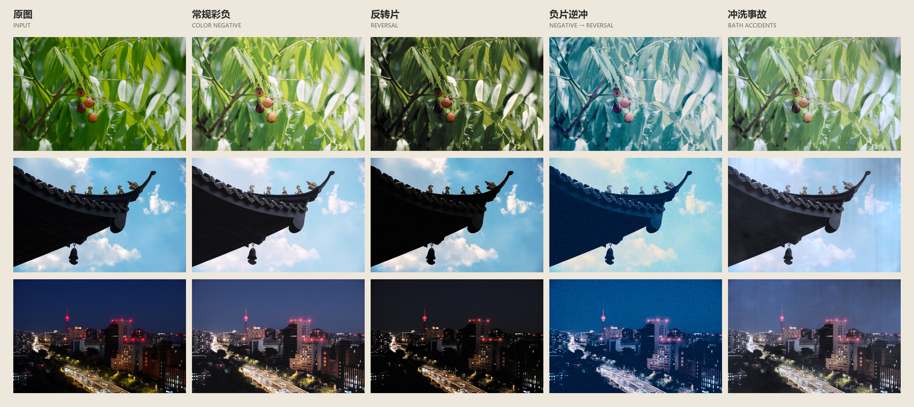
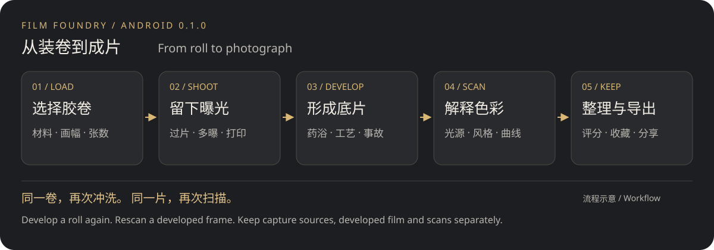
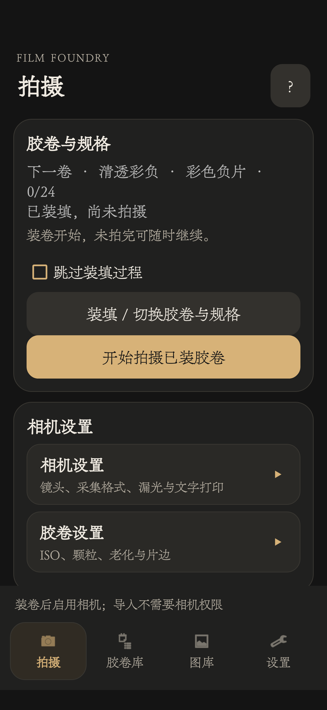
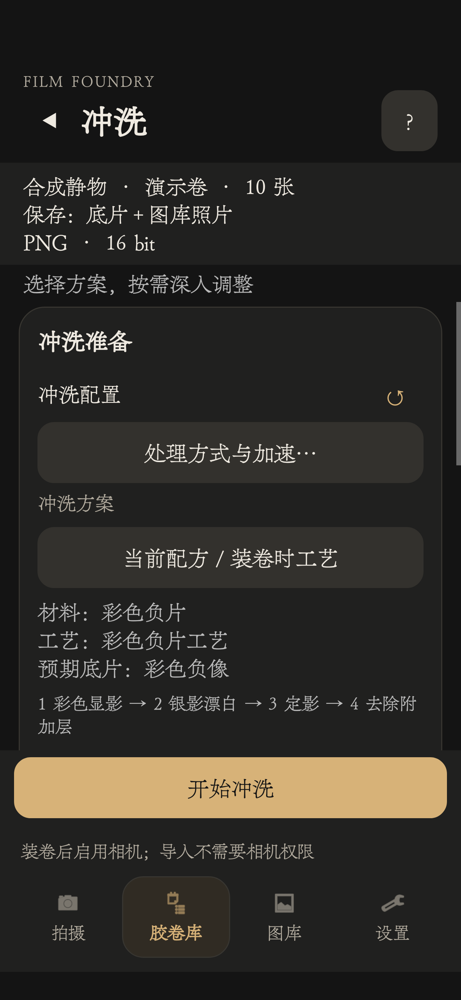
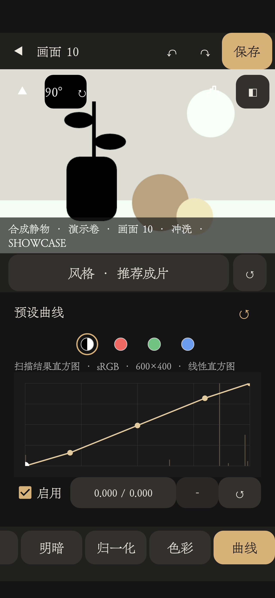
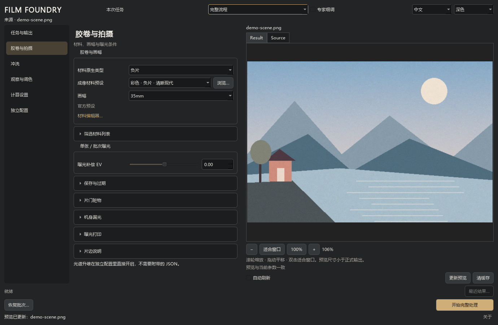
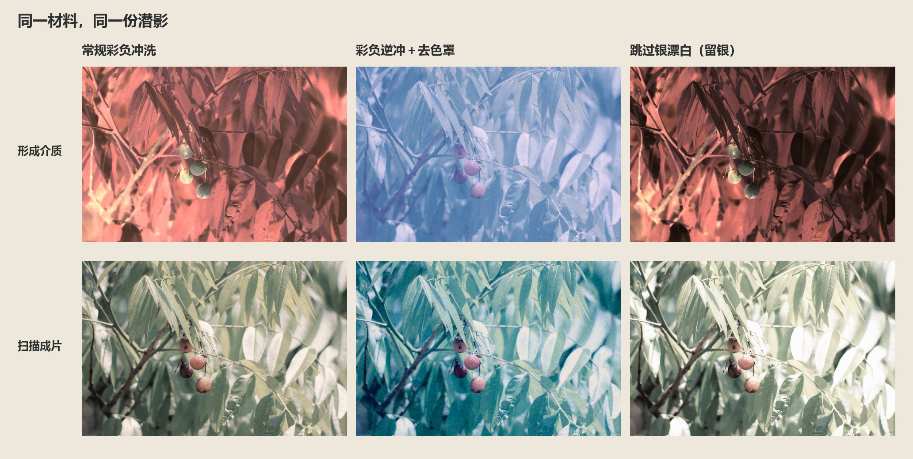

# Film Foundry



## About the project

Film Foundry is an image-creation tool built around materials and processes. Exposure leaves a latent image; materials and baths form the developed medium; viewing and scanning bring it to the screen. Try cross processing, silver retention and processing accidents with the same material.

**Desktop 0.4.0 Alpha** · [中文](README.md) · [Release notes](docs/CHANGELOG.md)

The current tree is a **2026-11-10 development source checkpoint**, including gallery workflows, experimental media, processing/performance work and selective preset sharing. Display versions are unchanged; no new EXE or APK was built. Previously distributed binaries differ from this source. See the [source snapshot notes](docs/DEVELOPMENT_SNAPSHOT.md).

## Mobile

Load a roll, shoot, develop and view. Currently an **Android 0.1.0 test version**, requiring Android 8.0 or later, with testing focused on **ARM64 phones**. There is no iOS version. See [Android source and build instructions](android/README.md).

[Illustrated mobile overview](docs/MOBILE_SHOWCASE.en.md) · [Mobile guide](docs/MOBILE_GUIDE.en.md)



Manual or automatic advance, multiple exposure and text imprinting. Develop a sealed roll with presets or custom baths, then scan with light, color and curves. Browse three-column, five-column or list layouts, with separate ratings and favorites. Originals, developed film and scans remain available independently for further experiments.

| Camera home | Development preparation | Scan curves |
| --- | --- | --- |
|  |  |  |

Actual phone UI with synthetic rolls in a separate demo installation. See the [illustrated mobile overview](docs/MOBILE_SHOWCASE.en.md) for more layouts and controls.

## Desktop

For individual images, batches and recipe experiments. The current source starts from the gallery and keeps workspaces and full editors in one window, with single/dual sidebars, preset management, tone / RGB curves, HSL, Chinese / English and Dark / Light themes.



This is the historical 0.4.0 interface. Current preset management and selective import appear in the [snapshot notes](docs/DEVELOPMENT_SNAPSHOT.md).

## Features

- Color and black-and-white negatives and reversal stocks, with shared processing, cross processing, push / pull and silver retention.
- Grain, MTF, halation, light leaks, gate debris, imprinting, material ageing and processing accidents.
- Separate latent images, developed media and scans. Rescan and grade the same medium repeatedly.
- Spectral exposure and transmission viewing, tone / RGB curves, transparent media, 16-bit TIFF and plate-layer export.

## One material, different processes

The same latent image is developed as a standard color negative, a reversal positive with mask-dye removal, and a silver-retaining negative. Media are above, scans below.



[Recipes and grain / MTF / halation close-ups](docs/SHOWCASE.md)

## Quick start

Python 3.11 or newer is recommended for this development snapshot:

```bash
pip install -r requirements.txt
python run_film_foundry_launcher.py
```

Desktop inputs: JPEG, PNG, TIFF, BMP and WebP. For the Windows portable build, keep the complete FilmFoundry folder and run `FilmFoundry.exe`. Alpha packages are unsigned.

## Guides and reference

| Document | Contents |
| --- | --- |
| [Development snapshot](docs/DEVELOPMENT_SNAPSHOT.md) | Current source changes, compatibility and remaining limits |
| [Mobile overview](docs/MOBILE_SHOWCASE.en.md) / [Guide](docs/MOBILE_GUIDE.en.md) | Mobile workflow, interface and synthetic examples, installation, operation and resource handling |
| [Desktop guide](docs/DESKTOP_GUIDE.md) | Tasks, presets, development, scanning, export, CLI and material masters |
| [Technical reference](docs/REFERENCE.md) | Material / process model, parameter dictionary, spectra and performance |
| [Examples and recipes](docs/SHOWCASE.md) | Style comparisons, settings and detail crops |
| [Changelog](docs/CHANGELOG.md) | Current and earlier releases |
| [Build instructions](packaging/README.md) | Build Windows EXE / Android APK from the public source |

The detailed desktop documents are primarily in Chinese, with an English workbench summary in the guide.

## Acknowledgements and license

Thanks to spektrafilm, Fotufilm, Smits's spectral research and the dependency authors. [Acknowledgements](docs/REFERENCE.md#acknowledgements) distinguish design references from adopted algorithms. AI tools assisted development.

[GPL-3.0-or-later](LICENSE) · [Third-party notices](THIRD_PARTY_NOTICES.md) · [Source status](docs/REFERENCE.md#source). Contact the author for other licensing arrangements.

Author: **soundsec** · [GitHub](https://github.com/soundsec/Film-Foundry)
