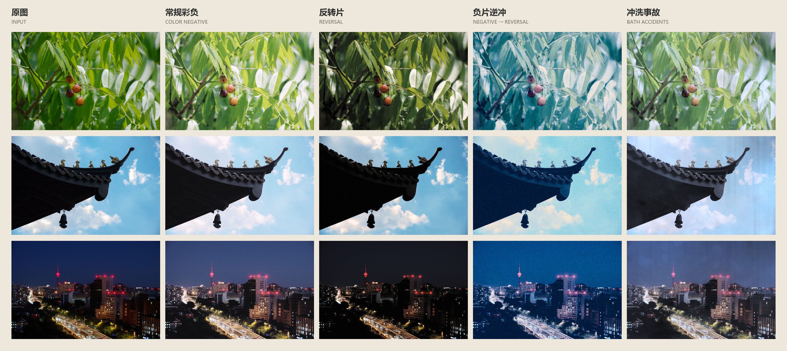
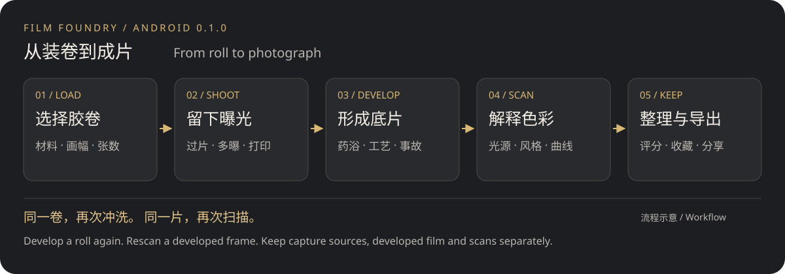
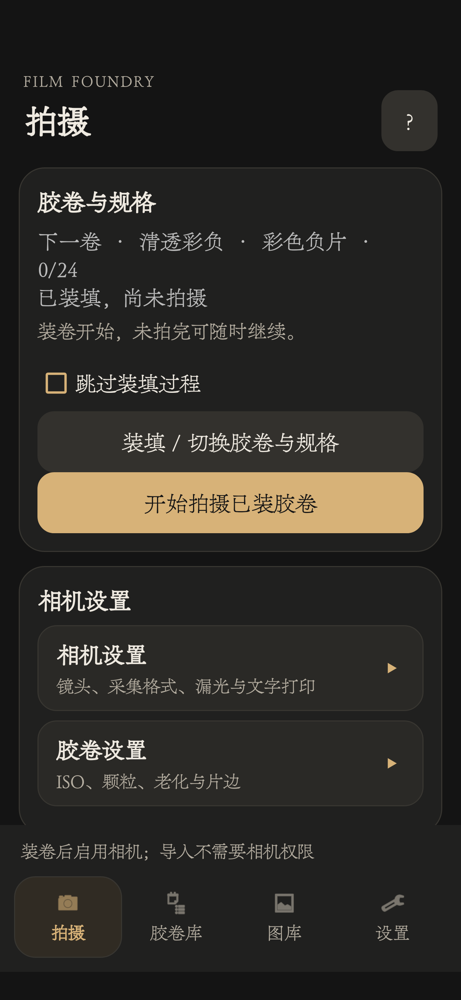
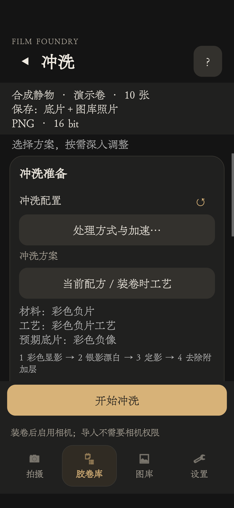
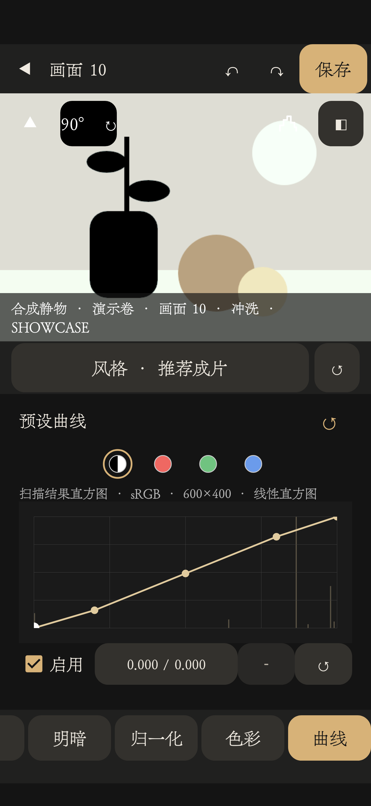
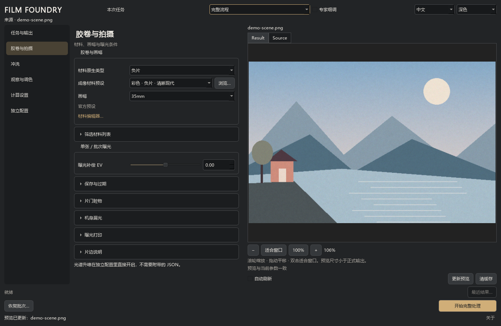
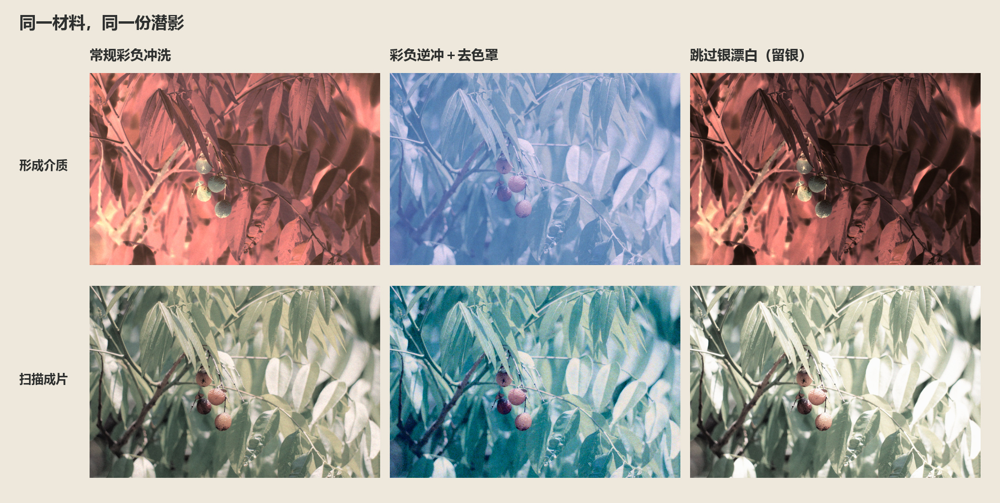
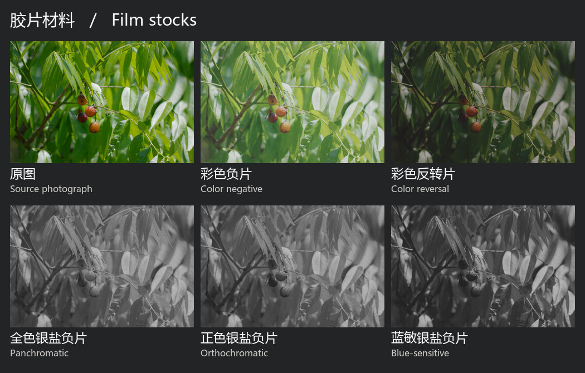

# Film Foundry



## About the project

Film Foundry is an image-creation tool organized around **imaging materials and photographic processes**. Exposure creates a latent image, materials and baths form the developed medium, and read-only viewing and scanning bring it to screen. Use the same material to explore cross processing, silver retention, and processing accidents.

**Desktop 0.4.0 Alpha** · [中文](README.md) · [Command line & batches](docs/DESKTOP_GUIDE.en.md#cli) · [Python scripts](docs/DESKTOP_GUIDE.en.md#scripts) · [Changelog](docs/CHANGELOG.en.md)

With the desktop source you can expose RGB or DNG input, edit a stock’s emulsion and filter layers, and rescan the developed medium. Compare how the same photograph responds to a change in emulsion sensitivity or grain. [Layer controls](docs/DESKTOP_GUIDE.en.md#coatings) · [Sample plates](docs/SHOWCASE.en.md#coatings) · [Source notes](docs/DEVELOPMENT_SNAPSHOT.en.md)

## Mobile

Load a roll, shoot, develop, and view on your phone. Currently available as an **Android 0.1.0 test version** requiring **Android 8.0 or later**, with device testing focused on **ARM64 phones** (no iOS version). See [Android source and build instructions](android/README.md).

[Illustrated mobile overview](docs/MOBILE_SHOWCASE.en.md) · [Mobile guide](docs/MOBILE_GUIDE.en.md)



Supports manual or automatic film advance, multiple exposure, and text imprinting. Develop a sealed roll using presets or custom baths, then scan with light, color, and curves. Browse in 3-column, 5-column, or list layouts with independent ratings and favorites; originals, developed film, and scans remain stored separately for repeated experiments.

| Camera home | Development preparation | Scan curves |
| --- | --- | --- |
|  |  |  |

Real phone UI screenshots captured from a separate demo installation using synthetic rolls. See the [illustrated mobile overview](docs/MOBILE_SHOWCASE.en.md) for more screens and controls.

## Desktop

Built for single-frame work, folder batches, and deep recipe experiments. The current source starts from the gallery and keeps workspaces and full editors inside one window, with single/dual sidebars, preset management, tone/RGB curves, 8-band HSL, importable community translations, and customizable workbench themes.



The screenshot above shows the historical 0.4.0 interface. See the [development snapshot](docs/DEVELOPMENT_SNAPSHOT.en.md) for current preset management and selective import screens.

## Features

- Color and black-and-white negative and reversal stocks sharing one processing architecture, with cross processing, push/pull, and silver retention.
- Grain, emulsion MTF, halation, light leaks, gate debris, text imprinting, material ageing, and processing accidents.
- Separate latent images, developed media, and scans; rescan and grade the same medium repeatedly without altering formation results.
- Spectral exposure and transmission viewing, tone/RGB curves, 8-band HSL, transparent media, 16-bit TIFF, and plate-layer export.

## One material, different processes

The same latent image is developed as a standard color negative, a reversal positive with mask-dye removal, and a silver-retaining negative. Developed media appear on top, scans below.



## How do different film stocks render red fruit?

The top row pairs our photograph of red fruit and green leaves with a color negative and a color reversal scan. The bottom row uses identical exposure, development, and scanning across three monochrome silver negatives—the tonal shift between fruit and leaves comes purely from panchromatic, orthochromatic, and blue-sensitive emulsion responses.



[Lens filters on color film](docs/SHOWCASE.en.md#lens-filters) · [Filters on silver negatives](docs/SHOWCASE.en.md#silver-filters) · [Instant film, plates, and prints](docs/SHOWCASE.en.md#materials) · [Grain, MTF, and halation close-ups](docs/SHOWCASE.en.md#details)

## Quick start

**Python 3.11 or newer** is recommended for the current development source:

```bash
pip install -r requirements.txt
python run_film_foundry_launcher.py
```

Desktop source builds accept JPEG, PNG, TIFF, BMP, WebP, and camera DNG. For DNG, `tifffile` validates the container and `rawpy` calls LibRaw to decode 16-bit linear data for film and experimental material exposure. [Decoder credits and licenses](THIRD_PARTY_NOTICES.md#current-source-input-codecs-not-yet-rebuilt-into-a-release)

> **Keeping the camera look**: To preserve a camera's RAW filter, film simulation, or manufacturer rendering, apply that style in the manufacturer's software and export a 16-bit TIFF with an embedded sRGB profile before importing.

For the Windows portable release, keep the complete `FilmFoundry` folder intact and run `FilmFoundry.exe` (Alpha packages are unsigned).

### Run an existing recipe from a terminal or script

Use the desktop workbench to choose materials and adjust recipes visually. With dependencies installed in a source checkout, run the command below to process the bundled sample photo with a complete JSON recipe:

```bash
python -m film_foundry.app.cli full docs/images/fruit-and-leaves.jpg outputs/example.png --preset film_foundry/presets/generic_color_negative.json --format png --progress
```

Pass a photo directory and a separate output directory for batch runs, using `--session` for exported desktop sessions or `--preset` for full configurations (`--progress` writes stage progress to stderr). To run fixed settings from an IDE, edit the top of `film_foundry/tools/run_darkroom.py` and run `python -m film_foundry.tools.run_darkroom`. [CLI examples](docs/DESKTOP_GUIDE.en.md#cli) · [Python and IDE scripts](docs/DESKTOP_GUIDE.en.md#scripts)

## Guides and reference

| Document | Contents |
| --- | --- |
| [Documentation index](docs/README.en.md) | Full catalog of bilingual user guides and technical references |
| [Development snapshot](docs/DEVELOPMENT_SNAPSHOT.en.md) | Recent source changes, compatibility, and known limits |
| [Mobile overview](docs/MOBILE_SHOWCASE.en.md) / [Mobile guide](docs/MOBILE_GUIDE.en.md) | Mobile workflow, interface screenshots, installation, controls, and resource management |
| [Desktop guide](docs/DESKTOP_GUIDE.en.md) | Tasks, presets, development, scanning, export, CLI, and material masters |
| [Command line](docs/DESKTOP_GUIDE.en.md#cli) / [Scripts](docs/DESKTOP_GUIDE.en.md#scripts) | Run saved recipes, process folders, resume batches, or rescan media |
| [Technical reference](docs/REFERENCE.en.md) | Unified material/process model, parameter dictionary, spectra, and performance |
| [Examples and recipes](docs/SHOWCASE.en.md) | Film sensitivity, color filters, instant film, plates, prints, and detail crops |
| [Changelog](docs/CHANGELOG.en.md) | Current snapshot and historical releases |
| [Build instructions](packaging/README.md) | Build Windows EXE and Android APK from the public source |

## Acknowledgements and license

Thanks to spektrafilm, Fotufilm, Smits's spectral research, and the authors of all open-source dependencies. [Acknowledgements](docs/REFERENCE.en.md#acknowledgements) distinguish design references from adopted algorithms. AI tools assisted development.

[GPL-3.0-or-later](LICENSE) · [Third-party notices](THIRD_PARTY_NOTICES.md) · [Source status](docs/REFERENCE.en.md#source). Contact the author for other licensing arrangements.

Author: **soundsec** · [GitHub](https://github.com/soundsec/Film-Foundry)
