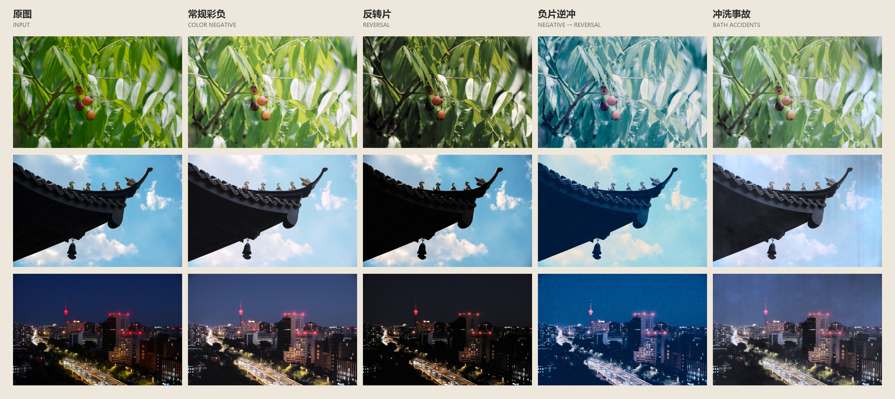
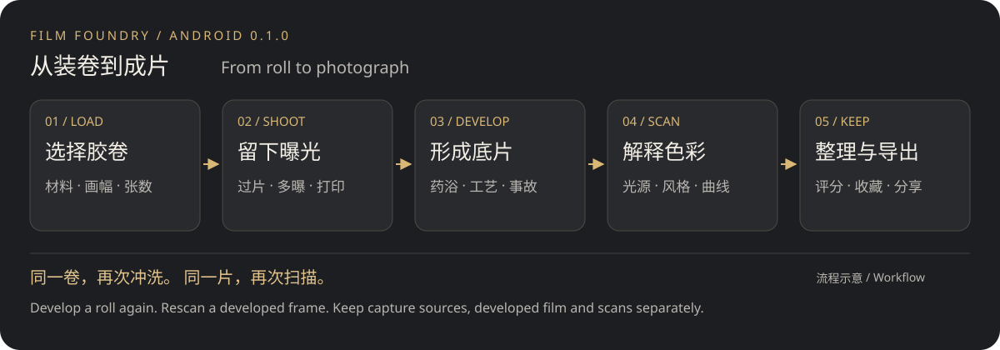
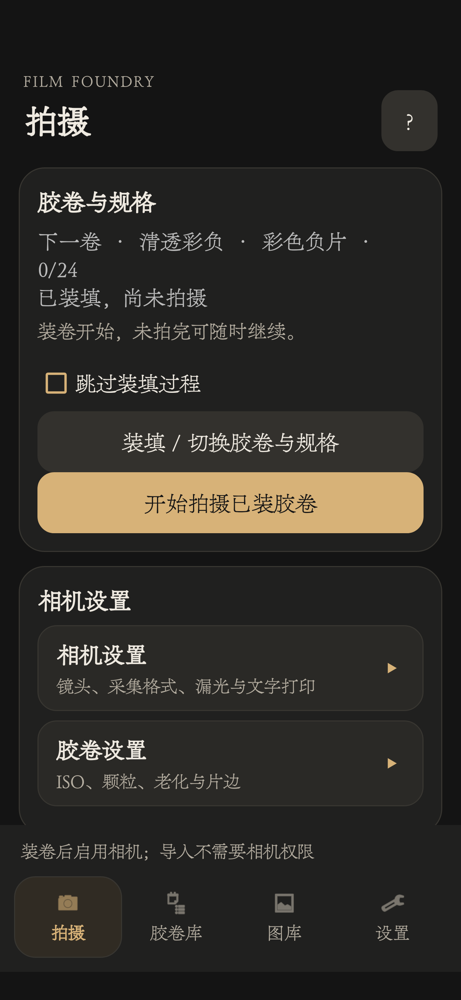
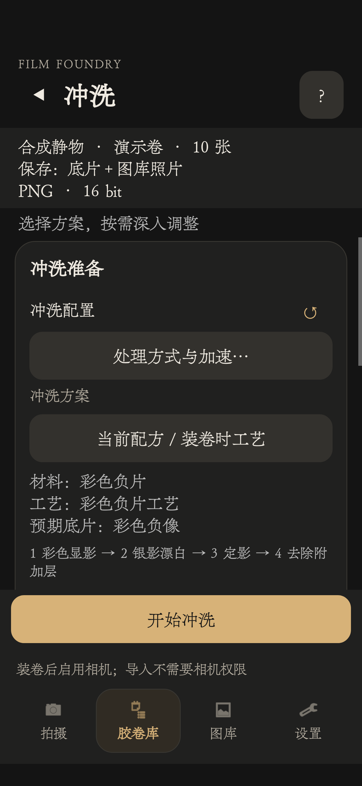
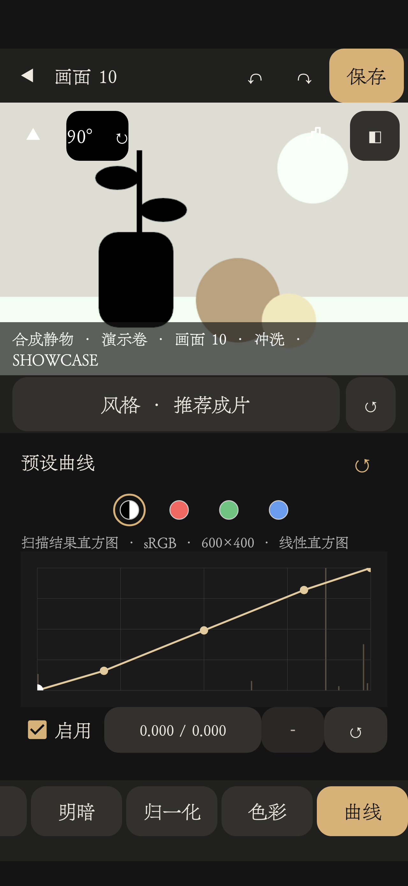
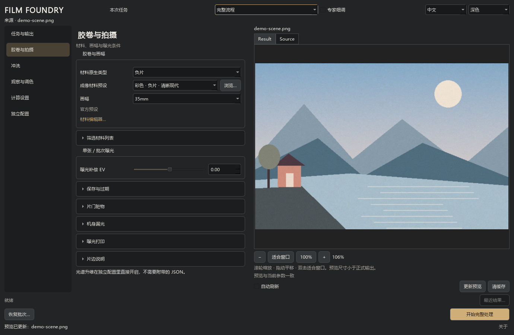
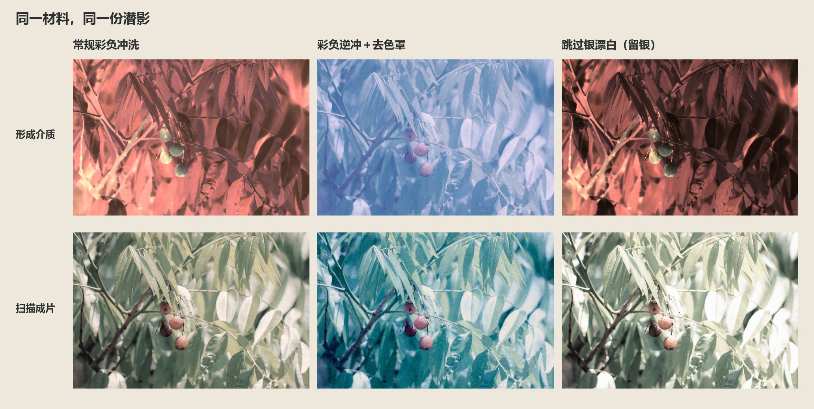

# Film Foundry



## 项目说明

Film Foundry 是围绕成像材料与处理过程组织的影像创作工具。曝光留下潜影，材料与药浴共同形成影像，灯台与扫描呈现最终结果。同一材料可以尝试不同工艺，组合交叉冲洗、留银与冲洗事故。

**桌面 0.4.0 Alpha** · [English](README.en.md) · [更新记录](docs/CHANGELOG.md)

## 手机版

围绕装卷、拍摄、冲洗和观片，打造完整的手机摄影体验。目前提供 **Android 0.1.0 测试版**，要求 Android 8.0 及以上，现阶段以 **ARM64 手机**为测试范围。暂无 iOS 版本。

[手机图文介绍](docs/MOBILE_SHOWCASE.md) · [手机指南](docs/MOBILE_GUIDE.md) · [Android 源码与编译](android/README.md)



手动／自动过片、多重曝光与文字打印；封卷后可按预设或自定义药浴冲洗，再用光源、色彩与曲线扫描。图库支持三列、五列和列表，评分与收藏独立管理。原片、底片与扫描照片分别保留，便于反复尝试。

| 拍摄首页 | 冲洗准备 | 扫描曲线 |
| --- | --- | --- |
|  |  |  |

真实手机界面，使用独立演示副本中的合成胶卷；更多布局与操作截图见[手机图文介绍](docs/MOBILE_SHOWCASE.md)。

## 桌面版

适合单张创作、批量处理和配方实验。提供独立材料、药浴与扫描编辑器，影调／RGB 曲线，以及中文、英文和深色／Light 外观。



## 主要功能

- 彩色／黑白负片与反转片，共享材料与冲洗架构，支持交叉冲洗、迫冲／减冲与留银。
- 颗粒、MTF、光晕、漏光、片门脏物、字符打印、材料退化与冲洗事故。
- 潜影、冲洗介质与扫描成片分别保存；同一介质可以反复扫描、调色。
- 光谱曝光与透射观察、影调／RGB 曲线，以及透明介质、16-bit TIFF 和制版层导出。

## 同一材料，不同冲洗

同一份潜影经过常规彩负冲洗、彩负逆冲＋去色罩和跳过银漂白（留银）。上排是介质，下排是扫描成片。



[查看风格配方和颗粒／MTF／光晕局部对照](docs/SHOWCASE.md)

## 快速开始

Python 3.10 或更新版本：

```bash
pip install -r requirements.txt
python run_film_foundry_launcher.py
```

桌面支持 JPEG、PNG、TIFF、BMP、WebP 输入。Windows 便携版保留完整 FilmFoundry 文件夹，运行 `FilmFoundry.exe`；Alpha 包未签名。

## 使用与技术文档

| 文档 | 查什么 |
| --- | --- |
| [手机图文介绍](docs/MOBILE_SHOWCASE.md) / [操作指南](docs/MOBILE_GUIDE.md) | 手机体验、界面与合成效果、安装架构、操作与资源保留 |
| [桌面指南](docs/DESKTOP_GUIDE.md) | 任务、预设、冲洗与扫描、导出、CLI 和材料母带 |
| [技术参考](docs/REFERENCE.md) | 材料与工艺、参数字典、光谱与性能策略 |
| [效果展示](docs/SHOWCASE.md) | 样张、具体配方与局部细节 |
| [更新记录](docs/CHANGELOG.md) | 当前与历史版本变化 |
| [构建与打包](packaging/README.md) | 从公开源码生成 Windows EXE／Android APK |

## 致敬与许可

感谢 spektrafilm、SpektraLab、Fotufilm、Smits 光谱研究及各依赖的作者。[致敬与借鉴说明](docs/REFERENCE.md#acknowledgements)区分设计参考与实际采用的算法；项目开发使用 AI 工具辅助。

[GPL-3.0-or-later](LICENSE) · [第三方署名与许可](THIRD_PARTY_NOTICES.md) · [源码状态](docs/REFERENCE.md#source)。其他授权请联系作者。

作者：**soundsec** · [GitHub](https://github.com/soundsec/Film-Foundry)
