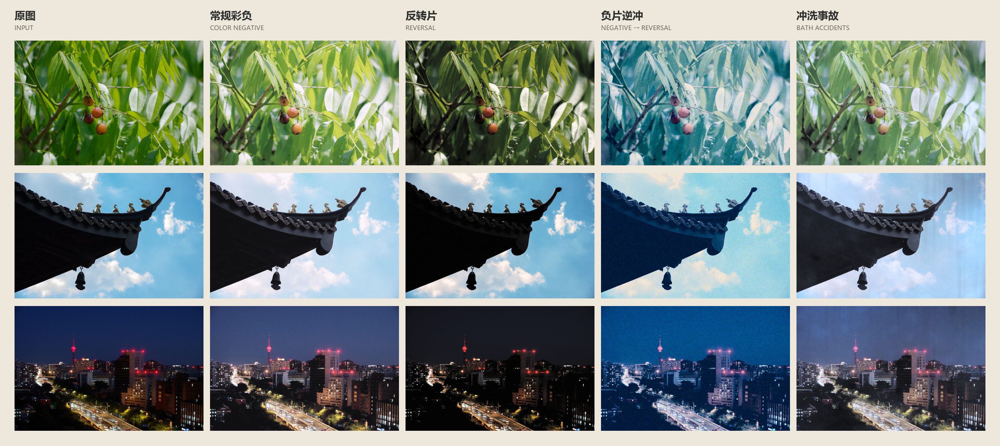
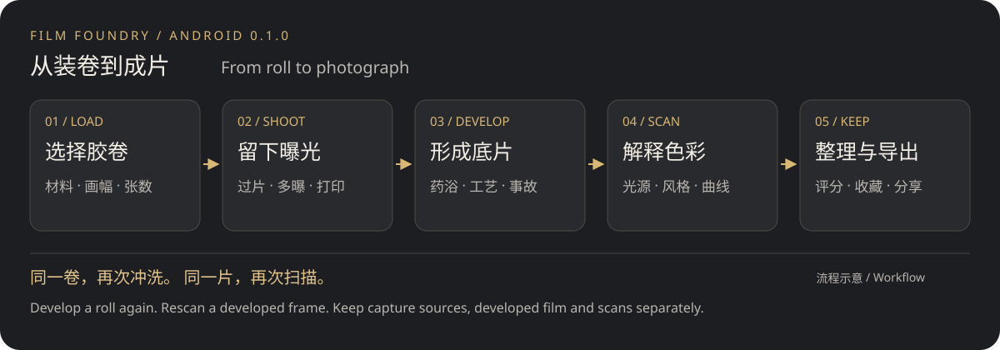
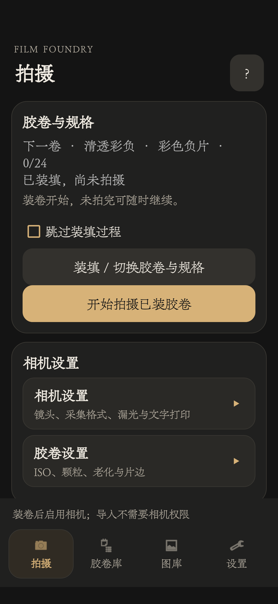
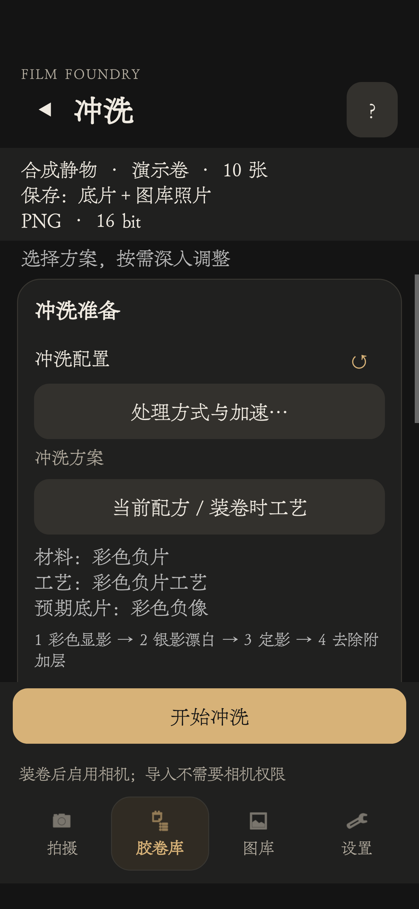
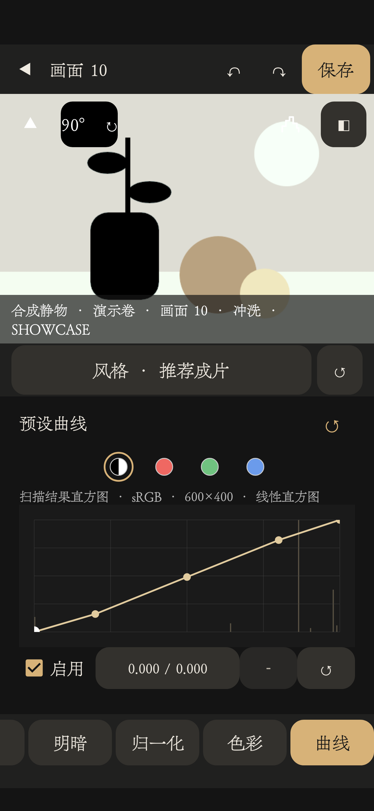
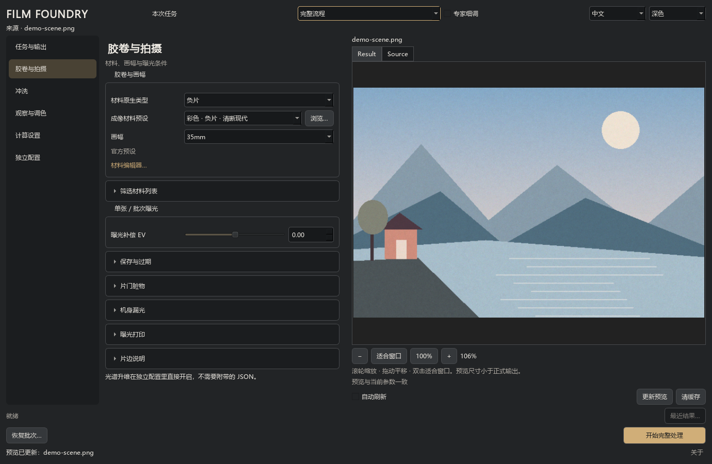
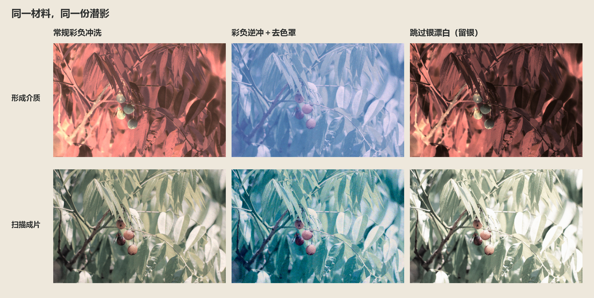
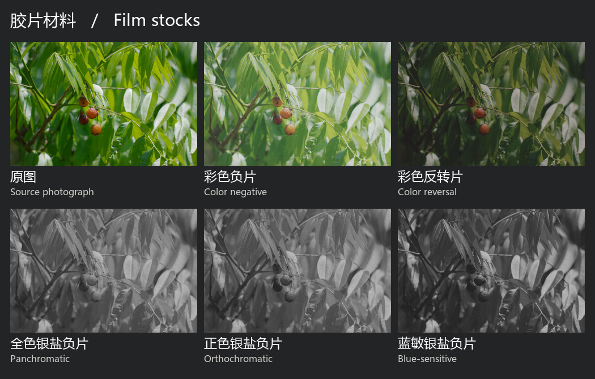

# Film Foundry



## 项目说明

Film Foundry 是一款围绕**成像材料与工艺过程**组织的影像创作工具。曝光留下潜影，材料与药浴共同形成介质，灯台与扫描只读呈现最终成片。同一份材料可以尝试不同工艺，自由组合交叉冲洗、留银与冲洗事故。

**桌面 0.4.0 Alpha** · [English](README.en.md) · [命令行与批处理](docs/DESKTOP_GUIDE.md#cli) · [参数脚本](docs/DESKTOP_GUIDE.md#scripts) · [更新记录](docs/CHANGELOG.md)

桌面源码可以用普通照片或 DNG 曝光，编辑乳剂与滤光夹层，再对冲洗好的介质反复扫描。想看改动一层乳剂会怎样影响同一张照片，可以先看对照样张。[分层操作](docs/DESKTOP_GUIDE.md#coatings) · [效果对照](docs/SHOWCASE.md#coatings) · [源码近况](docs/DEVELOPMENT_SNAPSHOT.md)

## 手机版

围绕装卷、拍摄、冲洗与观片构建完整的手机摄影体验。当前提供 **Android 0.1.0 测试版**，要求 **Android 8.0 及以上系统**，现阶段以 **ARM64 手机**为实机测试范围，暂无 iOS 版本。

[手机图文介绍](docs/MOBILE_SHOWCASE.md) · [手机指南](docs/MOBILE_GUIDE.md) · [Android 源码与编译](android/README.md)



支持手动/自动过片、多重曝光与文字打印；封卷后可按预设或自由药浴冲洗，再通过光源、色彩与曲线扫描。图库支持三列、五列与列表视图，评分与收藏独立管理；原片、底片与扫描成片分别保留，便于反复试验。

| 拍摄首页 | 冲洗准备 | 扫描曲线 |
| --- | --- | --- |
|  |  |  |

以上为真实手机界面截图（使用独立演示副本中的合成胶卷）；更多界面与操作示意见[手机图文介绍](docs/MOBILE_SHOWCASE.md)。

## 桌面版

面向单张创作、目录批处理与深度配方实验。当前源码从图库选图直接进入同窗工作台，提供单/双侧布局、材料/药浴/扫描完整编辑器、预设管理、影调与 RGB 曲线、分色 HSL、可导入语言包，以及黑橙、象牙白、灰蓝与自定义配色。



上图为 0.4.0 历史界面；当前工作台、预设管理与选择性导入界面见[源码快照](docs/DEVELOPMENT_SNAPSHOT.md)。

## 主要功能

- 彩色/黑白负片与反转片共享材料与冲洗架构，支持交叉冲洗、迫冲/减冲与留银。
- 颗粒、乳剂 MTF、光晕、漏光、片门脏物、字符打印、材料退化与冲洗事故。
- 潜影、已冲洗介质与扫描成片分别保存；同一介质可反复扫描、调色而不改写冲洗结果。
- 光谱曝光与透射观察、影调/RGB 曲线与分色 HSL，以及透明介质、16-bit TIFF 与制版层导出。

## 同一材料，不同冲洗

同一份潜影分别经过常规彩负冲洗、彩负逆冲＋去色罩与跳过银漂白（留银）。上排为形成介质的透射外观，下排为扫描成片。



## 同一枝红果在不同胶片上是什么样？

使用项目自摄的红果绿叶对照选材：上排为原图、彩色负片与彩色反转片；下排三种黑白银盐负片共用同一曝光、药浴与扫描，红果与叶片的明暗反差完全源于全色、正色与蓝敏乳剂对色彩的不同响应。



[彩卷与镜前滤镜](docs/SHOWCASE.md#lens-filters) · [黑白胶片与色镜](docs/SHOWCASE.md#silver-filters) · [即时片、版材与印相](docs/SHOWCASE.md#materials) · [颗粒、MTF 与光晕局部](docs/SHOWCASE.md#details)

## 快速开始

当前开发源码建议使用 **Python 3.11 或更新版本**：

```bash
pip install -r requirements.txt
python run_film_foundry_launcher.py
```

桌面源码支持 JPEG、PNG、TIFF、BMP、WebP 与相机 DNG。DNG 容器由 `tifffile` 校验，`rawpy` 调用 LibRaw 解码为 16 位线性数据后进入胶片或实验材料曝光。[解码依赖与许可](THIRD_PARTY_NOTICES.md#current-source-input-codecs-not-yet-rebuilt-into-a-release)

> **保留相机原厂显色**：如需沿用相机内置 RAW 滤镜、胶片模拟或原厂软件解码风格，请在原厂软件中应用风格并导出带 sRGB 配置的 16 位 TIFF，再导入工作台。

Windows 便携版请解压并保留完整 `FilmFoundry` 文件夹，运行 `FilmFoundry.exe`（Alpha 包未签名）。

### 已有配方，直接用命令行或脚本

日常选材、调参与看预览请使用桌面工作台；已有现成配方时，可在源码根目录通过 CLI 处理单张或整批照片。下面这条命令使用随附样图与完整配置生成第一张扫描成片：

```bash
python -m film_foundry.app.cli full docs/images/fruit-and-leaves.jpg outputs/example.png --preset film_foundry/presets/generic_color_negative.json --format png --progress
```

批处理时将输入改为照片目录、输出改为独立结果目录。如需在 Python 或 IDE 中固定任务参数，也可直接编辑 `film_foundry/tools/run_darkroom.py` 顶部的路径、阶段与预设，再运行 `python -m film_foundry.tools.run_darkroom`。[命令与分阶段示例](docs/DESKTOP_GUIDE.md#cli) · [Python 与 IDE 脚本](docs/DESKTOP_GUIDE.md#scripts)

## 使用与技术文档

| 文档 | 内容 |
| --- | --- |
| [开发中源码快照](docs/DEVELOPMENT_SNAPSHOT.md) | 近期源码更新、兼容范围与已知边界 |
| [手机图文介绍](docs/MOBILE_SHOWCASE.md) / [手机指南](docs/MOBILE_GUIDE.md) | 手机工作流、界面截图、安装架构、操作与资源管理 |
| [桌面使用指南](docs/DESKTOP_GUIDE.md) | 图库、工作台、预设、冲洗与扫描、导出、CLI 与材料母带 |
| [命令行](docs/DESKTOP_GUIDE.md#cli) / [脚本](docs/DESKTOP_GUIDE.md#scripts) | 完整 JSON、会话、目录批处理、进度与中断续跑 |
| [技术参考](docs/REFERENCE.md) | 统一材料与工艺模型、参数字典、光谱与性能策略 |
| [效果展示与配方](docs/SHOWCASE.md) | 胶片感色、镜前滤镜、即时片与印相、同潜影不同冲洗及局部细节 |
| [更新记录](docs/CHANGELOG.md) | 当前快照与历史发行版本变更 |
| [构建与打包](packaging/README.md) | 从公开源码构建 Windows EXE 与 Android APK |

## 致敬与许可

感谢 spektrafilm、Fotufilm、Smits 光谱研究及各开源依赖的作者。[致敬与借鉴说明](docs/REFERENCE.md#acknowledgements)明确区分了设计参考与实际采用的算法；项目开发过程使用 AI 工具辅助。

[GPL-3.0-or-later](LICENSE) · [第三方署名与许可](THIRD_PARTY_NOTICES.md) · [源码状态](docs/REFERENCE.md#source)。其他授权事宜请联系作者。

作者：**soundsec** · [GitHub](https://github.com/soundsec/Film-Foundry)
