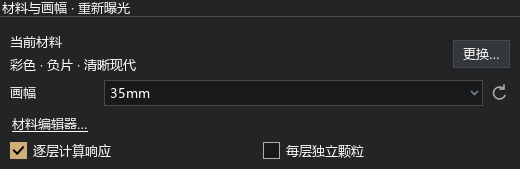
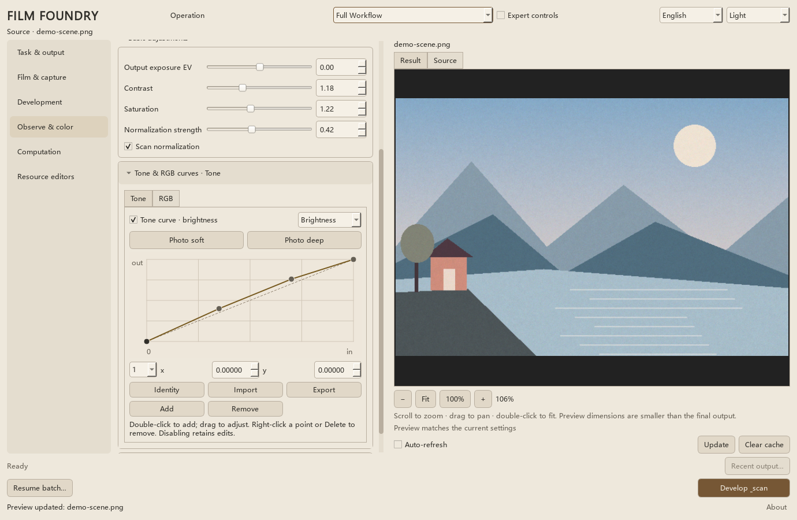
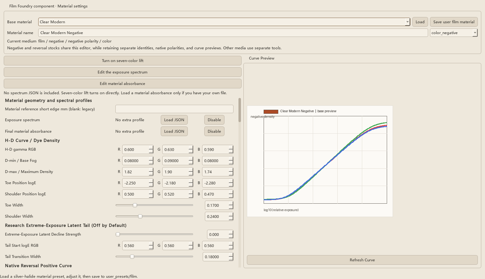

# Desktop User Guide

[中文](DESKTOP_GUIDE.md) · [Technical reference](REFERENCE.en.md) · [Examples & recipes](SHOWCASE.en.md) · [Project home](../README.en.md)

This guide covers desktop installation, the gallery and single-window workbench, presets, test strips and density probes, export and hardware compute, CLI batch processing, and material movie masters. See the [Technical Reference](REFERENCE.en.md) for the formation model and complete parameter dictionary, and [Examples & Recipes](SHOWCASE.en.md) for visual comparisons.

> **Version note**: This guide reflects the current desktop development source. The published 0.4.0 Alpha portable binary predates several newer interactions (such as the gallery-first workflow, 2D test strips, DNG decoding, and experimental material workspaces). See the [Development Source Snapshot](DEVELOPMENT_SNAPSHOT.en.md) for exact differences.

## Table of Contents

- [Installation and Launch](#start)
- [Workbench, Tasks, Previews, and Controls](#workbench) · [Emulsion layers and grain](#coatings)
- [Saving Work, Automatic Recovery, and Preset Sharing](#preset-sharing)
- [Material, Development, and Scanner Catalog](#presets)
- [Preset Roles and Style Guidance](#preset-details)
- [Scan Tone References](#scan-tones)
- [Dimensions, Quality, Output, and Hardware Compute](#output)
- [Command Line & Batch Processing](#cli) · [Python / IDE Scripts](#scripts) · [Standalone Editors](#editors)
- [Video Frame-by-Frame and Material Masters](#video)

---

<a id="start"></a>

## Installation and Launch

### Run from source (Python 3.11+ recommended)

```bash
pip install -r requirements.txt
python run_film_foundry_launcher.py
```

Or create an environment with Conda:

```bash
conda env create -f environment.yml
conda activate film-foundry
python run_film_foundry_launcher.py
```

To open the workbench directly without the launcher:

```bash
python -m film_foundry.tools.run_desktop_gui
```

### Windows portable build

Download the portable package from GitHub Releases, extract it, and **keep the entire `FilmFoundry` folder intact** before running `FilmFoundry.exe`. Alpha builds are unsigned and may trigger a Windows SmartScreen prompt.

---

<a id="workbench"></a>

## Workbench and Daily Workflow

### 1. Gallery entry, onboarding, and contextual help

- **Start in the gallery**: Import individual files or register source folders (indexed in place without moving originals). Double-click any item for read-only high-resolution viewing, ratings, favorites, and related-artifact inspection; select one or more images and click **Choose material, create work…** to open a workspace. All workspaces and full editors switch inside one main window while preserving drafts.
- **First darkroom walkthrough**: On first launch, click **Start walkthrough** in the gallery to step through selection, exposure, development, scanning, and saving on a bundled sample photo. Confirmed parameter edits refresh the sample automatically (or click **Update sample**). Reopen anytime via **Tools → First Darkroom Workflow…**.
- **Drag-and-drop & filters**: An empty gallery offers direct buttons for **Import photos… / Open negative or latent… / Electronic roll darkroom…**, or drop local photos, NPZ files, result records, or folders directly (folders index recursively in the background; open `.fffilm` / `.ffworkspace` directory bundles via *Open existing work…*). Detailed type, family, origin, and rating filters collapse under **Filters**, and batch actions appear once items are selected.
- **Contextual guide (`? Page guide` / `F1`)**: Opens a context-aware help card with a read-only snapshot summarizing your active source, editable stages, output settings, or completed material steps. Navigation buttons inside the guide jump to controls without triggering computation or altering drafts.

### 2. Material chooser, reference thumbnails, and favorites

Click **Choose material, create work…** or **Current material → Change…** on the film page to choose a family and stock/type with search and color/polarity/origin filters. Selecting a film stock automatically pairs its recommended development and scanner presets. The film material editor's **Build material…** also provides panchromatic, orthochromatic, and blue-sensitive B&W emulsion templates.

- **Reference-workflow thumbnails**: Material, development, and scanner choosers display 240 px reference thumbnails computed with a fixed comparison seed against the built-in **sample photo**, **synthetic color chart**, or your **current source image**. Built-in default pairings ship with precomputed reference thumbnails; custom combinations render in the background for visible items (they illustrate directional behavior rather than full-scale grain and never alter your active recipe).
- **Disk thumbnail cache**: Chooser and gallery thumbnails cache locally (up to 128 MiB / 2048 entries, LRU eviction) across restarts. Clear anytime under **Settings → Cache & Info → Clear disk thumbnails** without touching originals, media, or saved work.
- **Favorites & recent**: Filter choosers by **All / Favorites / Recent** (up to 512 favorites and 40 recent confirmations, stored by stable ID independent of UI language).

### 3. Tasks, stage bar, and recalculation scope

| Task | Input source | Main output |
| --- | --- | --- |
| Full | Photo or folder | Developed medium and scanned image |
| Develop only | Photo or folder | Reusable developed electronic medium |
| Scan only | Image, developed medium, or scanner raw | New scanned image |
| Expose only | Photo or folder | Undeveloped latent (`.darkroom_latent.npz`) |
| Develop latent | Saved latent archive | Developed medium |

- **Top four-stage bar**: Displays *Exposure & Latent → Development → Observation & Scan → Save & Export*, marking each stage as **Editable**, **Frozen**, **Observe only**, or **Skipped**. Click a card body to inspect controls, click **Set endpoint / Endpoint** on the right to choose where execution stops (the scan endpoint menu also offers *Skip formation, scan image only*), and click the bottom primary button to run formal processing and save.
- **Subtitles & recalculation hints**: Stage subtitles indicate the starting preset or frozen source record; group headers display recalculation scope—**Re-expose**, **Re-develop**, or **Observe only** (cached media skip re-formation when only scan controls change). **Storage & ageing** on the material page refers to film storage history, not file saving.
- **Preserving latents & reusing versions**:
  - Formal development and previews never destroy the source latent; use **Develop again from latent** to try another process while keeping earlier media and scans (legacy latents already marked consumed cannot be redeveloped).
  - Opening a developed medium enters **Medium · Scan**, locking formation controls while exposing **Formation record** and **Related results**.
  - Selecting a saved film scan in the gallery or related results enables **Adjust this scan version**, reopening the source medium with that scan's saved light, curves, color, rotation, and export settings (requires both the scan JSON and original NPZ).
- **Staged development checkpoints**: From a latent workspace, click **Develop in stages** to open an independent checkpoint page, advance via **Run to here & save**, branch eligible upcoming baths in a small dialog, or **Return to last checkpoint** after finishing to explore alternate endings.

### 4. Camera DNG and RAW input

Select `.dng` files directly from the gallery. Desktop decodes black/white levels, camera white balance, and color matrices via `rawpy` / LibRaw into 16-bit linear sRGB before floating-point exposure (ordinary JPEGs enter via the inverse sRGB transfer function).

- **Verified layouts**: Uncompressed and lossless-JPEG Bayer DNG, 3-channel Linear DNG, and single-channel monochrome DNG; other compressions and camera models depend on the installed LibRaw version.
- **Keeping manufacturer color**: To retain a camera's RAW filter, film simulation, or vendor software look, apply it in the vendor's tool and export a 16-bit sRGB TIFF before importing. A dismissible notice appears on first RAW import/processing (with a *Don't show again* option).

### 5. Lens filters and three-color separation

Under **Material & Exposure → Single / Batch Exposure → Lens filter and exposure**, set **Film orientation** to **Base toward lens**. On mobile, choose **Reverse loading** in **Load new film → More loading settings**. Compare a color negative at 0, +1 and +2 EV with fixed baths, a fixed scanner, and scan normalization off. The CLI accepts `--film-side base` and defaults to `emulsion`.

Base-first loading mirrors the scene horizontally by default. Choose **Camera orientation** to keep the composition, or mirror vertically for a different flip axis. **Automatically compensate focus shift** starts off and tracks support thickness and refractive index when enabled. A positive manual correction moves focus toward the emulsion. The taking aperture changes defocus at equal integrated exposure.

For custom stocks, select **Generic** reverse response. A support of optical density D transmits 10⁻ᴰ in each RGB band. Zero density gives full transmission, and equal densities attenuate all three bands equally. In a color negative, `clear_support_density_rgb` specifies the permanent support, capped per channel by the total base density. The remainder belongs to the processed mask. Silver monochrome and reversal stocks use their full `film_base_density_rgb` as permanent support. Tint affects the light reaching the emulsion during reverse exposure. Thickness and refractive index determine refocus.

Load the [matched RED 125 reference recipe](../film_foundry/presets/harman_red_125_reference.json) for the calibrated carrier, standard negative process and fixed scan. Selecting **HARMAN RED 125 wedge reference** in the loading controls retains the current material and bath. The CLI accepts `--film-side base --rear-profile harman_red_125 --rear-mirror horizontal` and optionally `--rear-auto-refocus`.

**Model scope**

The generic path uses the unprocessed support, carbon backing and stock sensitivity. The matched recipe fits neutral RGB density to the HARMAN RED 125 (135) standard C41 wedge. Relative exposure places 18% gray at approximately 0.50 D net red density. The published red trace ends near log H 3.86 and the fitted table holds its last reading above that point. Blue cross-sensitivity and grain appearance are estimates. Absolute EI, other baths and chromatic patches require physical-film measurements. [Manufacturer data, pp. 2–3](https://ilford.co.jp/photo/wp-content/uploads/2026/09/TDS_HARMAN_-RED125.pdf)

The geometry assumes a fixed lens-side rail and a paraxial residual of support thickness divided by refractive index. The manufacturer's 135 support is 125 µm thick. The estimated default index of 1.48 gives 84.46 µm of refocus. The blur uses physical pixel pitch and a separable approximation with the variance of a circular pupil. Scene mirroring is relative to factory marks in film coordinates.

- **Lens filters**: Under **Material & Exposure → Single / Batch Exposure**, click **Lens filter & exposure conditions…** below the Exposure EV slider to pick Yellow, Orange, Red, Green, Blue, or Skylight. Enabling **neutral-light compensation** restores neutral total exposure while preserving color shifts or monochrome tonal separation; disabling it retains the filter's true light loss (disable scanner auto-normalization when comparing exposure loss). Selected filters freeze into the latent image.
- **Three-color separation & registration**: Open **Work → Three-Color Separation & Composite** to expose one photo into three R/G/B monochrome negatives, or load three already-developed B&W media in R, G, B order. Switch to **Composite** to adjust per-channel pixel offsets and exposure, then export a 16-bit color PNG, parameter record, and three independently rescannable NPZ files.

```bash
python -m film_foundry.app.cli full scene.jpg scan.png --film-preset monochrome_fine_negative --develop-preset standard_bw_negative --lens-filter orange --filter-compensation
python -m film_foundry.app.cli separations scene.jpg --seed 19 --output Tricolour
python -m film_foundry.app.cli separations red.darkroom_negative.npz green.darkroom_negative.npz blue.darkroom_negative.npz --red-offset 2 0 --output Registered
```

> **Model scope**: Lens filters use visible-light linear RGB transmittances, with Skylight providing gentle visible warming; they do not model measured vendor filter spectra, UV, or infrared imaging.

<a id="coatings"></a>

#### Emulsion layers, spectral response and grain

In **Material & format**, select **Layered response** to expose each emulsion separately. It starts enabled for stocks with distinct layer data. Clear it to use the stock’s effective records. Hover over a disabled control to see which data or processing stage it requires. The same switches are available under **Job model**.



1. Load **Clear Modern Negative**, open **Material editor → Edit 7 coatings…**, and select an emulsion. Its speed shifts exposure in EV, its amount sets the initial halide load, and its development rate controls how it responds to the bath. A filter row attenuates light reaching subsequent layers. A support row places the base between emulsions for a double-sided stock.
2. To compare RGB and spectral exposure, keep the baths, scan and seed fixed. The Spectrum menu can build a response from the current stock’s RGB sensitivities or load a measured profile. With spectral lift enabled, custom emulsion sensitivities and filter transmission curves operate over 380–780 nm. RGB exposure uses the RGB weights and filter densities. Both choices retain the authored layer curves.
3. Enable grain during development, then compare **Independent grain per coating** off and on. By default, color film combines a shared texture with fluctuations per color record. Independent grain forms a texture from each emulsion’s retained dye or silver and costs more as layer count increases. A saved layered latent can be developed again with either grain setting. Its exposure records stay fixed.

The work recipe stores the two processing choices. The material stores the layer order and properties and can be edited while using effective records. [See the spectral and grain comparisons](SHOWCASE.en.md#coatings).

**Model scope**

RGB reconstruction estimates incident spectra. Built-in coating values are authored stock designs. Stocks with only whole-film calibration, including the RED 125 reference, use effective records. Mobile uses effective records; develop desktop layered latents on desktop.

### 6. Layout, menus, and experimental material workspaces

- **Top menus**:
  - **Work**: Navigate workspaces (instant film, plates, and printing papers live under *Experimental materials*);
  - **File**: Save/open film workspaces and `.ffworkspace` material workspaces, plus crash recovery;
  - **Materials & Presets**: Preset Manager, full resource editors, and recipe sharing;
  - **Tools**: Light table, video movie masters, density/exposure probe, full-scale local preview, shortcuts, and onboarding.
- **Adaptive layout & memory**: Single- and dual-sidebar layouts keep extra space for the preview as windows widen. Splitter widths and histogram/viewing heights persist per layout and can be reset anytime via **Settings → Appearance & Layout → Reset window & panel layout**. Unfocused sliders, spinboxes, and closed combo boxes ignore scroll wheels to prevent accidental edits.
- **Control tiers & units**: Development offers **Common / Expected effect / By bath** tiers (each retaining its draft); scanning offers an independent **Show advanced controls** toggle (`F8` toggles the active tier on Develop or Scan). Numeric inputs display unit suffixes (`min`, `°C`, `EV`, `×`) inline with per-control reset buttons.
- **Themes & language packs**: Choose Black & amber, Ivory, Slate, Silver, or custom colors and import community language packs under **Settings → Appearance & Layout** (see [Desktop Translation Guide](TRANSLATING.en.md)).
- **Experimental material workspaces**:
  - Loading a source before formation shows a **Source preview · Not exposed** badge. The single-row adaptive step bar underlines the inspected step and marks currently executable steps with **●**; clicking a step inspects parameters without executing.
  - **Peel-apart, integral instant, and daguerreotype** offer **Run standard steps with current parameters** before formation begins, while optional clean-up, gilding, and accident actions live under **Optional interventions**.
  - **Photographic paper, cyanotype, and platinum/palladium** are negative-working by default and alert you without silently inverting positive photos; pick direct-positive paper or load an existing negative via *Optical source* for positive prints.
  - **Save state/medium** and **Export image** remain pinned at the bottom of the preview panel and operate independently.

### 7. Pinned controls, scan framing, and optical dodge/burn

- **Pin controls**: Open **Pin parameters…** from Film **Tools** or Material **Quick setup** to pin frequently used fields into the workbench's **Common** section (saved per family while preserving original units, resets, and freeze rules).
- **Scan base reference & eyedropper**: Enabling **Remove base mask** automatically uses the formed medium's known base (or recorded capture reference on project RAWs). To calibrate manually, open **Observation → Base / Eyedropper…**, pick a 1×1 / 3×3 / 5×5 / 9×9 neighborhood, and click a neutral area in the uninverted capture preview; **Restore automatic reference** reverts anytime.
- **Crop & straighten**: Under **Observation → Crop & Straighten…**, choose free or fixed aspect ratios, toggle guides, straighten up to ±45° (or draw along a horizon edge) with automatic inscribed cropping. Framing applies only to scanned output without altering the underlying medium.
- **Per-frame batch exposure**: Under **Work Settings → Sources / Per-Frame Exposure…**, assign individual relative EV offsets per frame (with optional source-brightness suggestions); formal runs, test strips, resumes, and portable film workspaces retain all offsets.
- **Optical dodge & burn**: Before loading an optical source into paper or another receiving material, open **Dodge / Burn…** to place feathered elliptical, rectangular, or gradient EV masks (overlapping regions add EV). Paper workspaces also provide a 240 px **Paper estimate** preview and approximate Grade 00–5 variable-contrast filter conversions.

### 8. Previews, histograms, probes, and characteristic curves

- **Responsive previews**: Auto-refresh is enabled by default. Dragging film sliders produces a fast 320 px draft and refines to the target long edge on release (default 900 px; configurable 480–1600 px and 100–800 ms delay under **Settings → Preview & Recovery**). Queue priority is strictly *interactive preview > test strips > thumbnails*. Right-click the canvas to change viewing backdrop color.
- **Comparison & zoom**: Switch **Single / Side-by-side / Split (drag)**; in Single mode, hold the mouse button or `Space` to inspect the original. `100%` reflects preview pixels—use **Full-Scale Local Preview** to inspect output-resolution grain.
- **Histogram & display clipping**: Supports **Sidebar · Compact** and **Below preview · Wide** layouts with Curve/Bar, Linear/Log, and Outline/Translucent/Solid modes plus any R/G/B/L combination (saved immediately). Corner triangles flag RGB channels hitting display `0 / 255`; click to toggle blue shadow / red highlight overlays (display clipping only, not RAW headroom).
- **Density & exposure probe**: Open **Tools → Density & Exposure Probe** on film pages to read cursor coordinates, display RGB8, optical density D, and per-layer relative $\log_{10} H$ overlaid on the material curve (1×1, 5×5, or 15×15 aperture; `Shift + Click` pins up to 4 points). Experimental materials provide **Viewing Tools → Material Density Probe**.
- **Characteristic curve**: **Characteristic Curve…** runs a real grayscale wedge through your active film recipe to measure RGB optical densities, toe/shoulder points, and average contrast; keep the window open, adjust baths in the workbench, and click **Refresh curve** to re-measure.

### 9. Preview history and customizable shortcuts

- **Preview history (`Ctrl+H`)**: Stores thumbnails of recent successful previews (default 6 per page, 32 MiB shared budget, configurable under **Settings → Preview & Recovery**; in-session only). Pin a fixed reference, hover to inspect parameter diffs, compare via split/side-by-side/hold, and click **Restore selected parameters** to apply (undoable; on experimental materials, older states after process advancement are comparison-only).
- **Keyboard shortcuts**: Customize primary and alternate bindings under **Settings → Shortcuts** (or **Tools → Work Shortcuts…**) with conflict detection and immediate apply:

| Default shortcut | Action |
| --- | --- |
| `Ctrl+Z` / `Ctrl+Y` (`Ctrl+Shift+Z`) | Undo / Redo |
| `Ctrl+S` | Save current work (or material state in standalone window) |
| `F5` | Update preview manually |
| `Ctrl+\` | Cycle Single / Side-by-side / Split comparison |
| `Ctrl+H` | Open preview history |
| `Hold Space` / `Hold Shift+Space` | Peek original / Peek previous preview |
| `Alt+← / →` | Switch film stage page |
| `Ctrl+T` | Open test strip / bracket dialog |
| `Ctrl+0` / `Ctrl+1` | Fit to window / 100% |
| `Ctrl+Enter` | Run formal processing |
| `F1` / `F8` | Page guide / Advanced Develop or Scan controls |

### 10. Test strips, full-scale local preview, and process checkpoints

- **Film test strips (`Ctrl+T`)**: Fix source and random identity to sweep 2–9 linear, geometric, or custom values along one axis—or up to 25 cells on a **2D test strip** (Exposure EV × time/temperature/concentration/contrast) at 480 / 640 / 900 px with synchronized zoom, cropping, and one-click **Adopt selected parameters**.
- **Experimental material test strips**: New sheets preview along standard steps at the chosen long edge; already-formed sheets keep their formation dimensions and test only the active executable step or viewing controls (viewing-only sweeps reuse one formed preview state).
- **Full-scale local preview**: Available from Film **Tools**, Material **Quick setup**, or the side-by-side test-strip window. Computes the recipe at your formal output dimensions (preserving spatial neighborhoods and whole-frame scan statistics), crops the selected region, and displays it at `100%` physical pixels to judge grain and halation (caches up to 32 MiB for quick re-cropping).
- **Material process checkpoints**: Under **Quick setup → Process Checkpoints…**, review completed steps, **Branch from selected step** into a new tab (replaying earlier steps from recorded seeds and parameters), or save the current full-precision state to a `.ffworkspace` directory.
- **Electronic roll cheat peek**: Sealed, undeveloped rolls do not use test strips; instead, **Development Recipe… → Cheat Peek…** renders a 640 px modal preview of the first exposed frame using your uncommitted bath draft and discards the image immediately on close.

### 11. Running tasks and completion

- Output directories are confirmed only when execution starts (defaulting to a timestamped subfolder under `outputs/YYYY-MM-DD/`).
- Active runs lock task type, sources, and paths while keeping parameter controls editable for the next run. The footer shows stage number and progress; clicking the primary button requests cooperative cancellation, and interrupted batches offer **Resume batch…**.

---

<a id="preset-sharing"></a>

## Saving Work, Automatic Recovery, and Preset Sharing

### Manual saves, crash recovery, and fault logs

- **Manual saves**: Portable film workspaces, electronic rolls, staged development checkpoints, and `.ffworkspace` material directories each serve distinct stages; saving parameters and source references does not save mid-bath chemical states.
- **Automatic recovery (`File → Restore Last Work…`)**: Checks valid parameters every 5 seconds and atomically updates `desktop_recovery/last_work.json` (configurable 1 / 3 / 5 rotating slots under **Settings → Preview & Recovery**). After an unexpected exit, the previous slot freezes and offers **Restore** or **Ignore** in the gallery (starting new work first archives the unresolved slot under **File → Unrecovered Work**).
  - **Scope**: Stores task settings, recipes, source references, and valid uncommitted drafts—**never original images, large arrays, preview caches, or unsaved intermediate media**.
- **Fault logs**: Main/worker exceptions rotate in `desktop_recovery/desktop.log` (native faults in `native-fault.log`), containing no image data and never uploaded.

### Preset Manager and selective FFC2 sharing

Open **Materials & Presets → Preset Manager** to filter, duplicate-edit (built-ins stay read-only), and selectively share materials, bath solutions, development processes, scanners, and exposure/edge presets:

- **Share current / Share selected**: Generate a multi-item **FFC2 collection** or a legacy single-item-per-category code (for Android and CLI). External light-leak mask images are not embedded in parameter codes.
- **Selective import**: Independently check **Keep in my presets** and **Apply to current work** per item (default Keep only; duplicates auto-number; frozen stages allow Keep only). Processes embed their bath solutions and do not rely on matching local filenames.

<details>
<summary>Historical 0.4.0 observation and material-editor screenshots</summary>





</details>

---

<a id="presets"></a>

## Material, Development, and Scanner Catalog

The daily desktop catalog offers **12 film stocks, 5 development programs, and 9 scanner/interpreter presets**. Enable **Show more film variants / style variants / bath recipes** for additional stocks, scanner-channel compensation, and specialty baths. User presets and the current selection remain visible.

| Material family | Daily stocks |
| --- | --- |
| Color negative | Clear Modern, Warm Consumer, Vivid Balanced, Cyan Shadow Warm Highlight |
| B&W negative | High Contrast (CLI key `monochrome_push`), Monochrome Fine |
| Color reversal | Standard Reversal, Vivid, Amber Warm, Cobalt Cool |
| B&W reversal | Neutral Fine, Hard Coarse |

| Development catalog | Included processes |
| --- | --- |
| Daily five | Color negative, B&W negative, Color reversal, B&W reversal, Experimental negative reversal with mask bleach |
| Extended baths | Fine grain, Compensating, High acutance (enables first-dev adjacency), B&W push, Clean monobath, Exhausted silver-retaining monobath |
| Diagnostic / accident | Retained as explicit files outside the daily list |

| Scanner / interpreter | Typical use |
| --- | --- |
| Negative · Color · Neutral Scan | General color-negative baseline |
| Negative · Color · Warm Consumer Scan | Gentle warm consumer print interpretation |
| Negative · Color · Channel Compensation (more style variants) | Explicit scanner-side blue/green compensation |
| Negative · B&W · Neutral Scan | Monochrome negative interpretation |
| Positive · Neutral Light Table | Standard slide viewing baseline |
| Vivid Positive / Amber Cyan / Violet Night / Acid Green / Cobalt Red | Five stylized observation looks |

**Reference Soft** and **Reference Deep** in the tone editor replace the output tone curve on any scanner preset. The daily mobile catalog offers 14 stocks, including orthochromatic and blue-sensitive B&W. For a newly loaded roll, choose **Standard · match this film** to use its native process. The standalone recipe editor also offers fixed programs for use across rolls. On a silver B&W roll, **No image on this roll** groups processes that bleach away the silver image. Select one to inspect the processed base.

---

<a id="preset-details"></a>

## Preset Roles and Style Guidance

Split presets into three clean subdirectories (`film_foundry/presets/film/`, `develop/`, `scanner/`); root `*.json` files remain only as full-configuration examples. Official display names localize with UI language, while CLI commands use the English filename keys.

### Representative film stocks

- **`film/clear_modern_negative` + `scanner/neutral_scan` (Recommended default)**: Gentle toe/shoulder, mild channel crosstalk, and `luma` global black/white normalization—ideal as a neutral starting point.
- **`film/clean_digital_like` + `scanner/clean_digital_scan`**: Wide latitude, restrained grain/halation, standard orange mask—useful as a forgiving neutral base.
- **`film/warm_consumer_negative`**: Warm highlights with fuller grain, halation, and dye crosstalk—suited to street and indoor warm light (stylized by design rather than a neutral baseline).
- **`film/red_rich_negative`**: Stronger warm/red separation in the material/dye layer; tame skin tones via scanner saturation or `print_color_shift` first.
- **`film/deep_shadow_negative`** remains available by key. It gives a similar tonal rendering to the extended catalog’s hard-tone color negative with finer grain. Saved recipes retain their original stock.
- **`film/high_contrast_push`**: Punchy, coarser-grained base stock (actual process pushing still belongs to `push_stops`, time, and temperature in development).

### Representative scanner presets

- **`scanner/neutral_scan`**: Moderate `luma` normalization (scales RGB equally without auto white balance); ideal for scan-only baselines.
- **`scanner/color_restored_scan`**: Enables bounded scanner-side blue/green compensation (`0.35`) without inverting material dye matrices.
- **`scanner/rich_color_scan` / `warm_consumer_scan` / `dense_shadow_scan`**: Ready-made stylized prints for richer color, gentle warmth, or deeper blacks.
- **`scanner/positive_transparency_scan` / `bright` / `warm`**: Light-table baselines at `+0.35 EV`, `+0.80 EV`, and `+0.50 EV / 4800 K`.

### Recommended tuning order

Build film character from material outward rather than forcing strong RGB splits in the scanner:

```text
H-D toe/shoulder -> D-min/D-max -> density grain -> base mask
-> gentle dye crosstalk -> scanner black/white points & midtone contrast -> subtle print shift & saturation
```

See the [Technical Reference](REFERENCE.en.md#process-fields) for full field definitions.

---

<a id="scan-tones"></a>

## Scan Tone References

The **Reference Soft** and **Reference Deep** buttons in the tone editor swap only the final output tone curve while keeping all other scanner settings intact (legacy full presets remain available via *Show more style variants* or CLI):

| UI label | CLI flag | Tonal tendency |
| --- | --- | --- |
| Negative · Photo Reference · Soft Tone | `--scanner-preset reference_soft_tone_scan` | Lifts shadows and reins in bright highlights while keeping midtones intact |
| Negative · Photo Reference · Deep Tone | `--scanner-preset reference_deep_tone_scan` | Deepens shadows and expands upper-midtone contrast |

These two curves describe relative output brightness only—not commercial stock or scanner calibrations—and no third-party photographs are bundled. Trends were informed by public same-negative comparisons (copyright remains with their respective authors): [theFINDlab](https://thefindlab.com/2016/02/01/frontier-and-noritsu-contrast-comparison/) (Marla Cyree), [PhotoVision](https://www.photovision.co/working-with-us/film-scannerbattle/) (Kristine Herman), and [Richard Photo Lab](https://richardphotolab.com/blogs/post/find-your-film-stock-and-exposure-comparisons).

---

<a id="output"></a>

## Dimensions, Quality, Output, and Hardware Compute

### Three orthogonal processing controls

- **Edge scaling**: Caps working long edge for fast iteration (default 1600 px; disable for native resolution).
- **Reduced fast mode**: Uses a lighter formation profile for speed (enabled by default; disable for the full formation model).
- **Quality tier**: `draft` / `standard` / `high` controls internal spatial and grain grid resolution (under full formation, `standard` defaults to an 1800 px dye-grain working cap while `high` uses native size) without dropping enabled phenomena or changing output size.

See [Performance & Compute Strategy](REFERENCE.en.md#performance) for architectural details.

### Output files

- **Full / Develop**: Creates a timestamped output folder containing scans, `film_foundry_run.json`, and `.darkroom_negative.npz` / `.darkroom_positive.npz` under `negative/`.
- **Scan only**: Defaults to the parent folder of the source medium (or any chosen folder), creating distinct results without overwriting prior scans.
- **Optional exports**: Transparent plates (`export_transparent_plate`), plate layers (`export_plate_set`), 16-bit linear scanner raw TIFF, and comprehensive **Layer Packs** (`export_layer_pack`).

### Global compute settings and GPU acceleration

Configure backend (`CPU` / `Auto` / `CUDA` / `OpenCL`) and CPU thread cap (default CPU, Auto up to 4 threads) under **Settings → Compute**, restarting the workbench to apply.

- **CLI launcher & diagnostics**:
  ```bash
  python -m film_foundry.tools.run_compute_desktop --compute auto --diagnose
  ```
  Override per launch with `--compute` (`cpu` / `auto` / `cuda` / `opencl`) and `--material-threads`. Individual fallback env vars: `FILM_FOUNDRY_EXPOSURE_GPU=0`, `FILM_FOUNDRY_DEVELOPMENT_GPU=0`, `FILM_FOUNDRY_GRAIN_RESIDENT=0`.
- **Current GPU operator coverage**:

| Material | GPU-accelerated stages | Primarily CPU stages |
| --- | --- | --- |
| Film | Selected development reactions, 3-layer latent curve, reversal dye shaping, Smits 7-basis exposure mapping, edge-anchored wetting, CUDA resident multiscale grain (≥ 524,288 px), shared display encoding | Remaining formation, stage orchestration, and archive saving |
| Peel-apart | Finite developer, light competition, transfer (12-node FP64), shared encoding | Exposure/spread fields and paper observation (kept CPU due to transfer overhead) |
| Integral instant | Transfer reactions, receiver/opacifier optics (FP64), shared encoding | Exposure/spread fields and state handling |
| Daguerreotype | Exposure response, normals, specular/particle reflection & tarnish optics (FP64), shared encoding | Remaining formation steps |
| Paper / Wet plate / Cyanotype / Pt-Pd | Exposure response, native optical observers (FP32), shared display encoding | Coating, flow, and remaining formation steps |

> **Hardware note**: Auto probes CUDA → OpenCL → CPU with per-platform OpenCL isolation; FP64-requiring operators automatically fall back to CPU on FP32-only devices. CUDA and OpenCL paths have been verified on an NVIDIA RTX 3070 Laptop; integrated and AMD GPUs await real-hardware verification. Minor floating-point rounding differences (at most 1/255 in 8-bit output) may occur between CPU and GPU.

---

<a id="cli"></a>

## Command Line and Batch Processing

Run from the repository root in the same Python environment (after `python -m pip install -e .`, you may also invoke `film-foundry` directly, or `python film_foundry/tools/run_foundry_cli.py`).

### Single image with a saved recipe

```bash
python -m film_foundry.app.cli full docs/images/fruit-and-leaves.jpg outputs/example.png \
  --preset film_foundry/presets/generic_color_negative.json --format png --progress
```

| What you have | CLI option |
| --- | --- |
| Full configuration JSON (*Export recipe*) | `--preset recipe.json` |
| Exported desktop session JSON | `--session session.json` (input/output paths come from CLI) |
| Split presets | `--film-preset`, `--develop-preset`, `--scanner-preset` |

Explicit CLI flags override loaded configuration values. Run `python -m film_foundry.app.cli full --help` for all options.

### Folder batching and resume

```bash
python -m film_foundry.app.cli full input_images outputs/prints \
  --preset film_foundry/presets/generic_color_negative.json --progress
python -m film_foundry.app.cli full input_images outputs/session-prints \
  --session user_presets/film_foundry_session.json --progress
```

`--progress` reports stage progress on stderr. Re-run with `--resume` after an interruption to skip files whose primary outputs are already complete (use a fresh output folder when changing recipes).

### Staged execution: expose → develop latent → rescan

```bash
python -m film_foundry.app.cli expose docs/images/fruit-and-leaves.jpg outputs/latent \
  --film-preset clear_modern_negative --seed-strategy fixed --seed 43
python -m film_foundry.app.cli develop_latent outputs/latent outputs/media \
  --develop-preset standard_color_negative
python -m film_foundry.app.cli scan outputs/media outputs/scans \
  --scanner-preset neutral_scan --format png
```

Use `develop` to combine the first two steps. Add `--processing-mode scaled_fast --resize-long-edge 1600 --fast --quality-mode draft` on `full` for quick scaled drafts.

### Instant film, plates, and paper recipes

```bash
python -m film_foundry.app.cli material-replay photo.jpg paper-recipe.json outputs/print.npz --stop medium --progress
python -m film_foundry.app.cli material-batch run --recipe paper-recipe.json --sources first.jpg second.jpg --output outputs/paper --progress
python -m film_foundry.app.cli material-batch resume outputs/paper/material_batch.json
```

<a id="scripts"></a>

### Running from Python or an IDE

**Invoke the CLI from Python** (handles spaces safely and raises on error):

```python
import subprocess
import sys

subprocess.run(
    [
        sys.executable, "-m", "film_foundry.app.cli", "full",
        "docs/images/fruit-and-leaves.jpg", "outputs/script-example.png",
        "--preset", "film_foundry/presets/generic_color_negative.json",
        "--format", "png", "--progress",
    ],
    check=True,
)
```

**Edit parameters directly in an IDE**: Open `film_foundry/tools/run_darkroom.py`, adjust the top user-settings block (`PIPELINE_MODE` = `"full"`, `"develop"`, or `"scan"`; `FAST_MODE = True` by default), and run `python -m film_foundry.tools.run_darkroom`.

<a id="editors"></a>

### Standalone editors

User presets live in `user_presets/` and take precedence over built-in presets of the same name. Besides opening them inside the main window, you can launch each editor standalone:

- Material editor: `python -m film_foundry.tools.run_film_material_editor`
- Development process editor: `python -m film_foundry.tools.run_develop_process_editor`
- Transmission scanner editor: `python -m film_foundry.tools.run_scanner_render_editor`

---

<a id="video"></a>

## Video Frame-by-Frame and Material Masters

Finite still rolls remain the primary workflow; as an optional tool, existing videos can be unpacked frame by frame into a **material movie master** that stores per-frame latents or developed media along the original timeline (no NLE editing, audio mixing, or video encoding—audio stays in the original source).

- **Desktop**: Open the video/master tool under **Tools** to import videos using your active material/process/curve/compute settings, save new developed masters without altering original latents, preview individual frames, or export ZIP interchange packages.
- **CLI** (requires optional `video` extra):

```bash
python -m pip install -e ".[video]"
film-foundry movie-expose input.mp4 latent-master --seed-strategy fixed --seed 42
film-foundry movie-develop latent-master optical-master --seed-strategy fixed --seed 42
film-foundry movie-observe optical-master frame.png --frame 1
film-foundry movie-export optical-master optical-master.zip
```

- **Current limits & cross-platform interchange**: Accepts SDR, single-video-track, square-pixel inputs (wide gamut not yet supported). Frame-by-frame media can use substantial disk space and require a new output directory (interrupted temporary files are cleaned up automatically). Desktop ZIP exports can be imported directly into the mobile master library for redevelopment or viewing; mobile ZIP exports can be extracted and opened via their manifest on desktop.
