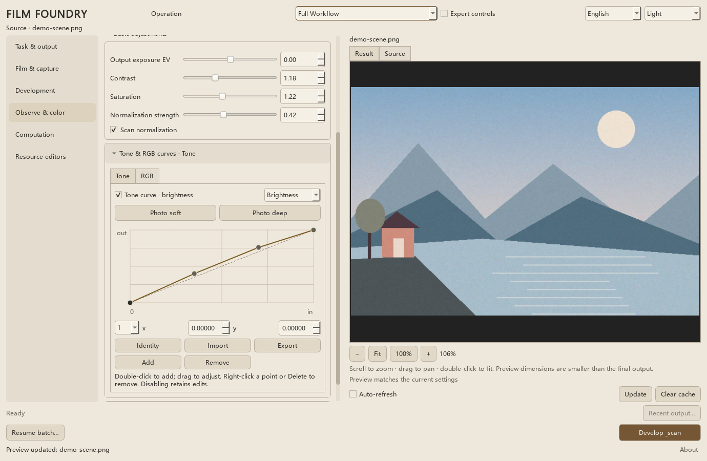
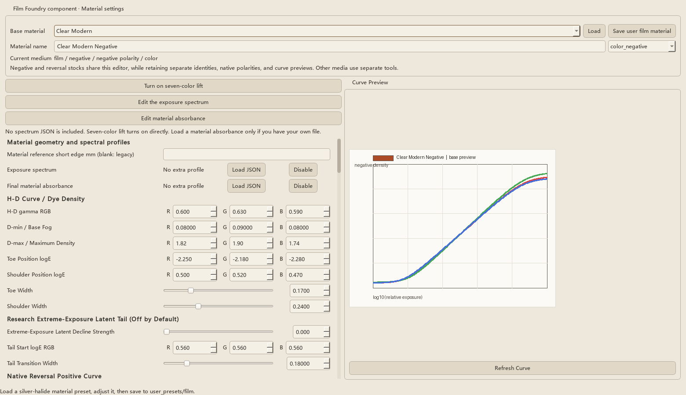

# 桌面使用指南

从安装、第一次处理到材料／药浴／扫描预设、命令行与材料母带，都在本页。字段含义和形成原理集中在[技术参考](REFERENCE.md)，效果与具体配方见[效果展示](SHOWCASE.md)。

## 目录

- [安装与启动](#start)
- [工作台、任务、预览与保存配置](#workbench)
- [材料、冲洗与扫描的预设目录](#presets)
- [预设分工与风格选择](#preset-details)
- [扫描影调参考](#scan-tones)
- [尺寸、质量与输出文件](#output)
- [命令行与独立编辑器](#cli)
- [视频逐帧与材料母带](#video)

<a id="start"></a>

## 安装与启动

Python 3.10 或更新版本：

```bash
pip install -r requirements.txt
python run_film_foundry_launcher.py
```

也可使用 conda：

```bash
conda env create -f environment.yml
conda activate film-foundry
python run_film_foundry_launcher.py
```

直接打开工作台：`python -m film_foundry.tools.run_desktop_gui`。

### Windows 便携版

在 Releases 下载便携包，解压后保留整个 FilmFoundry 文件夹运行。Alpha 包未签名，Windows 可能提示未知发布者。

<a id="workbench"></a>

## 工作台与日常操作

从“任务与输出”选择本次任务、来源和保存位置，再设置材料、冲洗与观察。参数与独立编辑器共用同一份任务配置；切换页面或专家细调不会清空参数。

### 先确定要做什么

| 本次任务 | 来源 | 保存结果 |
| --- | --- | --- |
| 完整流程 / Full | 图片或图片文件夹 | 冲洗介质与扫描成片 |
| 只冲洗 / Develop | 图片或图片文件夹 | 可重复观察、扫描的介质 |
| 只扫描 / Scan | 冲洗介质或 scanner raw | 新的扫描成片 |
| 只曝光 / Expose | 图片或图片文件夹 | 未冲洗潜影 |
| 冲洗潜影 / Develop latent | 已保存潜影 | 冲洗介质 |

任务页只显示当前任务使用的来源栏。切换任务后，另一类来源路径仍保留。只扫描默认按来源确定保存位置，界面会显示目标位置；取消这个选项即可指定输出目录。其他任务在所选输出位置建立本次运行文件夹。

正式冲洗和预览都保留原潜影，可更换药浴反复冲洗、分别保存结果。扫描只观察已经形成的介质，调色不会修改冲洗结果。旧版已标记“消耗”的潜影仍不能重新冲洗，需要保留的未消耗原档。

### 页面与常用操作

- **胶卷与拍摄**：选择负片或反转材料，按彩色／黑白、内置／自己保存筛选；设置画幅、曝光、保存退化、机身漏光、片门脏物及曝光打印。已保存来源的形成设置会沿用原值。
- **冲洗**：选择程序，调整时间、温度、浓度、摇晃与事故强度；更细的药水组合与材料反应在独立工艺编辑器中配置。
- **观察与调色**：选择扫描／解释预设，调整成片与影调、RGB曲线。双击曲线加点，拖动调整，右键或 Delete 删除内部点。
- **计算设置**：正式处理的尺寸、降阶、质量与随机设置。缩放、降阶和质量可以独立组合。
- **独立配置**：材料、药水和扫描完整编辑器，以及光谱配置。编辑后可显式应用到当前任务，或另存预设。

常用参数优先展开：胶卷页先选材料、画幅和曝光；冲洗页先选程序、时间、温度、浓度和摇晃；观察页先选扫描风格，再调曝光、对比度和饱和度。材料、药浴步骤与完整扫描设置也可从各自页面直接打开独立编辑器。

点击带箭头的分组标题展开或收起事故、曲线、灯台解释和附属输出。折叠只收起控件，不会关闭选项或清空参数；标题会提示已选项目、当前筛选或启用的曲线。影调／RGB曲线不要求开启专家细调。专家细调仅控制额外专业参数组的显示。切换界面语言保留分组展开状态、分栏宽度和当前页滚动位置。

三类预设旁的“浏览…”可搜索当前列表，完整显示名称；点击“使用所选预设”或双击条目才应用，取消不改变当前配方。材料浏览遵循当前负片／反转片与色彩、来源筛选；需要更多材料时展开“筛选材料列表”。

日常目录为12种材料、10种扫描／解释预设；“显示更多风格变体”展开兼容和额外变体，当前已选项与自定义项会保留。详见[预设选择](DESKTOP_GUIDE.md#presets)。

### 预览与正式输出

默认自动刷新；关掉后用图像下方的“更新预览”手动更新。“自动刷新”“更新预览”和“清缓存”集中在图像旁，正式处理按钮留在窗口底部。交互预览采用较小尺寸和快速设置，正式处理使用计算页选定的设置。

预览下方会标明正在更新、与当前参数一致、参数已修改或更新失败。修改后尚未更新的画面会保留，方便比较；失败时也不会把旧画面误标成最新结果。

预览中滚轮缩放、拖动平移、双击适合窗口；工具栏也有缩小、适合窗口、100%和放大。100%表示预览图的实际像素，同尺寸刷新保留当前放大状态。显示倍率不改变处理尺寸；检查最终细节应打开正式输出文件。

“清理缓存”只释放预览计算缓存；“恢复批次”读取已保存运行清单，按原参数继续未完成项。任务运行中的主按钮用于取消，取消后不会启动后续帧。

### 任务进行中与收尾

开始前必须选择当前任务的来源和所需输出位置；只扫描采用来源相对保存时，不需要填写手动目录。

任务运行中锁定任务类型、来源、保存位置和恢复入口；参数仍可调整，但用于下一次任务。底部显示当前处理阶段，进度条表示该阶段的进度，不能当作整批完成百分比。未提供比例的阶段显示活动进度条。

点击关闭窗口时，可以继续处理，或取消任务后退出。选择退出会等待任务响应取消并收尾，保留已完成的输出；窗口可能不会立即消失。完成或取消后，“最近结果…”打开本次实际结果目录，恢复批次也沿用原目录；目录被移动或删除时会提示。

滚动参数页时，未聚焦的滑条和数字框不会响应滚轮；先点击数值框或滑条后仍可滚轮调整。收起的选择框不响应滚轮，避免滚动页面时意外替换整套预设；可以点击展开选择，或聚焦后用方向键切换。

### 保存配置

会话保存当前任务设置与路径；JSON／FFC2用于复用配置，其中FFC2不包含桌面的全部运行与导出设置。保存的预设仍可在独立编辑器中继续编辑。深色与米白（英文 Light）属于界面偏好，单独保存。

启动器与工作台底部角落的“关于”显示桌面版本、作者与仓库链接。材料、工艺与扫描编辑器是 Film Foundry 的独立组件，共用当前任务的数据契约。

### English quick reference

Start on **Task & output**: choose an operation, its source and destination. Source fields follow the operation without discarding the other saved path. **Scan** shows the source-relative destination and can use a manually chosen folder instead. Successful **Develop latent** marks the latent as processed; previews and scans remain read-only.

Preview inspection: scroll to zoom, drag to pan, double-click to fit, or use the Fit/100% buttons. The percentage describes preview pixels, not final output dimensions. Same-size updates retain the zoom position. Formal processing uses the computation settings. Material, chemistry and scanner editors remain separate and can apply their working copies to the task.

The preview status distinguishes current, outdated and failed updates. While a task runs, its operation, paths and resume entry are locked; parameter edits apply to the next task. The progress bar describes the current stage. Closing offers to keep processing or cancel and exit after the task finishes. **Recent output…** opens the actual result folder, including the original folder of a resumed batch.

Common controls appear first. Expand arrow headings for curves, accidents, interpretation and additional exports; folding never clears values or disables a setting. **Browse…** searches the currently visible preset list and applies only on confirmation or double-click. Full material, bath/process and scanner editors are also linked from their respective pages. Preview actions are beside the image; formal processing remains at the bottom.

<details>
<summary>观察与材料编辑界面</summary>





</details>

<a id="presets"></a>

## 材料、冲洗与扫描目录

桌面主窗口默认显示 12 类材料、5 类冲洗程序、10 类扫描／解释配置。材料按负片／反转片分组显示；用户自己保存的预设始终显示。

| 材料类型 | 日常材料 |
| --- | --- |
| 彩色负片 | 清晰现代、暖调消费级、浓郁均衡、青影暖光 |
| 黑白负片 | 高反差（命令行名称仍是 `monochrome_push`）、微粒柔调 |
| 彩色反转 | 标准反转、浓彩、琥珀暖光、钴蓝冷光 |
| 黑白反转 | 中性细调、硬调粗粒 |

| 冲洗目录 | 内容 |
| --- | --- |
| 日常五项 | 彩色负片、黑白负片、彩色反转、黑白反转、实验性负片逆冲与色罩漂白 |
| 展开更多药浴 | 细颗粒、补偿、高锐度、黑白迫冲、清洁单浴、疲劳留银单浴 |
| 诊断／事故例子 | 保留文件供明确载入，不进入日常或扩展列表 |

材料原生正负极性与所选冲洗程序可以交叉组合。色罩漂白属于形成步骤，扫描去色罩只改变观察。完整创作配置、材料／药浴／扫描分类预设和仅影调参考各有用途，不应互相替代。

| 扫描／解释 | 用途 |
| --- | --- |
| 负片 · 彩色 · 中性扫描 | 一般彩负观察起点 |
| 负片 · 彩色 · 暖调扫描 | 偏暖的成片解释 |
| 负片 · 彩色 · 扫描通道补偿 | 显式采集／通道补偿配置，可与中性结果对比 |
| 负片 · 黑白 · 中性扫描 | 黑白负片解释 |
| 正片 · 中性灯台 | 正片观看起点 |
| 浓彩正像 | 强化色彩的创作观察 |
| 琥珀青影 | 暖高光与青色暗部 |
| 紫夜 | 紫色与夜景取向 |
| 酸绿 | 绿调创作风格 |
| 钴蓝红光 | 冷蓝与红色对照 |

“显示更多风格变体”展开原有冷蓝高光、红色浓郁、厚暗部、洁净宽容、反转柔和，以及扫描端的厚暗部、洁净、正片明亮／暖调等额外配置。冲洗页的“显示更多药浴方案”也使用同一显示偏好；三页同步，偏好单独保存，不进入配方或介质。

影调编辑器的 **实拍柔和／实拍浓厚** 只改变当前影调曲线，不会替换扫描色彩、灯台、去色罩或设备响应；可搭配任意当前扫描配置。来源与适用边界见 [实拍参考扫描影调](DESKTOP_GUIDE.md#scan-tones)。

旧预设、命令行名称、会话和配方分享码里的参数保持原值。正在使用的变体即使收起列表也继续显示；开关不会换配方、重置微调或重新形成介质。完整的材料和扫描编辑器仍提供全部资源。黑白材料原来的显示名「迫冲」改为「高反差」，用来区分材料特性和冲洗页上的迫冲操作；命令行名称和数值不变。

The desktop starts with twelve material choices and ten scanner/interpreter choices. **Show more style variants** restores the previous choices; user presets and the currently selected variant remain visible. Existing recipe keys and values are preserved. Photo-reference tone buttons replace only the current output tone curve. Full resource editors keep the complete catalog.

手机装卷与独立材料配置共用三个筛选：负片／反转片、彩色／黑白、官方／自定义。日常目录两种极性各六种，每种极性有四种彩色、两种黑白。兼容旧材料隐藏但不删定义；旧搭配仍按原材料参数打开。厂商胶片的定量复刻不在这些创作风格的承诺内。

新增材料参数来自本项目已有材料模型，桌面与手机共用参数源；手机版独立降阶形成。取景框保留简洁线框与中心对焦框。

<a id="preset-details"></a>

## 预设分工与风格选择

主界面在完整流程和只冲洗里，先按材料自己的最终极性分成负片和正片，再列出对应的材料预设。分类看材料极性，旧预设里的工艺标记只作兼容。彩色或黑白标签看材料的色彩类型。这只是目录过滤，不会禁止负片材料走反转程序，也不会禁止反转片材料走负片程序。

显示名面向用户，可以是中文或其他文字。官方预设会随界面语言切换主名称；你自己保存的预设保留原来的显示名。命令行和会话使用的名称不会出现在普通下拉列表里。

独立的材料、冲洗和透射扫描编辑器会继承启动器或主界面的当前语言。三个编辑器的内置 preset 名称和界面标签会同步切换；数值参数同时支持滑条调整与直接输入。

develop preset 的官方显示名明确包含彩色/黑白与负片/反转正片语义。scanner preset 现在共用一个透射扫描目录和编辑器；旧 `negative_scan` / `positive_transparency_scan` 身份只用于兼容旧 preset 并初始化建议组合，不再代表两台不同扫描器，也不会禁止用户加载另一类 preset。

主 GUI 列出 `standard_color_negative`、`standard_bw_negative`、`standard_color_reversal`、`standard_bw_reversal` 四个标准内置冲洗流程，并额外列出明确标记为实验性的 `experimental_color_negative_clear_reversal`。展开“显示更多药浴方案”可以选择细颗粒、补偿、高锐度、黑白迫冲和单浴；银盐工艺程序编辑器和 CLI 也可读取。`high_acutance_bw` 使用已有的首次显影邻接动力学表达边缘效应，不是扫描锐化。

反转片材料示例：`color_reversal_transparency`（标准）、`color_reversal_soft`（柔和宽容）、`color_reversal_vivid`（高饱和高反差）、`monochrome_reversal_transparency`（黑白细颗粒）。当前公开正片灯台：`positive_transparency_scan`（中性，`+0.35 EV`）、`positive_transparency_bright`（明亮，`+0.80 EV`）、`positive_transparency_warm`（暖调，`+0.50 EV / 4800 K`）。

非常规彩色负片材料包括：`blue_highlight_negative`（中高曝光逐渐偏冷蓝）、`vivid_balanced_negative`（低串色、浓郁且相对均衡的近数码式颜色分离）和 `cyan_shadow_warm_highlight_negative`（青色暗部向暖色高光过渡）。这些效果来自材料 H-D 层响应、染料吸收和片基配置，不是扫描后的 RGB 滤镜；更换冲洗程序或扫描解释仍会产生可解释的不同结果。

输出配置中，`export_transparent_plate` 表示 standalone 透明/透射介质，默认开启；`export_plate_set` 表示 standalone 密度与效果辅助层；`export_layer_pack` 表示包含前两者以及 NPZ、预览/raw 和 manifest 的完整归档。Layer Pack 开启时，前两个布尔值不再决定包内是否包含对应内容，也不会另外生成重复目录。

公开负片材料的颗粒基准比早期略低一成。这只降低材料本身的颗粒；实际颗粒仍由显影液、迫冲、过显、温度、疲劳、残银、药染、显影不均和画幅共同决定幅度、尺度和粗粒比例。粗粒比例只调整已有颗粒里粗尺度占多少，不会再生成一套颗粒。反转片使用另一组更细、更紧的颗粒。正片灯台的饱和度接近中性，颜色主要来自材料与冲洗。

这份说明用于解释预设的用途。不是每个 preset 都应该被理解成“正常照片输出”，有些是调试基准，有些是扫描风格，有些更接近材料母版。

当前推荐使用拆分后的预设目录：

```text
film_foundry/presets/film/
  film material: H-D curve, base, dye, grain, halation

film_foundry/presets/develop/
  silver-halide film process program: operator topology + developer/monobath,
  time, temperature, concentration, agitation, exhaustion, frame size
  银盐负片 / 反转片共享算子程序；非银盐介质使用独立 preset 目录

film_foundry/presets/scanner/
  扫描 / 正像解释 / 输出影调
```

根目录下的 `film_foundry/presets/*.json` 现在只建议保留少量完整配置示例。它们不是主流程依赖；GUI 和 CLI 默认组合 `film/`、`develop/` 与 `scanner/` 三个子目录。

材料预设只写材料，冲洗预设只写冲洗，扫描预设只写观察。放错目录的字段不会混进另一步。要同时保存各阶段和输出开关，请用完整配置或会话，不要让一份分类预设偷偷带上其他阶段。

### 推荐默认

#### `film/clear_modern_negative` + `scanner/neutral_scan`

用途：默认中性彩色负片、冲洗介质标准样张、日常照片。

特点：

- H-D 曲线有温和 toe / shoulder。
- RGB 三层只轻微分离。
- scan/render 曲线保持中性，并以 luma 全局黑白点建立正常显示范围，不用强通道分离制造风格。
- 适合作为桌面的默认材料与扫描组合。

### 高宽容干净负片类

#### `film/clean_digital_like` + `scanner/clean_digital_scan`

用途：高端干净彩色负片、低颗粒、高宽容度、接近数码容错的中性胶片基底。

特点：

- H-D 曲线更低反差、更宽 toe / shoulder，亮部和暗部都比默认负片更柔和。
- 片基仍是彩色负片的橙色 mask，不再使用近透明诊断片基。
- 颗粒、halation 和 MTF 都很克制，但不是完全“无胶片感”的调试材料。
- 适合需要干净、宽容、中性的输入基底，再通过 scanner preset 轻微解释成片。
- 不再作为流程诊断基准；需要诊断冲洗灵敏度时使用 `film/diagnostic_develop_sensitive` + `scanner/diagnostic_flat_scan`。

### 写实负片类

#### `film/clear_modern_negative`

用途：现代干净负片、中性默认。

建议：

- 作为默认。
- 适合先确认输入照片在本项目里是否能稳定工作。

#### `film/warm_consumer_negative`

用途：消费级暖调彩负。

特点：

- 高光略暖，蓝通道轻微压低。
- 颗粒、halation 和染料交叉比默认更明显，整体更软、更日常。
- 适合日常、街景、室内暖光。
- 不建议作为默认，因为它本身就是有风格的扫描解释。

#### `film/red_rich_negative`

用途：红色更厚、但整体尽量不明显偏红的彩负。

特点：

- 胶片/染料层比默认更有颜色性格。
- 红色和暖色更容易显得浓郁，但主要发生在材料/染料侧，不依赖 scanner 强行拉红。
- 如果肤色或白色物体偏色明显，优先降低扫描饱和度和 `print_color_shift`，不要先改 H-D 曲线。

#### `film/deep_shadow_negative`

用途：暗部更厚的中性负片。

特点：

- 适合低饱和街景、阴天、夜景氛围。
- toe 更短、gamma 略高，暗部更快进入厚密度。
- 黑位更明确，但仍应保持扫描阶段不过度通道分离。

#### `film/high_contrast_push`

用途：彩色负片的高反差、粗颗粒、迫冲感材料 preset。

特点：

- gamma 和 D-max 高于默认负片，toe / shoulder 更短，宽容度更紧。
- 颗粒更粗，片基和 halation 明确写入，避免回退到隐式默认。
- 它描述“像迫冲材料”的胶片基底；真实本次迫冲仍应通过 develop preset 的 `push_stops`、时间、温度等参数表达。

### 风格扫描类

所有 scanner preset 先由共享透射光源与 `scanner_response_matrix` 形成 `scanner_raw`。只有用户启用去片基/色罩时才使用已知片基、明确边框样本或兜底估计；只有用户启用反相时才进入密度反相、`negative_channel_matrix` / `negative_channel_gamma` 和正像映射。前一个矩阵描述采样器，后一个矩阵描述反相后的通道重建，不能互相代替。内置旧 preset 未显式提供新字段时会迁移到旧行为，以保持兼容。

#### `scanner/color_restored_scan`

用途：扫描解释侧的彩色负片蓝绿通道补偿；只读取已经合成的 RGB 总光学密度，不反演材料组分。

特点：

- 影调、归一化和饱和度保持接近 `neutral_scan`，便于单独比较通道补偿作用。
- 显式开启 `negative_channel_compensation_enabled`，强度为 0.35。
- 补偿矩阵是固定有界的 scanner-side 蓝绿响应，由强度控制；它不读取 `dye_absorption_matrix`，避免把残银或银盐误当成染料分离。
- 黑白介质自动关闭该步骤；外部 raw 与项目内部介质使用同一扫描侧规则。

#### `scanner/rich_color_scan`

用途：浓郁彩负扫描、偏风格化输出。

特点：

- scan/render 饱和度和反差高于默认，负责“浓郁成片”。
- 通道分离比默认更明显，但避免过度压低蓝通道或把暖色扫描变成红色滤镜。
- 适合“想直接得到厚重成片”的场景，不适合作为系统基准。

#### `scanner/neutral_scan`

用途：中性扫描解释，对已有冲洗介质重新扫描时做基准。

特点：

- 更像扫描器/软件的中性解释，而不是胶片材料 preset。
- 使用中等强度的 luma 黑白点标定，避免负片反相后黑位和白位都停在灰区；三个通道按同一像素倍率缩放，不会逐通道自动白平衡，也不会抹掉扫描侧已有的色温或整体色偏。
- 只保留很弱的高光偏色和接近中性的饱和度。
- 适合 scan-only 阶段测试。

#### `scanner/warm_consumer_scan`

用途：轻微暖调的日常扫描解释。

特点：

- 比 `rich_color_scan` 更低饱和、更低反差。
- 主要通过温和的红/绿偏移和高光暖偏塑造消费级暖调。
- 适合搭配 `warm_consumer_negative`，但也可用于默认负片的轻度暖化。

#### `scanner/dense_shadow_scan`

用途：压实暗部、强化黑位的扫描解释。

特点：

- 比默认有更高反差和更强归一化，但饱和度保持克制。
- 不负责制造浓郁色彩；浓郁色彩应优先使用 `rich_color_scan`。
- 适合搭配 `deep_shadow_negative` 或需要更明确黑位的场景。

### 黑白类

#### `film/monochrome_push` + `scanner/bw_neutral_scan`

用途：黑白迫冲测试。

特点：

- 绕开彩色染料和色罩问题。
- 适合验证 H-D 曲线、颗粒、MTF、halation 是否自然。

### 调参原则

胶片味不应该主要靠 scan/render 的 RGB 通道强分离来获得。更稳的顺序是：

```text
H-D toe / shoulder
-> D-min / D-max
-> 密度域颗粒
-> 片基色罩
-> 温和染料交叉
-> 扫描黑白点与中间调反差
-> 少量扫描色偏和饱和度
```

如果 scan/render 曲线里蓝通道很早进入低平台，常见后果是：

- 高光发黄或发绿。
- 天空蓝变灰。
- 暗部颜色分离过度。
- 整体像通道曲线硬掰过。

如果想要“浓郁”，优先提高 luma 黑白点展开、中间调反差和扫描饱和度；不要只靠大幅度 `print_color_shift` 或三通道独立曲线。

药浴字段、事故字段与扫描解释键的完整说明见[技术参考](REFERENCE.md#process-fields)。

<a id="scan-tones"></a>

## 扫描影调参考

观察与调色页的“影调”编辑器提供 **实拍柔和／实拍浓厚** 两个按钮，只替换当前影调曲线，可搭配当前扫描配置。恒等按钮恢复直线。旧版整套扫描预设继续保留在“显示更多风格变体”中，CLI 名称也保持可用：

| 界面名称 | CLI 参数 | 作用 |
| --- | --- | --- |
| 负片 · 实拍参考 · 柔和影调 | `--scanner-preset reference_soft_tone_scan` | 抬起较暗影调，收拢亮部；保留中间调附近的关系 |
| 负片 · 实拍参考 · 浓厚影调 | `--scanner-preset reference_deep_tone_scan` | 压低暗部、拉开较亮影调；高光可能更早到达输出上限 |

上表的兼容扫描预设沿用现有 `neutral_scan`，只增加最终输出影调曲线；**影调按钮则保留当前扫描配置的全部其他值**。可继续编辑、关闭或恢复恒等。不改变材料、冲洗、scanner raw、RGB 曲线顺序或默认扫描选择，也不把材料与某个扫描预设绑定。可以对同一个已形成介质反复切换比较。精简目录见 [预设选择](DESKTOP_GUIDE.md#presets)。

这两条曲线只表示成片明暗的相对变化，加在现有扫描之后。它不是某款胶卷的标定，也不是某台扫描仪或冲印机的复现，不包含颜色、光谱或颗粒。原图没有放进程序或发布包。

曲线依据公开发表的同底片扫描对照计算，版权仍属于原作者：

- [theFINDlab 的反差对照](https://thefindlab.com/2016/02/01/frontier-and-noritsu-contrast-comparison/)，照片 Marla Cyree。
- [PhotoVision 的同帧双扫](https://www.photovision.co/working-with-us/film-scannerbattle/)，摄影 Kristine Herman。不同画面的亮度和反差方向并不一致，因此没有用一个系数代表某台机器。
- [Richard Photo Lab 的胶卷与曝光阶梯](https://richardphotolab.com/blogs/post/find-your-film-stock-and-exposure-comparisons)。那是相机曝光变化，不是迫冲或减冲数据，也不用于颗粒或清晰度。

The two curves are relative output tones added after the current scan. They do not change a developed medium, and they are not a film-stock or scanner reproduction. Source photographs are not included. Credits are listed above.

<a id="output"></a>

## 尺寸、质量与输出文件

- **边长缩放**：指定处理尺寸。
- **降阶快速**：以较轻的计算模型加快处理。
- **质量档位**：`draft`／`standard`／`high`。

三项可独立组合。默认开启1600长边缩放与降阶；需要原尺寸时关闭缩放。大图处理可按电脑内存调整尺寸与导出项。[性能策略](REFERENCE.md#performance)

### 输出文件

完整流程和只冲洗按时间创建独立运行目录，保存成片、介质与 `film_foundry_run.json` 设置。介质位于 `negative/` 子目录，使用 `.darkroom_negative.npz` 或 `.darkroom_positive.npz` 后缀。

只扫描默认输出到底片目录的上一级，也可手动指定目录。每次扫描保留独立结果。可选导出包括透明介质、16-bit raw／透射TIFF、CMY／颗粒／光晕制版层；Layer Pack 将这些资源打包归档。

<a id="cli"></a>

## 命令行与独立编辑器

```bash
# 查看帮助
python -m film_foundry.app.cli --help

# 完整流程
python -m film_foundry.app.cli full input_images outputs --film-preset clear_modern_negative --develop-preset standard_color_negative --scanner-preset neutral_scan

# 生成介质
python -m film_foundry.app.cli develop input_images outputs/negatives --film-preset clear_modern_negative --develop-preset standard_color_negative

# 重新扫描
python -m film_foundry.app.cli scan outputs/negatives outputs/rescans --scanner-preset rich_color_scan

# 缩放、降阶与快速质量
python -m film_foundry.app.cli full input_images outputs --processing-mode scaled_fast --fast --quality-mode draft --preview-long-edge 1600

# 读取GUI会话
python -m film_foundry.app.cli full input_images outputs --session user_presets/film_foundry_session.json
```

### 独立编辑器

内置预设分别位于 `film_foundry/presets/film/`、`develop/`、`scanner/`。自定义预设放入 `user_presets/`，同名时优先使用自定义配置。

独立编辑器：

- 材料：`python -m film_foundry.tools.run_film_material_editor`
- 药浴：`python -m film_foundry.tools.run_develop_process_editor`
- 扫描：`python -m film_foundry.tools.run_scanner_render_editor`

[预设指南](DESKTOP_GUIDE.md#preset-details)

<a id="video"></a>

## 视频逐帧与材料母带

主线仍是有限胶卷：逐格曝光、留下潜影、整卷冲洗。桌面没有按固定帧率自动生成一整卷的功能。手机上的连续过片使用同一条有限卷，会主动缩小尺寸，并报告实际拍到的速度，不会补造没有拍到的画面。

已有视频可以拆成一帧帧导入。母带按原来的时间顺序保存每一帧的潜影或冲洗结果，不包含剪辑、混音或成片编码。

桌面在「任务与输出」里可以导入视频、另存一份冲洗结果、查看所选帧，并导出压缩包。使用的是当时窗口里的材料、工艺、曲线和计算设置。每次冲洗都是新母带，原来的潜影不动。调色不会写回已冲洗的介质。

安装了可选的视频解码组件后，也可以用命令行：

```shell
python -m pip install -e ".[video]"
film-foundry movie-expose input.mp4 latent-master --seed-strategy fixed --seed 42
film-foundry movie-develop latent-master optical-master --seed-strategy fixed --seed 42
film-foundry movie-observe optical-master frame.png --frame 1
film-foundry movie-export optical-master optical-master.zip
```

第一版只接受普通动态范围、单条视频轨和方形像素的视频。宽色域需要以后单独处理。帧和时间都会保留。缩放只使用你明确设置的尺寸。逐帧介质可能占用大量磁盘。母带必须写到新目录；取消或失败不会留下半套。暂不能从中断处继续。

同一输出目录里、由本程序标记且没有被占用的中断临时文件会被清掉。已经完成的母带和没有标记的旧目录保持不动。空间太少时会停下来并清掉这一次的临时文件；这不是预先留出的空间，长片仍然需要足够的磁盘，程序也不会靠缩小或跳帧来做完。

手机上可以装卷、单帧拍摄、过片、封卷、整卷冲洗，并在软件里观看。没有无限录像。已有视频可以从附加工具导入，再导出原文件，或生成潜影母带、另存冲洗结果、选择一帧做扫描或灯台观看。也可以导入、导出完整母带压缩包。可以粘贴自己的配方分享码；留空则用手机上的默认配方。

桌面导出的压缩包可以在手机里导入。完成后进入母带库：潜影可以反复冲洗，已冲洗的介质可以直接观看。压缩包里可以多包一层文件夹，但只保留清单和它列出的帧。身份、配方、时间和帧文件保持原样。导入使用新的本地目录，不覆盖已有母带。手机导出的压缩包在桌面解压后，选择里面的清单即可读取。

导入时会暂时同时占用压缩包和解出的介质。完成后清掉压缩包的临时副本。超过大小或帧数限制、文件损坏、缺帧或取消，都不会入库，也不会靠缩小或丢帧来导入。

拍摄来源和材料母带是分开的。声音留在原来的视频里，不进入母带。母带、录像和观片预览不会自动写入系统相册。真机上的解码、录像、方向、声音和速度还不能当作已经完成。
