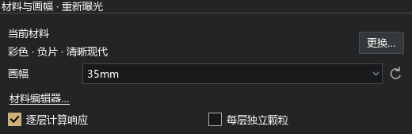
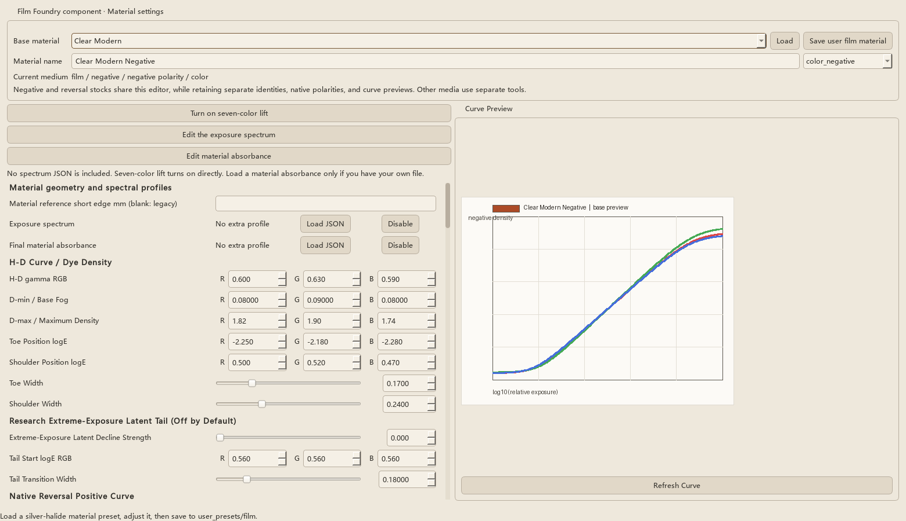

# 桌面使用指南

[English](DESKTOP_GUIDE.en.md) · [技术参考](REFERENCE.md) · [效果展示](SHOWCASE.md) · [项目首页](../README.md)

本指南覆盖桌面端的安装启动、图库与工作台操作、预设管理、试条与探针、导出与硬件计算、命令行批处理及材料母带。材料形成原理与完整参数字典见[技术参考](REFERENCE.md)，样张与配方对照见[效果展示](SHOWCASE.md)。

> **版本适用说明**：本指南基于当前开发源码编写。已发布的 0.4.0 Alpha 便携安装包界面早于部分新增交互（如图库起点、二维试条、DNG 解码与实验材料工作区等），具体差异见[开发中源码快照](DEVELOPMENT_SNAPSHOT.md)。

## 目录

- [安装与启动](#start)
- [工作台、任务、预览与保存配置](#workbench) · [乳剂分层与颗粒](#coatings)
- [保存工作、自动恢复与预设分享](#preset-sharing)
- [材料、冲洗与扫描目录](#presets)
- [预设分工与风格选择](#preset-details)
- [扫描影调参考](#scan-tones)
- [尺寸、质量、输出与硬件计算](#output)
- [命令行、现有配方与批处理](#cli) · [Python／IDE 脚本](#scripts) · [独立编辑器](#editors)
- [视频逐帧与材料母带](#video)

---

<a id="start"></a>

## 安装与启动

### 从源码运行（推荐 Python 3.11+）

```bash
pip install -r requirements.txt
python run_film_foundry_launcher.py
```

也可以使用 Conda 创建环境：

```bash
conda env create -f environment.yml
conda activate film-foundry
python run_film_foundry_launcher.py
```

如需跳过启动器直接进入主工作台，可运行：

```bash
python -m film_foundry.tools.run_desktop_gui
```

### Windows 便携版

在 GitHub Releases 下载便携包后，解压并**保留完整的 `FilmFoundry` 文件夹**运行 `FilmFoundry.exe`。Alpha 包尚未进行代码签名，首次运行可能出现系统安全提示。

---

<a id="workbench"></a>

## 工作台与日常操作

### 1. 图库起点、首次导览与上下文指南

- **从图库开始**：在图库添加单张照片或登记来源文件夹（仅建立索引，不搬动原文件）。双击缩略图进入只读高清浏览，可评分、收藏与查看关联材料；选中一张或多张图像后点击 **选材料，创建工作…** 进入对应工作区。所有工作区与完整编辑器在同一主窗口内切换，切换时保留当前草稿。
- **首次导览**：首次打开图库可点击 **开始导览**，用随附示例照片体验选图、曝光、冲洗、扫描与保存全过程。调整导览中的曝光、冲洗时间或成片曝光后，小样会自动刷新（也可手动点 **更新示例**）。随时可通过 **工具 → 第一次暗房工作…** 重新打开。
- **快捷导入与筛选**：空图库提供 **导入照片… / 打开底片或潜影… / 整卷暗房…** 三个入口；也可直接拖入本地图片、材料 NPZ、结果记录或文件夹（文件夹会在后台递归索引；工作目录包 `.fffilm` / `.ffworkspace` 请通过“打开已有工作…”打开）。图库默认展示分类与搜索两排控件，详细类型、材料族、来源与评级筛选收在 **筛选** 中，选中条目后显示批量管理操作。
- **上下文指南（`? 本页指南` / `F1`）**：右上角随时可打开当前页面的说明卡片，顶部只读快照汇总当前来源、可调阶段、实际输出配置或已执行工序；指南中的跳转按钮仅切换视图，不触发计算或改动草稿。

### 2. 选材窗口、参考缩略图与收藏

点击 **选材料，创建工作…** 或胶片材料页的 **当前材料 → 更换…**，可先选材料族再选具体胶片或材料类型，并支持名称搜索、色彩、正负片与来源筛选；创建胶片工作时会自动配套推荐冲洗与扫描预设。材料编辑器的 **构建材料…** 还提供全色、正色、蓝敏等黑白乳剂模板。

- **参考流程示意缩略图**：材料选择窗及冲洗/扫描选择窗支持对照同一张**示例照片**、**合成色卡**或**当前来源照片**预览效果。缩略图以固定比较种子、长边 240 px 生成，仅用于快速比较参考（内置默认组合随附只读参考缩略图，其余组合在后台按可见范围计算，不代表原尺寸颗粒，也不改变当前配方）。
- **磁盘缩略图缓存**：选材、预设与图库小缩略图自动缓存在本地（上限 128 MiB / 2048 项，按最近使用淘汰），重开软件可复用；可在 **全局设置 → 缓存与软件信息 → 清理磁盘缩略图** 清空，不影响原图、介质与工作存档。
- **收藏与最近选用**：选择窗支持按 **全部 / 收藏 / 最近选用** 筛选（收藏上限 512 项，最近确认上限 40 项，按稳定标识保存，不随界面语言变化）。

### 3. 确定任务、顶部阶段条与重算范围

| 任务模式 | 输入来源 | 主要输出 |
| --- | --- | --- |
| 完整流程（Full） | 照片或文件夹 | 冲洗介质与扫描成片 |
| 只冲洗（Develop） | 照片或文件夹 | 可反复观察、扫描的电子介质 |
| 只扫描（Scan） | 常见图像、已冲洗介质或 scanner raw | 新的扫描成片 |
| 只曝光（Expose） | 照片或文件夹 | 未冲洗潜影（`.darkroom_latent.npz`） |
| 冲洗潜影（Develop latent） | 已保存潜影 | 冲洗介质 |

- **顶部四段阶段条**：按 **曝光与潜影 → 化学冲洗 → 观察与扫描 → 保存与导出** 展示当前工作状态，明确区分**可调**、**已冻结**、**仅观察**与**跳过**。点击卡片主体查看或调整参数，点击右侧 **设为终点 / 当前终点** 切换执行范围（扫描终点旁菜单可选择“跳过形成，仅扫描原图”）；底部主按钮才启动正式执行与保存。
- **阶段副标题与重算提示**：卡片副标题标明当前配方起点或冻结记录中的材料/药浴名称；分组标题同时提示改动后的重算范围——**重新曝光**、**重新冲洗**或**仅观察**（仅观察在命中介质缓存时不重算冲洗）。材料页中的**储存与老化**指胶片存放历史，而非文件保存。
- **保留原潜影与复用版本**：
  - 正式冲洗与预览均保留原潜影，可通过 **从潜影另做冲洗** 更换药浴生成新底片（已有底片与扫描保留；旧版已标“消耗”的潜影不可重冲）。
  - 已有底片进入 **底片 · 扫描** 工作区，仅开放观察与输出；通过 **形成记录** 可查阅冻结的材料与工艺事实。
  - 在图库或关联结果中选中已有扫描成片，点击 **按此版本调整扫描** 可回到对应原底片并还原当时保存的灯光、曲线、色彩、旋转与导出设置（要求扫描 JSON 与原 NPZ 均存在）。
- **分段冲洗检查点**：在潜影工作页点击 **分段冲洗** 可创建独立冲洗工作页，按反应边界逐步 **执行至此并保存**，并对尚未开始且未锁定的后续药浴另存分支；冲洗完成后仍可 **返回最后存档** 另做尝试。

### 4. 相机 DNG 与 RAW 输入

直接从图库选择 `.dng` 即可进入曝光。桌面端通过 `rawpy` / LibRaw 读取黑白电平、相机白平衡与色彩矩阵，解码为 16 位线性 sRGB 后以浮点数据进入胶片或实验材料曝光（普通 JPEG 则先经显示编码逆转换）。

- **支持范围**：已验证未压缩及无损 JPEG 压缩的 Bayer DNG、三通道 Linear DNG 与单通道黑白 DNG；其他压缩变体和具体机型取决于所装 LibRaw。
- **保留相机原厂显色**：如需沿用相机的 RAW 滤镜、胶片模拟或原厂软件渲染，请在原厂软件中应用风格并导出带 sRGB 配置的 16 位 TIFF 再导入。首次导入或处理 RAW 时工作台会弹出简短提示，可随时关闭或勾选“不再显示”。

### 5. 镜前滤镜与三色分离

在 **材料与曝光 → 单张／批次曝光 → 镜前滤镜与曝光条件** 中，将 **装片方向** 改为 **片基朝镜头（反装）**。手机在 **装填新胶卷 → 更多装卷设置** 选择整卷反装。可以用同一款彩负对照 0、+1、+2 EV，固定药浴和扫描并关闭扫描自动归一化。命令行使用 `--film-side base`，默认值为 `emulsion`。

反装默认左右翻转。选择 **保持相机构图** 可以关闭镜像，竖向翻片可选 **上下翻转**。**自动补偿焦面偏移** 默认关闭，打开后会随片基厚度和折射率补偿。手动补偿以 µm 输入，正值表示把焦面向乳剂方向移动。拍摄光圈决定失焦程度，输入画面已包含曝光量，各光圈的比较按等曝光量计算。

自制胶片可选 **通用** 反装响应。支持体的 R、G、B 密度分别为 D 时，该通道的透过率为 10⁻ᴰ。三个通道都是零时支持体完全透光；三者相等时只减光。普通彩负用 `clear_support_density_rgb` 声明永久支持体，逐通道以总基底密度为上限。总基底的其余部分属于冲洗后的色罩。银盐黑白片及反转片直接用 `film_base_density_rgb` 表示其永久支持体。改变支持体颜色后，反装时各感光层接收的光量会随之变化。焦面补偿仍由厚度和折射率决定。

要试 HARMAN RED 125，载入[配套反装配方](../film_foundry/presets/harman_red_125_reference.json)，其中包含参考材料、标准彩负药浴和固定扫描。单独在装片设置选择 **HARMAN RED 125 曲线参考** 会沿用当前胶片与药浴。命令行可组合 `--film-side base --rear-profile harman_red_125 --rear-mirror horizontal`，需要自动调焦时追加 `--rear-auto-refocus`。

**模型范围**

通用光路使用未冲洗片基、实际配方的炭黑背层与材料感色响应。配套彩负的白光灰阶按 HARMAN RED 125（135）标准 C41 的三通道密度拟合，曝光轴为相对值，18% 灰映射到红色净密度约 0.50 D。原图中红通道曲线在相对 log H 约 3.86 结束，更高曝光沿用最后读数。单色蓝光在红、绿层间的分配和颗粒外观为近似，绝对 EI、不同药浴及彩色色块仍需实片校验。[厂家技术资料，第 2–3 页](https://ilford.co.jp/photo/wp-content/uploads/2026/09/TDS_HARMAN_-RED125.pdf)

焦面模型假设片轨固定靠镜头的一面，近轴残差为片基厚度除以折射率。厂家给出的 135 片基厚度为 125 µm。折射率默认估计为 1.48，补偿量约 84.46 µm。模糊按像素与实际画幅尺寸换算，以等方差的可分离核近似圆形光瞳。镜像作用于场景曝光，厂印边字沿材料自身方向排列。

- **镜前滤镜**：打开 **材料与曝光 → 单张／批次曝光**，在 **曝光补偿 EV** 下方点击 **镜前滤镜与曝光条件…**，可选黄、橙、红、绿、蓝或天光镜。勾选**中性损光补偿**会自动补足中性光总感光量，同时保留滤镜造成的色彩或黑白灰阶差异；关闭补偿则保留实际滤镜损光（比较时建议关闭扫描自动归一化）。滤镜随新曝光冻结进潜影。
- **三色分离与合成**：打开 **工作 → 三色分离与合成**，可从单张照片自动曝光出红、绿、蓝三张黑白底片，或按 R/G/B 顺序载入三张已有黑白介质。切换至 **合成** 可微调各片像素位移与通道曝光，导出 16 位彩色 PNG、参数记录及三张可独立重扫的 NPZ。

```bash
python -m film_foundry.app.cli full scene.jpg scan.png --film-preset monochrome_fine_negative --develop-preset standard_bw_negative --lens-filter orange --filter-compensation
python -m film_foundry.app.cli separations scene.jpg --seed 19 --output Tricolour
python -m film_foundry.app.cli separations red.darkroom_negative.npz green.darkroom_negative.npz blue.darkroom_negative.npz --red-offset 2 0 --output Registered
```

> **模型范围**：镜前滤镜基于可见光线性 RGB 透过率估算，天光镜提供可见光内轻微暖化；不模拟特定品牌滤镜实测光谱、紫外或红外成像。

<a id="coatings"></a>

#### 自定义感光涂层与药浴

胶片工作区的 **材料与画幅** 提供 **逐层计算响应** 和 **每层独立颗粒**，底部的 **正式算法** 菜单也能切换。逐层响应默认开启；关闭后使用整片等效记录。仅有整片记录的材料自动使用等效记录，灰显的控件可悬停查看原因。换材料会保留本次工作的选择。



同一材料切换光谱和颗粒后的实拍结果见[逐层效果对照](SHOWCASE.md#coatings)。

例如，载入「清晰现代」，打开 **材料编辑器 → 编辑 7 层**。表格从乳剂面排向片基，可看到蓝记录的快层、慢层以及下方的黄色滤光夹层。选中慢层，调整 **本层显影速率**；也可以双击速度或涂布量输入数值。选中滤层后可调透射密度，或移动它观察入射顺序的影响。**拆分乳剂** 将选中层的涂布量和透射密度均分给两层。

| 设置 | 在曝光和冲洗中的作用 |
| --- | --- |
| 成像通道 | 常规彩色材料中，红敏记录形成青染料 C，绿敏形成品红 M，蓝敏形成黄染料 Y。各组染料最终怎样吸光取决于材料的染料吸收矩阵。银像材料形成金属银。 |
| 感光波段 / nm | 可选 400–430、480–510、590–620 nm，也可点 **编辑光谱** 绘制乳剂响应或夹层透射曲线。每条曲线包含 2–81 个按波长递增的点，覆盖 380–780 nm，各点可取 0–100%，点间线性插值。 |
| 速度 EV、感度 R G B | 速度每增加 1 EV，该层有效曝光加倍。感度留空沿用材料的感色响应，也可输入三个线性 RGB 权重，自定义该层接收的颜色。 |
| 透射密度 R G B | 每个通道的透过率为 10⁻ᴰ。正装从表格顶部入射，反装先经过片基和背层，再从底部逐层入射。 |
| 涂布量、成色剂容量 | 涂布量决定本层初始卤化银量。成色剂容量决定彩色乳剂能形成多少染料，零容量的涂层仍可形成金属银。 |
| 本层显影速率 | 该倍率作用于显影浴。改变它后，同次曝光的两层可以形成不同的银量，漂白和定影继续处理各自的剩余物质。 |

材料编辑器用相同的原生药浴比较两种结构的特性曲线。点 **应用到当前任务** 后，工作台用当前任务的曝光、药浴和事故设置处理这份材料。例如气泡遮浴会同时影响气泡下方的各层，每层再按自己的显影速率发生反应。保存未冲洗潜影会冻结各层，之后可以换药浴或从工序检查点继续。

**对照 RGB 与光谱曝光。** 在材料编辑器的 **光谱** 菜单选择七色升维，或载入材料自己的曝光光谱。逐层模式按入射顺序累乘夹层的透射曲线，再按乳剂的响应积分。夹层的 20% 透射会将该波段的光量降为五分之一。乳剂曲线按面积归一后保留峰值倍率，可用速度 EV 调整整层感度。显式指定 RGB 感度的乳剂可在同一材料中沿用三通道计算。选择 **使用 RGB 感度（关闭升维）** 会保留波段与曲线，曝光改用 RGB 感度和夹层的 RGB 密度。切换只影响再次曝光。

开启七色升维时，材料已有的感光谱继续生效。只有 RGB 标定的胶片会按各记录的 RGB 权重构造响应，保留中性和原色的曝光量。旧配方若已保存通用宽谱，可点 **光谱 → 按当前 RGB 感度重建光谱**，再应用到当前任务。逐层乳剂和夹层曲线会保留。在 **曝光感光谱 → 新建 Smits 创作模板** 中仍可选用通用宽谱感度。

**估计范围。** RGB 标定可以约束分色，波长之间的形状仍是估计值。有实测材料档案时，可从文件载入。

默认的彩片染料颗粒在每个尺度生成一份共享底纹，三个成像记录各自混入独立扰动，再按密度调整强弱。同一记录内的快慢乳剂先合并。要分别观察这些乳剂，在工作区勾选 **每层独立颗粒**，并开启工作台的颗粒总开关。每层按实际留下的染料或银量生成自己的纹理，再合成最终介质。滤光夹层和片基不生成乳剂颗粒。独立颗粒默认关闭，随工作配方保存。潜影固定曝光时形成的层记录；再次冲洗逐层潜影时可以另选颗粒方式。内存和计算开销随参与的乳剂层数增加。

**自定义镜前滤镜。** 在 **镜前滤镜与曝光条件** 选择 **自定义透射率**，分别设置 R、G、B 的透射百分比。测光随材料、朝向和设置更新。镜前滤镜作用于进入材料前的线性 RGB，需要按波长筛选某层入射光时可使用光谱夹层。

要设计双面胶片，选中前侧乳剂，点 **定位片基**，再把另一层乳剂移到片基下方。片基读取材料已有的支撑体密度，正装和反装按各自的入射顺序穿透。移除定位行会恢复片基在末端的约定。滤色夹层可放在任意两行之间，影响其后接收光线的乳剂。镜头前的滤镜则影响整片入射光。

传统彩片的黄色滤层阻挡蓝光继续进入下层。双面乳剂也有实物先例，例如工业射线胶片。[柯达彩色成像手册](https://www.kodak.com/content/products-brochures/Film/Motion-Picture-Color-Theory-Workbook.pdf) · [富士工业射线摄影手册](https://asset.fujifilm.com/www/ar/files/2022-11/c562167d497850ddeec8ca0292523dcf/ix-film_fundamentals_of_industrial_radiography.pdf)

要制作自己的分层材料，可从内置分层胶片开始，修改后点 **保存为用户胶片材料**。在 **材料 → 构建材料** 中，全色银像负片、银像黑白反转片、彩色负片和彩色反转片也各自带有可编辑的层表。

在 **胶片材料编辑器 → 当前介质 → 编辑层结构** 可调整乳剂、夹层与顺序。层表随材料保存，工作区使用等效记录时也可以编辑。完整工作配方保存两项选择，含层表的 FFC2 分享码也会携带它们。

每多一层乳剂，潜影文件就多一组材料池，冲洗时每一浴也要处理这些像素。夹层只影响曝光；波长积分预先计算，像素沿用小型系数矩阵。由照片直接形成大图时，启用分块后会随乳剂数缩小行块，保留输出尺寸。

**模型范围**

窄带显色用于可见光实验。普通 RGB 照片不能区分产生相同三刺激值的不同光谱，400–430 nm 响应是对重建光谱的估计。片基按三波段透射。双面模型共享一次入射画面的焦面近似，只分别计算两侧乳剂接收到的光量和化学状态。

内置快慢乳剂的速度、涂布量和显影速率是 Film Foundry 的设计值。RED 125 的参考数据描述整片表现，只开放等效记录。自定义材料可声明各层独立的感度、显影或成色响应，或声明有透射密度的涂层和夹层。只复制记录、平分涂布量不会启用逐层。内置分层胶片默认按片基和涂层计算三波段光路；需使用原有测光和反装响应时，可勾选 **沿用材料曝光校准**。各层取光学中点采样，药浴同时接触各层。层间纵深扩散尚未建模。手机使用等效记录，逐层潜影在桌面冲洗。

### 6. 页面布局、菜单与实验材料工作区

- **菜单分工**：
  - **工作**：各工作区导航，即时片、版材与印相收在“实验材料”子菜单；
  - **文件**：胶片工作与实验材料工作区（`.ffworkspace`）的保存、另存、打开与自动保险恢复；
  - **材料与预设**：集中管理预设库、完整编辑器与配方分享；
  - **工具**：灯台、视频母带、密度与曝光落点探针、局部正式尺度预览、工作快捷键与首次导览。
- **灵活布局与记忆**：支持单侧与双侧布局（宽窗优先把空间留给预览）；控件与图像分隔条、直方图与观看区高度均可自由拖动并按布局自动记忆；可在 **全局设置 → 外观与布局 → 重置窗口与面板布局** 一键还原。未聚焦的滑杆、数字框与收起的下拉框不响应滚轮，避免误触。
- **分级控件与进阶显隐**：冲洗页提供 **常用 / 按效果 / 按药浴** 三档控制，各自保留草稿；扫描页的 **显示进阶参数** 独立控制观察细调与设备响应曲线（快捷键 `F8` 在冲洗/扫描页分别切换对应进阶视图）。数值框均把单位后缀（`min`、`°C`、`EV`、`×` 等）放在输入框末尾并附单项复位按钮。
- **主题与语言包**：在 **全局设置 → 外观与布局** 可切换黑橙、象牙白、灰蓝、浅灰或自定义配色，以及切换/导入社区语言包（格式见[桌面翻译指南](TRANSLATING.md)）。外观立即生效；语言切换会保留工作草稿并重建主工作台（已打开的独立材料页与编辑器重开后生效）。
- **实验材料工作区（即时片、版材与印相）**：
  - 载入来源但尚未开始形成时显示带 **来源预览 · 尚未曝光** 角标的预览图；顶部单行伸缩工序条以强调线标出查看位置，以 **● 可执行** 标出当前允许操作的步骤，点击步骤仅查看参数不自动执行。
  - **撕拉片、一体式即时片与银版**支持在新片未形成前点击 **按当前参数执行标准步骤** 一键跑完主干；可选清理、镀金、事故等干预集中在 **可选干预** 菜单。
  - **相纸、蓝晒与铂钯**默认按负感印相响应，载入普通正像照片时仅作提示而不自动反相；如需正像输出可选“直接正像相纸”或从已有底片走光学来源。
  - **保存状态／介质与导出图像**按钮常驻预览面板底部，与图像导出彻底解耦。

### 7. 常用参数钉选、扫描取景与局部印相

- **钉选参数**：通过胶片页 **工具 → 钉选参数…** 或材料页 **快速配置 → 钉选参数…**，把常用字段钉选到工作台「常用」区（名单按材料族保存，沿用原控件的单位、复位与冻结规则）。
- **扫描片基与滴管**：启用 **去片基** 后自动读取材料片基参考（或扫描 RAW 记录的采集参考）；如需手动校准，在 **观察方式 → 片基 / 滴管…** 点 **滴管取样**，点击采集预览中的中性参考点（支持 1×1、3×3、5×5、9×9 邻域线性中位数），随时可 **恢复自动参考**。
- **裁切与拉直**：在 **观察方式 → 裁切与拉直…** 支持自由或固定比例、参考网格、±45° 拉直、沿边画线与自动内接裁切。取景仅作用于扫描成片，不修改原片或介质全幅。
- **批量逐片曝光**：在 **工作设置 → 本次来源 / 逐片曝光…** 为批次内每张照片设置相对共用曝光的独立 EV 偏移（支持基于来源亮度的相对建议），正式执行、试条、续跑与胶片工作包均保留各片设置。
- **印相遮挡与加光**：将已形成介质送入相纸或其他接收材料时，载入前打开 **遮挡 / 加光…**，在接收面绘制椭圆、矩形或渐变区域并调节羽化、旋转与 EV（重叠区域剂量叠加）。相纸页另提供 240 px **纸面预估**与 00–5 号可变反差滤镜近似换算。

### 8. 预览、直方图、探针与特性曲线

- **响应式预览**：默认开启自动刷新；拖动胶片滑杆时先生成最长 320 px 草稿，松开后渲染到设定长边（默认 900 px，可在 **全局设置 → 预览与恢复** 调整 480–1600 px 与等待延迟）。排队优先级固定为：交互预览 > 试条 > 缩略图。右键预览画布可切换黑、中灰、白、纸白观看底色。
- **对比与缩放**：支持 **单图 / 并列 / 切分（拖线）**；单图时按住鼠标左键或按住 `Space` 可即时查看原图。预览栏的 `100%` 对应屏幕预览像素，检查正式输出像素与颗粒请使用 **局部正式尺度预览**。
- **直方图与显示裁切提示**：支持 **侧栏 · 紧凑** 与 **预览下方 · 长图** 两种布局，右键或在 **全局设置 → 直方图** 可切换曲线/柱状、线性/对数、镂空/半透明/实色填充及自由叠加 R / G / B / L 通道（即时生效保存）。顶角小三角指示当前预览像素达到显示端 `0 / 255` 的通道，点击可开关蓝色阴影/红色高光覆盖层（仅表示显示端裁切，不代表 RAW 曝光余量）。
- **密度与曝光落点探针**：在胶片页打开 **工具 → 密度与曝光落点**，悬停结果图即可读取坐标、显示 RGB8、光学密度 D 及各层相对曝光量 $\log_{10} H$（支持 1×1、5×5、15×15 孔径，按 `Shift + 单击` 可钉住最多 4 个测点随调参刷新）。实验材料页则在 **观看工具 → 材料密度探针** 读取最终片体的反射/透射密度。
- **特性曲线**：打开 **特性曲线…** 会用当前配方实际形成并测量中性灰阶，绘制各通道光学密度曲线并估算趾肩与平均反差；保持窗口打开并在工作台调参后，点击 **刷新曲线** 即可重测。

### 9. 预览历史与工作快捷键

- **预览历史（`Ctrl+H`）**：记录当前页最近成功预览的缩略图（可钉住一条固定参照），左侧显示历史记录，右侧为最近成功预览，支持切分/并列/按住对照，并标注相对上一条的参数差异。点击 **恢复选中参数** 才写回工作配方（可撤回）；实验材料在工序推进后仅允许对照旧图，不可借参数恢复倒退物理状态。历史默认每页 6 条、全程序共享 32 MiB（可在 **全局设置 → 预览与恢复** 调整，仅本次运行有效）。
- **自定义快捷键**：在 **全局设置 → 快捷键**（或 **工具 → 工作快捷键…**）可查看说明并自定义主键/备用键，冲突会提示并保留原绑定，点 **应用快捷键** 即时生效。常用默认键位如下：

| 默认快捷键 | 操作 |
| --- | --- |
| `Ctrl+Z` / `Ctrl+Y`（`Ctrl+Shift+Z`） | 撤回 / 重做 |
| `Ctrl+S` | 保存当前工作（独立材料窗保存材料状态） |
| `F5` | 手动更新预览 |
| `Ctrl+\` | 切换单图 / 并列 / 切分对比 |
| `Ctrl+H` | 打开预览历史 |
| `按住 Space` / `按住 Shift+Space` | 查看原图 / 查看上一次预览 |
| `Alt+← / →` | 切换胶片阶段页 |
| `Ctrl+T` | 打开试条 / 包围 |
| `Ctrl+0` / `Ctrl+1` | 适合窗口 / 100% |
| `Ctrl+Enter` | 开始正式执行 |
| `F1` / `F8` | 本页指南 / 冲洗或扫描进阶参数 |

### 10. 试条、局部正式尺度预览与工序检查点

- **胶片试条（`Ctrl+T`）**：固定来源与随机身份，单轴可生成 2–9 个等距、等比或自定义数值对照；照片的冲洗或全流程终点还支持**二维试条**（最多 25 格，横轴曝光 EV × 纵轴时间/温度/浓度/反差等），长边可选 480 / 640 / 900 px，支持同步缩放、局部框选与直接 **采用选中参数**。冻结或跳过阶段的参数不开放为试条轴。
- **实验材料试条**：新材料按标准步骤缩图试算，已有材料保持原形成尺寸仅试当前可执行一步或观察参数；只改观看条件时复用同一份试算形成结果。
- **局部正式尺度预览**：从胶片 **工具 → 局部正式尺度预览…**、材料 **快速配置 → 局部正式尺度预览…** 或试条并排窗进入，框选局部后按当前正式工作尺寸完整计算再裁出选区，按 `100%` 物理像素检查颗粒与光晕细节（首次计算某配方会处理整幅以保持邻域效应与全局扫描统计，窗口有界复用不超过 32 MiB 的缓存供重选区域）。
- **实验材料工序检查点**：在实验材料 **快速配置 → 工序检查点…** 可回溯已执行步骤，从“载入来源后”或任一步后 **新建分支**（重演早期步骤并在独立材料页打开对照），或将当前状态按完整精度存为 `.ffworkspace` 检查点目录。
- **整卷暗房作弊预览**：整卷暗房（折腾模式）不提供试条；封卷且未开始冲洗时，可在 **冲洗配方… → 作弊预览…** 用当前未提交草稿对第一格已曝光潜影做一次 640 px 隔离预览，关闭即丢弃，不影响整卷状态。

### 11. 任务进行中与收尾

- 点击执行后先确认输出目录（默认 `outputs/YYYY-MM-DD/` 下的独立时间戳目录），取消选择不启动处理。
- 运行期间锁定任务类型、来源与路径，参数改动留待下一次任务；底栏活动条显示当前工序编号与阶段进度，点击主按钮可协作取消。
- 若批次中途中断且留有运行清单，执行栏会提供 **恢复批次…**；完成或取消后可通过 **最近结果…** 直达输出目录。

---

<a id="preset-sharing"></a>

## 保存工作、自动恢复与预设分享

### 工作存档、自动保险与崩溃日志

- **手动存档**：胶片便携工作、电子胶卷、分段冲洗档与实验材料工作区（`.ffworkspace`）各司其职；保存配方与来源引用不等同于保存已执行到一半的药浴中间态。
- **自动保险（文件 → 恢复上一次工作…）**：每 5 秒检查有效参数并在后台原子更新 `last_work.json`（默认单槽，可在 **全局设置 → 预览与恢复** 改为 3 或 5 份历史槽并设轮转间隔）。异常退出后旧槽自动冻结，图库提供 **恢复** 或 **忽略**；未处理旧槽就直接开始新工作时，系统会先将旧槽归档到 **文件 → 未恢复的工作**。
  - **记录边界**：保险只存任务设置、完整配方、来源引用与未提交的有效草稿，**不保存原图、大数组、预览缓存或未落盘的中间介质**；恢复时重新读取来源，不自动执行冲洗或导出。
- **故障日志**：桌面主/工作线程异常与任务失败堆栈按大小轮转记录在设置旁的 `desktop_recovery/desktop.log`（原生故障记入 `native-fault.log`），不含图像数据，不自动上传。

### 预设管理与选择性 FFC2 分享

入口位于 **材料与预设 → 预设管理**，统一查看材料、独立药水、冲洗流程、扫描配置与曝光/片边预设，支持搜索筛选、编辑副本（不覆盖内置项）与多选分享。

- **分享当前配置 / 分享所选**：可勾选需要的类别生成新版 **FFC2 合集**（支持同类多个预设），也可导出每类一项的**兼容旧版配方码**（供 Android 与 CLI 使用）。FFC2 仅包含参数，不含图像、输出路径或运行质量；引用外部漏光遮罩的流程需改用内置形态或另附文件。
- **接收与合并**：接收时逐项选择 **保留到我的预设** 或 **应用到当前工作**（默认仅保留、同名自动加编号；已冻结阶段只能保留）。冲洗流程自带内嵌药水定义，不依赖本地同名药水文件；分享自动标准工艺时会固定发送端解析后的具体流程。

<details>
<summary>0.4.0 历史观察与材料编辑界面截图</summary>




</details>

---

<a id="presets"></a>

## 材料、冲洗与扫描目录

桌面日常目录提供 **12 种胶片、5 种冲洗程序、9 种扫描／解释配置**。勾选 **显示更多胶片变体 / 风格变体 / 药浴方案** 可选用更多材料、扫描通道补偿和扩展药浴。自建预设与当前已选项始终可见。

| 材料类别 | 日常材料 |
| --- | --- |
| 彩色负片 | 清晰现代、暖调消费级、浓郁均衡、青影暖光 |
| 黑白负片 | 高反差（命令行键名 `monochrome_push`）、微粒柔调 |
| 彩色反转 | 标准反转、浓彩、琥珀暖光、钴蓝冷光 |
| 黑白反转 | 中性细调、硬调粗粒 |

| 冲洗目录 | 包含方案 |
| --- | --- |
| 日常五项 | 彩色负片、黑白负片、彩色反转、黑白反转、实验性负片逆冲与色罩漂白 |
| 扩展药浴 | 细颗粒、补偿、高锐度（启用首次显影邻接）、黑白迫冲、清洁单浴、疲劳留银单浴 |
| 诊断 / 事故示例 | 保留预设文件供显式载入，不进入日常列表 |

| 扫描／解释预设 | 用途 |
| --- | --- |
| 负片 · 彩色 · 中性扫描 | 一般彩负观察基准 |
| 负片 · 彩色 · 暖调扫描 | 轻度暖调成片解释 |
| 负片 · 彩色 · 扫描通道补偿（更多风格变体） | 开启扫描侧蓝绿通道补偿，可与中性扫描对照 |
| 负片 · 黑白 · 中性扫描 | 黑白负片解释 |
| 正片 · 中性灯台 | 正片标准观看起点 |
| 浓彩正像 / 琥珀青影 / 紫夜 / 酸绿 / 钴蓝红光 | 五种风格化观察取向 |

影调编辑器中的 **实拍柔和 / 实拍浓厚** 可搭配任意扫描预设，仅替换输出影调曲线。手机日常装卷有 14 种胶片，含正色与蓝敏两种黑白响应。在已装新卷的冲洗页，选 **标准冲洗 · 自动匹配胶卷** 即可使用本卷的标准工艺。独立配方编辑器可指定工艺，用于其他胶卷。银盐黑白卷上会漂去银像的工艺集中在 **本卷无影像**，可选用并观察处理后的片基。

---

<a id="preset-details"></a>

## 预设分工与风格选择

推荐将预设按职责拆分到三个子目录，完整流程按需组合；根目录 `film_foundry/presets/*.json` 仅保留少量一体化配置示例：

```text
film_foundry/presets/film/     胶片材料：H-D 曲线、片基、染料、颗粒、光晕
film_foundry/presets/develop/  冲洗程序：算子拓扑、药浴条件、搅拌、疲劳与画幅
film_foundry/presets/scanner/  扫描观察：光源、去片基/反相、影调曲线与色彩解释
```

材料预设只影响形成，扫描预设只影响观察，跨目录字段不会混用。官方预设显示名随界面语言切换，用户自定义预设保留原名；如需在命令行复现，请使用对应的英文文件名键。

### 代表性材料预设

- **`film/clear_modern_negative` + `scanner/neutral_scan`（推荐默认）**：温和趾肩、低通道串色，搭配 `luma` 全局黑白点中性扫描，适合作为日常起点与基线对照。
- **`film/clean_digital_like` + `scanner/clean_digital_scan`**：低反差、宽容度大、颗粒与光晕克制，保留正常彩负橙色片基，适合作为干净基底再做后期解释。
- **`film/warm_consumer_negative`**：消费级暖调彩负，高光偏暖，颗粒、光晕与染料交叉比默认更明显，适合街景与室内暖光（本身带有明显暖调风格，不建议作中性基准）。
- **`film/red_rich_negative`**：材料与染料侧强化红暖表现；若肤色过暖，优先降低扫描饱和度与 `print_color_shift`。
- **`film/deep_shadow_negative`** 留作显式载入。它与扩展目录中的硬调粗粒彩负影调接近，颗粒更细。已有配方继续使用原材料。
- **`film/high_contrast_push`**：高反差、粗颗粒的迫冲感材料基底（真实工艺迫冲仍应配合冲洗页的 `push_stops`、时间与温度调节）。
- **其他特色与反转材料**：包括 `vivid_balanced_negative`、`cyan_shadow_warm_highlight_negative`、`blue_highlight_negative`、`monochrome_push`（高反差黑白），以及 `color_reversal_transparency` / `soft` / `vivid`、`monochrome_reversal_transparency` 等反转片材料。

### 代表性扫描预设

所有扫描预设均从同一透射采集出发，去片基与反相由用户独立控制，`scanner_response_matrix`（采样器）与 `negative_channel_matrix`（反相后重建）严格分开：

- **`scanner/neutral_scan`**：中等强度 `luma` 黑白点标定（三通道等比缩放，不自动白平衡），适合只扫描阶段基准测试。
- **`scanner/color_restored_scan`**：在接近中性影调上显式开启 `negative_channel_compensation_enabled`（强度 0.35），仅修正已合成 RGB 场景密度而不反演染料矩阵。
- **`scanner/rich_color_scan`**：更高饱和度与反差，适合直出厚重成片。
- **`scanner/warm_consumer_scan`**：温和红绿偏移与高光暖偏，适配消费级彩负。
- **`scanner/dense_shadow_scan`**：压实暗部与黑位，同时保持色彩克制。
- **`scanner/positive_transparency_scan` / `bright` / `warm`**：正片灯台观察起点，分别对应中性（+0.35 EV）、明亮（+0.80 EV）与暖调（+0.50 EV / 4800 K）。

### 调参顺序建议

胶片观感不建议主要靠扫描 RGB 三通道曲线硬拉，更稳妥的顺序是：

```text
H-D 趾部与肩部 -> D-min / D-max -> 密度域颗粒 -> 片基色罩
-> 温和染料交叉 -> 扫描黑白点与中间调反差 -> 少量扫描滤色与饱和度
```

若蓝通道在扫描曲线中过早压低，容易造成高光发黄/发绿、蓝天发灰与暗部色偏断裂。想要更浓郁的画面，优先调整 `luma` 黑白点展开、中间调反差与扫描饱和度。完整字段含义见[技术参考](REFERENCE.md#process-fields)。

---

<a id="scan-tones"></a>

## 扫描影调参考

「观察与调色」页影调编辑器中的 **实拍柔和 / 实拍浓厚** 按钮只替换当前输出影调曲线，保留其余全部扫描参数；兼容旧版扫描预设仍可通过“显示更多风格变体”或 CLI 调用：

| 界面名称 | CLI 参数 | 影调特征 |
| --- | --- | --- |
| 负片 · 实拍参考 · 柔和影调 | `--scanner-preset reference_soft_tone_scan` | 抬起较暗影调、收拢高光，保持中间调过渡 |
| 负片 · 实拍参考 · 浓厚影调 | `--scanner-preset reference_deep_tone_scan` | 压低暗部、拉开亮部反差，高光更早接近上限 |

两条曲线仅表达扫描后的相对亮度变化，不是对特定胶卷或商用扫描仪的色彩标定，程序与发布包均不包含任何第三方原图。曲线趋势参考以下公开同底片对照资料（版权归原作者所有）：

- [theFINDlab 反差对照](https://thefindlab.com/2016/02/01/frontier-and-noritsu-contrast-comparison/)（摄影：Marla Cyree）
- [PhotoVision 同帧双扫](https://www.photovision.co/working-with-us/film-scannerbattle/)（摄影：Kristine Herman）
- [Richard Photo Lab 胶卷与曝光阶梯](https://richardphotolab.com/blogs/post/find-your-film-stock-and-exposure-comparisons)

---

<a id="output"></a>

## 尺寸、质量、输出与硬件计算

### 三项正交处理控制

- **边长缩放**：限制处理长边以加快试参（默认开启 1600 px，正式输出可关闭恢复原尺寸）。
- **降阶快速**：启用更轻量的形成模型以换取速度（默认开启，完整工艺请关闭）。
- **质量档位**：`draft` / `standard` / `high` 控制内部细节与颗粒网格采样（完整形成下，标准档默认染料颗粒网格长边上限 1800 px，高档为原尺寸），均保留全部已开启现象与输出尺寸。

详细原理见[性能与计算策略](REFERENCE.md#performance)。

### 输出文件说明

- **完整流程 / 只冲洗**：按时间戳建立独立输出目录，保存成片、`film_foundry_run.json` 设置快照，以及 `negative/` 子目录下的 `.darkroom_negative.npz` 或 `.darkroom_positive.npz`。
- **只扫描**：默认写回介质目录上一级（可手动指定目录），每次扫描保存独立结果不覆盖旧版。
- **可选附属导出**：支持独立透明介质（`export_transparent_plate`）、密度与效果辅助层（`export_plate_set`）、16-bit 线性 scanner raw TIFF，以及包含上述全部资源与 manifest 的 **Layer Pack**（`export_layer_pack`）。

### 全局计算设置与硬件加速

在 **全局设置 → 计算** 可选择硬件后端（`CPU` / `自动选择` / `CUDA` / `OpenCL`）与 CPU 线程上限（默认 CPU、自动线程不超过 4 核），保存后重启工作台生效，并显示当前活动设备或 CPU 回退原因。

- **命令行启动与诊断**：
  ```bash
  python -m film_foundry.tools.run_compute_desktop --compute auto --diagnose
  ```
  `--compute`（`cpu` / `auto` / `cuda` / `opencl`）与 `--material-threads` 可覆盖本次启动配置。调试回退环境变量：`FILM_FOUNDRY_EXPOSURE_GPU=0`、`FILM_FOUNDRY_DEVELOPMENT_GPU=0`、`FILM_FOUNDRY_GRAIN_RESIDENT=0`。
- **当前 GPU 覆盖范围**：

| 材料 | 已接入 GPU 加速的主要环节 | 仍主要由 CPU 执行的环节 |
| --- | --- | --- |
| 胶片 | 部分显影反应、三层潜影曲线、反转染料塑形、七基谱曝光映射、贴边液面、CUDA 多尺度驻留颗粒（≥ 524,288 px）与共用显示编码 | 其余形成步骤、阶段协调与文件保存 |
| 撕拉片 | 有限显影剂、受光竞争与物质转移（12 节点 FP64）、共用编码 | 曝光/铺药场与纸面观察（因传输无收益保留 CPU） |
| 一体式即时片 | 转移反应、接收层/遮光层联合观察（FP64）、共用编码 | 曝光/铺药场与状态处理 |
| 银版 | 曝光响应、局部法线、镜面/颗粒反射与腐蚀色观察（FP64）、共用编码 | 其余形成工序 |
| 相纸 / 湿版 / 蓝晒 / 铂钯 | 曝光响应、各自光学观察（FP32）与共用显示编码 | 涂布、流动等其余形成工序 |

> **硬件说明**：自动选择会按 CUDA → OpenCL → CPU 顺序探测，并对 OpenCL 逐平台隔离校验；需要 FP64 的算子在单精度设备上会自动回退 CPU。CUDA 与 OpenCL 路径已在 NVIDIA RTX 3070 Laptop 上完成核对，核显与 AMD 独立显卡尚待实机覆盖。GPU 与 CPU 结果可能存在极微小浮点舍入差（8 位成片最大差 1 级）。

---

<a id="cli"></a>

## 命令行、现有配方与批处理

日常选材与调参请使用桌面工作台；已有配方后，可在源码根目录通过 CLI 批量处理（环境与桌面端相同）。安装包内执行 `python -m pip install -e .` 后也可直接使用 `film-foundry` 命令，或通过 `python film_foundry/tools/run_foundry_cli.py` 调用。

### 运行单张示例

```bash
python -m film_foundry.app.cli full docs/images/fruit-and-leaves.jpg outputs/example.png \
  --preset film_foundry/presets/generic_color_negative.json --format png --progress
```

| 手头配置类型 | CLI 传参方式 |
| --- | --- |
| 完整配置 JSON（工作台「导出配方」） | `--preset 配方.json` |
| 桌面会话 JSON | `--session 会话.json`（输入与输出路径仍由命令指定） |
| 分类预设组合 | 分别传 `--film-preset`、`--develop-preset`、`--scanner-preset` |

显式命令行选项（如 `--format png`）会覆盖配置文件中对应字段。完整参数请运行 `python -m film_foundry.app.cli full --help`。

### 目录批处理与中断续跑

```bash
python -m film_foundry.app.cli full input_images outputs/prints \
  --preset film_foundry/presets/generic_color_negative.json --progress
python -m film_foundry.app.cli full input_images outputs/session-prints \
  --session user_presets/film_foundry_session.json --progress
```

`--progress` 将各阶段进度输出到标准错误流。中断后用相同命令追加 `--resume` 可跳过主输出已完整的文件（更换配方时请使用新输出目录）。

### 分阶段运行：曝光 → 潜影冲洗 → 反复扫描

```bash
python -m film_foundry.app.cli expose docs/images/fruit-and-leaves.jpg outputs/latent \
  --film-preset clear_modern_negative --seed-strategy fixed --seed 43
python -m film_foundry.app.cli develop_latent outputs/latent outputs/media \
  --develop-preset standard_color_negative
python -m film_foundry.app.cli scan outputs/media outputs/scans \
  --scanner-preset neutral_scan --format png
```

- 仅生成可重扫介质时可用 `develop` 合并前两步；
- 需要在命令行主动缩图并启用降阶草稿时，可为 `full` 附加 `--processing-mode scaled_fast --resize-long-edge 1600 --fast --quality-mode draft`。

### 即时片、版材与印相批处理

在材料工作台保存操作配方 JSON 后，可用 `material-replay` 重放单张，或用 `material-batch` 批量执行与续跑：

```bash
python -m film_foundry.app.cli material-replay photo.jpg paper-recipe.json outputs/print.npz --stop medium --progress
python -m film_foundry.app.cli material-batch run --recipe paper-recipe.json --sources first.jpg second.jpg --output outputs/paper --progress
python -m film_foundry.app.cli material-batch resume outputs/paper/material_batch.json
```

<a id="scripts"></a>

### 从 Python 或 IDE 运行

**在自己的 Python 脚本中调用 CLI**（安全处理含空格路径，失败自动抛异常）：

```python
import subprocess
import sys

subprocess.run(
    [
        sys.executable, "-m", "film_foundry.app.cli", "full",
        "docs/images/fruit-and-leaves.jpg", "outputs/script-example.png",
        "--preset", "film_foundry/presets/generic_color_negative.json",
        "--format", "png", "--progress",
    ],
    check=True,
)
```

**在 IDE 中直接修改参数脚本**：打开 `film_foundry/tools/run_darkroom.py`，编辑顶部「用户常用设置」后直接运行（或执行 `python -m film_foundry.tools.run_darkroom`）：

| `PIPELINE_MODE` | 读取路径 | 输出路径 |
| --- | --- | --- |
| `"full"` | `INPUT_PATH`（照片或目录） | `OUTPUT_PATH`（扫描成片） |
| `"develop"` | `INPUT_PATH`（照片或目录） | `NEGATIVE_PATH`（冲洗介质） |
| `"scan"` | `NEGATIVE_PATH`（介质或目录） | `OUTPUT_PATH`（新扫描成片） |

脚本默认 `FAST_MODE = True`，完整形成请改为 `False`。

<a id="editors"></a>

### 独立编辑器

自定义预设保存在根目录 `user_presets/`，同名时优先于内置预设。除在主窗口内嵌打开外，也可独立启动三个编辑器：

- 材料编辑器：`python -m film_foundry.tools.run_film_material_editor`
- 药浴工艺编辑器：`python -m film_foundry.tools.run_develop_process_editor`
- 透射扫描编辑器：`python -m film_foundry.tools.run_scanner_render_editor`

更多预设组合建议见[预设分工与风格选择](DESKTOP_GUIDE.md#preset-details)。

---

<a id="video"></a>

## 视频逐帧与材料母带

Film Foundry 的主线是有限胶卷；视频功能作为附加工具，可将已有视频逐帧拆解为**材料母带**——按原始时间轴逐帧保存潜影或已冲洗介质，不包含剪辑、混音或成品视频编码（音轨留在原视频源中）。

- **桌面入口**：在 **工具** 菜单打开视频与材料母带工作页，使用当前窗口的材料、工艺、曲线与计算设置导入视频、另存冲洗母带、预览单帧或导出 ZIP 互换包。每次冲洗都会新建独立母带，不修改原始潜影；扫描调色同样只读。
- **命令行入口**（需先安装可选视频依赖）：

```bash
python -m pip install -e ".[video]"
film-foundry movie-expose input.mp4 latent-master --seed-strategy fixed --seed 42
film-foundry movie-develop latent-master optical-master --seed-strategy fixed --seed 42
film-foundry movie-observe optical-master frame.png --frame 1
film-foundry movie-export optical-master optical-master.zip
```

- **当前范围与跨端互通**：
  - 仅支持普通动态范围（SDR）、单视频轨、方形像素的视频输入，宽色域视频暂不支持；逐帧介质占用磁盘较大，输出必须指向新目录，暂不支持断点续跑（失败或取消会自动清理本次临时文件）。
  - 桌面导出的母带 ZIP 可直接导入手机母带库反复冲洗或单帧观看；手机导出的母带 ZIP 在桌面解压后选择其中的清单文件即可打开。导入校验失败、缺帧或超限时明确拒绝，不会静默缩放或丢帧。
