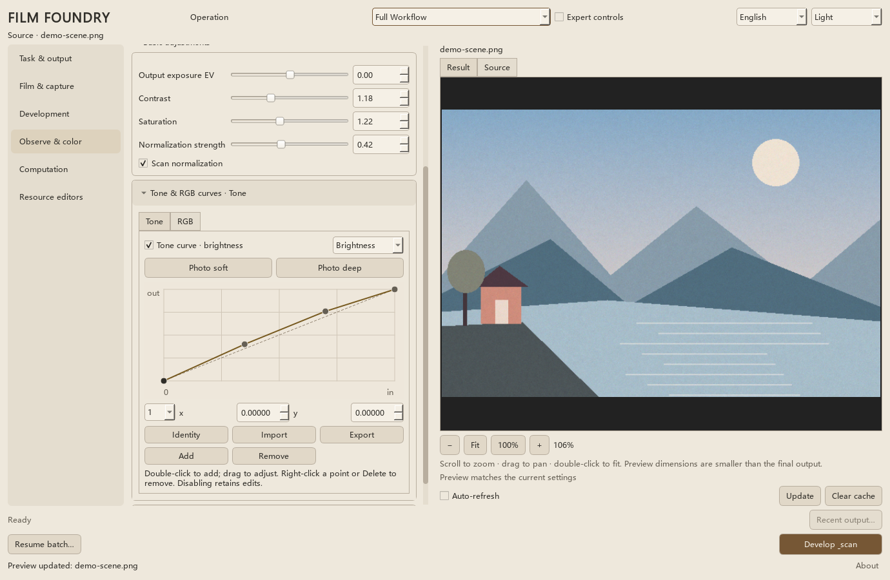

# 桌面使用指南

从安装、第一次处理到材料／药浴／扫描预设、命令行与材料母带，都在本页。字段含义和形成原理集中在[技术参考](REFERENCE.md)，效果与具体配方见[效果展示](SHOWCASE.md)。

本页主要操作已跟进 **2026-11-18 开发中源码**；旧 0.4.0 安装包界面不同。新增范围和当前限制见[源码快照](DEVELOPMENT_SNAPSHOT.md)，本次没有新 EXE／APK。

## 目录

- [安装与启动](#start)
- [工作台、任务、预览与保存配置](#workbench)
- [选择性分享与预设管理](#preset-sharing)
- [材料、冲洗与扫描的预设目录](#presets)
- [预设分工与风格选择](#preset-details)
- [扫描影调参考](#scan-tones)
- [尺寸、质量与输出文件](#output)
- [命令行与独立编辑器](#cli)
- [视频逐帧与材料母带](#video)

<a id="start"></a>

## 安装与启动

当前开发源码建议 Python 3.11 或更新版本，使用根目录依赖安装新增 DNG／Ultra HDR 解码支持：

```bash
pip install -r requirements.txt
python run_film_foundry_launcher.py
```

也可使用 conda：

```bash
conda env create -f environment.yml
conda activate film-foundry
python run_film_foundry_launcher.py
```

直接打开工作台：`python -m film_foundry.tools.run_desktop_gui`。

### Windows 便携版

在 Releases 下载便携包，解压后保留整个 FilmFoundry 文件夹运行。Alpha 包未签名，Windows 可能提示未知发布者。

<a id="workbench"></a>

## 工作台与日常操作

从图库添加图片或索引文件夹，选中一张或多张，再选择材料创建工作。双击图片进入只读浏览，可评分、收藏并查看关联材料；开始处理使用图库中的创建工作操作。完整工作区与配置编辑器在同一窗口中切换，小配置使用弹窗，切换保留草稿。

第一次打开图库可点 **开始导览**。内置照片依次演示选图、曝光、冲洗、扫描和保存。在示例中可调曝光补偿、冲洗时间及成片曝光，小样会在数值确认后自动更新，也可点 **更新示例** 立即查看。完成或跳过后，仍可从 **工具 → 第一次暗房工作…** 重开。最后一页的 **用示例照片新建工作** 会把照片带到普通胶片工作台，另行使用工作台配方。

图库空白时提供 **导入照片…／打开底片或潜影…／整卷暗房…** 三个入口。可将本地图片、材料 NPZ 或结果记录拖入图库，沿用原导入规则登记来源；不搬动文件、不自动执行工序。拖入文件夹会将其加入来源文件夹，在后台递归索引图片；连续添加会排队更新。工作目录包 `.fffilm`／`.ffworkspace` 仍从“打开已有工作…”进入。

图库默认显示分类与搜索两排控件，详细类型、材料族、来源和评级条件收在 **筛选** 中；折叠后仍生效，并显示“已启用”。选中项目后才显示浏览、移除等操作；无匹配结果时可直接清除筛选。移除仍只改索引，原文件保留。

右上角 **? 本页指南** 或默认 **F1** 打开当前工作页的指南。胶片页按当前曝光、冲洗或扫描任务解释冻结与下一步；图库解释来源关系；七类实验材料给出工序顺序、可尝试的操作和保存方式。材料独立窗口也有同名入口。指南中的按钮只跳转参数或工艺记录，不执行处理，不改动草稿。

指南顶部的只读工作快照显示当前来源和可调阶段。胶片快照使用本次实际输出配置显示尺寸上限与质量，并说明当前屏幕预览状态；已生成的快速草稿显示其真实像素尺寸，正式执行按输出设置重算。实验材料显示已记录的阶段与累计时间，撕拉等材料另有当前可执行步骤说明。

点击 **选材料，创建工作…** 后，在选材窗口先选材料族，再选具体胶片或材料类型；右侧显示该选择的流程、产物和观看方式。胶片支持名称搜索、色彩／正负片／来源筛选，创建时自动配套推荐冲洗与扫描。其他七族保持“实验中”：撕拉与拍立得可选彩色／黑白，相纸和湿版按真实类型选择，也可载入该族保存的材料定义 JSON。多选图片共用本次起始配置，取消选材不更改当前工作。

胶片的材料页现在以 **当前材料 → 更换…** 打开同一个选择窗；色彩、正负片和来源筛选集中在窗内。画幅与材料编辑器保留在工作页。已有潜影或底片冻结的材料仍不能更换。

材料选择窗与冲洗／扫描的 **选择** 窗提供缩略预览，默认在网格中对照同一张**示例照片**。也可选**合成色卡**，或改用**来源照片**（多张时用第一张）。标注“参考流程示意”：材料使用该族标准工序与推荐观看，冲洗／扫描预设与打开窗口时的其他参数组按预设合同组合。固定比较种子、长边 240 px，只缩图；不采用当前工作的全部额外设置，也不代表原尺寸颗粒。七族保留原有正负和观看方式，不为缩略图自动反相。

示例照片随附公开内置材料及默认搭配的参考缩略图，配方和版本匹配即可直接显示。其他组合在后台串行计算选中项与可见项，每个窗口最多保留 24 张缩略图；切换来源会丢弃旧结果，关闭后停止后续项并释放计算缓存。浏览、筛选和取消都不改配方；只有“使用此材料／使用所选预设”才沿原规则采用，不采用试算介质、不启动正式输出。

选材、冲洗／扫描预设及图库小缩略图会缓存到磁盘，重开程序也可复用。缓存按来源文件修订、实际参考配方、尺寸和计算版本区分，不读取整张照片计算哈希。PNG 与索引内容最多 128 MiB、2048 项，按最近使用淘汰（数据库另有少量管理开销）。**全局设置 → 缓存与软件信息 → 清理磁盘缩略图**可清空；清理前已开始的任务不会重新填入旧缓存。原图、介质、手动工作区和“上一次工作”均不受影响；保险槽仍只保存参数与来源引用。

选择窗可切换**全部／收藏／最近选用**，与搜索和其他筛选共同生效；星标只收藏所选材料或预设。最近记录仅在确认选用后更新，最多 40 项，收藏最多 512 项；按材料族／预设组与稳定标识保存，不依赖显示语言。材料 JSON 收藏保留文件引用，重开时读取最新定义；文件移动或丢失后不显示。没有独立文件的“当前自定义材料”不提供收藏。浏览或取消不会推进最近记录，也不改变工作配方。

胶片工作页及七族数值框把已有时间、温度、角度、曝光、浓度等单位移到输入框末尾，例如 `12.50 min`、`21.00 °C`、`1.25 ×`。这只改变显示位置，范围、数值、滑杆和保存格式不变。

相纸、蓝晒与铂钯通常承接负片曝光；直接使用正像照片时不会偷偷反相。需要正像相纸可选择“直接正像相纸”，或在结果堆叠中从已有底片选择光学印相。七族工作页顶部始终显示当前材料；开始形成前可再次选择，开始后材料冻结，保存状态／介质与导出图像仍是独立操作。

### 先确定要做什么

| 本次任务 | 来源 | 保存结果 |
| --- | --- | --- |
| 完整流程 / Full | 图片或图片文件夹 | 冲洗介质与扫描成片 |
| 只冲洗 / Develop | 图片或图片文件夹 | 可重复观察、扫描的介质 |
| 只扫描 / Scan | 常见图像、冲洗介质或 scanner raw | 新的扫描成片 |
| 只曝光 / Expose | 图片或图片文件夹 | 未冲洗潜影 |
| 冲洗潜影 / Develop latent | 已保存潜影 | 冲洗介质 |

来源由图库或打开的工作确定，不需要在正式工作页重复填写路径。已有潜影或介质只显示适用的工序。点击执行后选择输出位置，默认在工作区的 `outputs/日期/` 下建立本次目录；取消选择不会启动处理。导出窗口同时显示处理质量、尺寸与基础配置。

正式冲洗和预览都保留原潜影，可更换药浴反复冲洗、分别保存结果。扫描只观察已经形成的介质，调色不会修改冲洗结果。旧版已标记“消耗”的潜影仍不能重新冲洗，需要保留的未消耗原档。

已有底片进入 **底片 · 扫描** 工作区，只显示扫描与成片输出；形成质量、材料和药浴不在这里修改。**形成记录**读取来源实际保存的材料、曝光和冲洗配置，缺失记录不会用当前参数补填。**关联结果**可查看同一来源的底片和各次扫描。

当前源码的顶部阶段条按 **曝光与潜影 → 化学冲洗 → 观察与扫描 → 保存与导出** 显示状态：参与新形成的阶段标为“可调”，从潜影或底片继承的阶段标为“已冻结”，扫描标为“仅观察”，本次未执行的阶段标为“跳过”。点击卡片主体进入参数页；冻结节点可查看原因、形成记录，或从可用的关联潜影另做冲洗。普通图像直接扫描时，上游显示“跳过”，不会虚构冲洗记录。

照片工作在前三张卡片右侧点击 **设为终点** 选择执行终点，当前终点显示为 **当前终点**。点击卡片主体只切换查看页面；点击终点只改变任务，底部主按钮才执行并保存。扫描终点旁的下拉菜单还提供“跳过形成，仅扫描原图”。已有潜影和底片保持各自冻结范围，不能从终点按钮重新启用上游；整卷沿用专用胶卷流程和原任务选择行。

阶段副标题显示当前材料、冲洗和扫描的预设来源。“基于”表示参数以该预设为起点，不保证手动修改后仍与预设相同；按药浴模式显示当前药浴与操作条件。冻结阶段使用来源记录中的材料／冲洗名称，缺记录时不拿当前预设冒充。文字较长时可悬停查看完整摘要。

要尝试另一种冲洗，使用 **从潜影另做冲洗**：沿已记录的原潜影建立工作，优先使用原冲洗配方，保留本机的计算和输出设置；来源未保存完整配方时沿用当前工作配置。执行后新底片另存，已有底片与扫描保留。缺少原潜影时此入口不可用，不从成片反推曝光，也不猜测邻近文件。冲洗结束后任务来源仍是原潜影，可从关联结果选中新底片进入扫描。

For a saved film medium, the scan task exposes only observation and image output. **Formation record** shows saved source facts; missing values are not filled from current controls. **Related results** groups film and scans. **Develop again from latent** follows an explicitly recorded, available original latent and saves another medium. Existing media and scans remain intact; missing exposure data is never reconstructed from the final image.

在图库或关联结果中选中已有胶片扫描成片，可用 **按此版本调整扫描** 回到原底片，恢复该版本保存的灯台、影调、曲线、色彩、旋转、输出尺寸和编码设置；计算资源仍使用本机设置。预设栏显示“已保存的扫描设置”，选择新预设后可继续调整。执行后另存新成片，原底片与旧成片保留。此功能需要对应的扫描 JSON 参数记录及原介质 NPZ；缺失时入口禁用并说明原因，不猜测同名底片。**作为图像处理／创建工作** 仍可将成片作为新图像使用；图库双击浏览保持只读。

保存工作也记录当前控制页、预览对比方式和扫描版本来源。重新打开会话时恢复这些位置，并重新开始该工作的参数撤回历史。单纯切换控制页或对比方式不会触发未保存参数提示；替换已有编辑仍沿用全局的保存／不保存／询问策略。这不是自动恢复或跨重启撤回。

**Adjust this scan version** in the library or related results reopens the recorded film medium with that scan’s saved observation, color, rotation, size and encoding settings. Local execution settings remain local. The preset field identifies a saved scan recipe; selecting a preset replaces it normally. Execution creates another scan and preserves prior files. Both the scan JSON record and source NPZ are required; missing sources are never guessed. Processing the finished image as a new photograph remains a separate action, and double-click browsing stays read-only. Saved sessions also restore the control page, comparison view and scan-version reference, with a fresh undo history for the reopened work.

普通照片执行后可从 **关联结果** 找到本次潜影或底片。在潜影工作页点击 **分段冲洗**，直接沿用当前潜影与冲洗配方，选择存档位置后建立独立工作页；原照片／潜影工作保留。分段执行使用存档内冻结的配方，不受其他工作页随后改动影响。**执行至此并保存** 会依次推进到所选反应步骤结束；一浴可能包含多个反应步骤。只允许修改尚未开始且未锁定的药浴，使用小配置窗口另存分支；取消保存位置会保留该窗口中的修改。

中途存档会进入图库堆叠与最近工作，也可从图库的“打开已有工作 → 冲洗存档”重新打开。不同存档保留各自工作页。完成冲洗后所有步骤显示已执行，主要操作变为 **扫描此底片**；**返回最后存档** 可另做分支，已经保存的底片保留。完成状态不回写原存档的进度。新的分段结果记录原潜影路径；旧档未记录或原潜影已丢失时，不猜测来源，已有完整冲洗存档仍可独立继续。

**Develop in stages** starts a separate checkpoint from the current latent and recipe while preserving the original workspace. Each checkpoint owns its frozen conditions; changes in other work do not alter it. Run through a selected reaction boundary, or edit an eligible future bath in a small dialog and save a branch. Checkpoints appear in the library and recent work, with separate pages for different files. After finalization, **Scan this medium** becomes the main action. **Return to last checkpoint** opens the earlier saved state for another branch while retaining the finished medium. Missing historical source references are not guessed.

### 页面与常用操作

- **胶卷与拍摄**：选择负片或反转材料，按彩色／黑白、内置／自己保存筛选；设置画幅、曝光、保存退化、机身漏光、片门脏物及曝光打印。已保存来源的形成设置会沿用原值。
- **冲洗**：选择程序，调整时间、温度、浓度、摇晃与事故强度；更细的药水组合与材料反应在独立工艺编辑器中配置。
- **观察与调色**：选择扫描／解释预设，调整成片与影调、RGB曲线。双击曲线加点，拖动调整，右键或 Delete 删除内部点。
- **计算设置**：正式处理的尺寸、降阶、质量与随机设置。缩放、降阶和质量可以独立组合。
- **材料与预设**：统一管理材料、药水、流程、扫描；完整编辑器可打开工作副本，显式应用或保存。片边与齿孔和画面打印分开配置，前者在片基边沿，后者参与画面内曝光。
- 边字在“片边与齿孔 → 边字与曝光”分别设置曝光颜色与亮度；画面打印在“颜色、亮度与位置”设置自己的光源颜色和 ±4 EV 亮度，也可继续使用所选光源的默认颜色。这些是曝光设置，最终字色与明暗还会受材料、冲洗和扫描影响；黑白材料仍为黑白，已形成的底片不会由扫描重新改字色。

常用参数优先展开：材料页先选材料、画幅和曝光；冲洗页先选程序、时间、温度、浓度和搅拌；扫描页先选风格，再调曝光、对比度和饱和度。材料、药浴步骤与完整扫描设置也可从各自页面直接打开。单侧适合小屏；双侧把材料／冲洗放左侧、扫描放右侧，按所选工序显示控制。

默认布局为控件保留更多横向空间，单侧约占四成。拖动图像与控件之间的分隔条可以调整宽度；胶片直方图下沿、材料预览下沿也能拖动调整高度。材料的观看条件位于控件侧下方，可单独拖动高度；参数与观看区各自滚动。**保存状态／介质与导出图像始终固定在预览面板底部**，宽窗口排成一行，窄窗口分成两行。文件操作与处理设置、预览工具栏也按可用宽度合并或换行。

窗口变大时，新增空间优先交给预览；较短窗口的长直方图会适当缩小，完整保留曲线和横轴。材料预览工具栏固定在图像下方，直方图直接随分隔条伸缩，不会藏进滚动区；工艺记录仍可在表格内滚动。侧栏紧凑直方图可留出更多画布空间。工作台和各材料窗会自动记忆窗口大小、位置、最大化状态及分栏比例，包括材料观看区高度；单侧、双侧和胶片双侧扫描布局分别保存。手动拖动的分配优先保留。**全局设置 → 外观与布局 → 重置窗口与面板布局**立即恢复默认尺寸和比例，保留所选单侧／双侧模式、参数和当前工作。

点击带箭头的分组标题展开或收起事故、曲线、灯台解释和附属输出。折叠只收起控件，不会关闭选项或清空参数；部分标题提示当前选项或曲线。冲洗页的“常用”精简控制，“按效果”与“按药浴”保留各自草稿。扫描页的“显示进阶参数”独立控制观察细调与设备响应曲线的显隐，不改变冲洗模式或参数，也不会触发预览重算；此显示偏好会自动记忆。影调／RGB 曲线始终可用。切换界面语言保留分组展开状态、分栏宽度和当前页滚动位置。

分组标题同时提示重算范围：**重新曝光**从照片重算至所选终点；**重新冲洗**按新条件形成底片。照片工作保留原曝光和冲洗的随机顺序，已保存潜影则从冻结的曝光状态继续。**仅观察**不会修改材料，完整照片预览可复用匹配的已形成介质，但首次预览、清缓存或同时改变形成参数时仍需先形成。正式执行始终依任务终点和输出设置运行；这些提示不承诺预览耗时。悬停标题或标识可查看细节。材料页的**储存与老化**指材料经历的存放与老化条件，不是文件保存。

2026-11-17 源码界面：顶部四段阶段条是胶片工作的阶段导航，旧侧边列表、参数页切换下拉框和双侧材料／冲洗页签头已收起。**工作设置**保留计算与尺寸、档案与资源、本次来源列表及展开／收起参数。整卷工作沿用独立流程，没有单片阶段条，其扫描／输出选择保留。**常用／按效果／按药浴**只在冲洗页显示；材料页直接展示材料与曝光参数。F8 在冲洗页切换常用与上次的详细模式，在扫描页切换进阶参数；在其他工作页不改变冲洗模式。冻结或本次不执行的冲洗阶段不能从该面板更改模式；切换不清空已有草稿。形成记录与原潜影重冲从冻结阶段节点进入。此更新尚未包含在旧安装包中。

顶部 **工作** 菜单负责页面导航，七类材料集中在“实验材料”子菜单。**文件**区分胶片工作与实验材料工作区的保存、另存及打开；两类档案仍使用各自原有格式。**材料与预设**集中管理完整配置编辑器与配方分享，参数页保留就近的编辑入口；预览栏的**正式质量**设置正式任务的质量等级，底部形成按钮选择正式任务的完整或降阶算法。灯台和视频入口位于**工具**。

**全局设置 → 外观与布局**提供主题和语言，图库或材料工作页也可直接打开。外观即时应用并保存，点击“关闭”不会撤销；工作区与新工作默认值仍需明确保存。语言切换更新主工作台，已打开的材料页、编辑器及设置窗口保留当前文字，重开后使用新语言。存在尚未返回的内嵌编辑页时，先应用或返回，再切换语言。

同页支持**导出翻译模板／导入语言包**：在 JSON 中填写语言代码、名称和译文，导入后从语言列表选择即可应用；缺译回退中文或英文。更新正在使用的语言包后重新打开程序。模板覆盖内置词条与静态双语文本，部分旧动态消息、底层错误和系统对话框仍沿用内置语言。具体格式、占位符规则和扩展方法见 [桌面翻译指南](TRANSLATING.md)。

实验材料在已载入来源、尚未开始形成时，画布显示带 **来源预览 · 尚未曝光** 标识的来源图；这不会曝光或形成介质。材料工序始终排成一行。点击步骤后，该项展开并高亮；空间充足时其余步骤显示完整名称，空间紧时逐项收为编号。悬停任一步骤可读到完整名称和状态，按 Tab 和空格也能切换。步骤下方的强调线标出正在查看的参数页，**● 可执行** 表示材料当前允许的操作；提前查看后续步骤会显示前置工序说明。双侧布局只剩一个材料页时隐藏多余页签头，单侧页签内省去重复标题。

实验材料的数值输入旁有单项复位按钮：材料数值回到最近选择／载入的材料定义基准，处理数值回到该控件的初始基准。开始形成后的材料参数仍锁定。观看曝光、倾角、光源倾角与背景亮度在适用材料中提供滑杆与精确数值；双击滑杆或点复位恢复观看基准。拖动期间按节流刷新，正在观察时保留最新一次调整，始终只读材料。

相纸、蓝晒和铂钯工作室载入普通图像时，会提示负感印相的明暗反转关系；直接正像相纸不显示该提示。提示不会反转输入或改变材料参数。若希望走接触印相流程，可先形成底片，再从「光学来源」载入。

撕拉片、即显片和银版工作室新增 **按当前参数执行标准步骤**，只在载入来源且尚未开始形成时可用。撕拉片按曝光、铺药、推进时间、撕开执行；即显片按曝光、出片、铺药、推进时间和中和执行，已稳定时跳过重复中和；银版按备版、抛光、感光化、曝光、显影、定影执行。每步读取当前设置，标准步骤不自动清理负片、镀金或施加可选事故，也不保证不足的药剂或处理时间能完成反应。

编号阶段条显示主干与当前可执行步骤；**可选干预**集中后续环境、污染、清理、负片整理、镀金和表面操作，只开放当前材料允许的项。选择项目只进入参数页，点击执行才改变材料。撕拉片接触中显示实际推进秒数并提醒撕开会停止转移；即显片中和不足仍显示反应中，可继续操作或显式保留当前成片；银版浴液未完成可继续本浴。相纸、湿版、蓝晒和铂钯沿用各自已有的标准流程入口。以上界面更新尚未进入旧安装包。

预设旁的“浏览…”可搜索当前列表，完整显示名称；点击“使用所选预设”或双击条目才应用，取消不改变当前配方。材料筛选与选择位于同一组；预设管理页另有类型、来源和名称检索。

日常目录为12种材料、10种扫描／解释预设；“显示更多风格变体”展开兼容和额外变体，当前已选项与自定义项会保留。详见[预设选择](DESKTOP_GUIDE.md#presets)。

### 常用参数、扫描取景与局部印相

- **钉选参数**。在胶片工作台的「工具」或材料页的「快速配置」打开「钉选参数…」。按参数名或字段路径搜索，选中后点「钉选 / 取消钉选」。钉选后可直接在工作台「常用」里调整。有对应工作台控件的参数沿用该控件的单位、滑杆、复位及冻结规则。钉选名单按材料族保存，数值属于当前工作。已冻结的阶段可查看。
- **扫描片基与滴管**。启用「去片基」后，软件自动读取已形成材料的片基参考。带材料记录的扫描 RAW 使用该文件采集时的片基参考。外部扫描缺少记录时，可用文件片边或从画面估计。要自行校准，在「观察方式 → 片基 / 滴管…」点「滴管取样」，再点采集预览中想作为白参考的位置。可选 1×1、3×3、5×5 或 9×9 的预览像素邻域，默认 3×3。工具显示重新校准前后的成片色块，保存邻域的线性 RGB 中位数，预览与正式扫描共用。手动参考会随胶片工作保存。「恢复自动参考」可切回材料片基。旧工作曾保存的取样框会继续生效，直至更换参考。
- **裁切与拉直**。在「观察方式 → 裁切与拉直…」可选自由比例或固定宽高比，拖框内部移动、拖角点缩放。滚轮放大、中键平移，参考网格可开关。调节 ±45° 拉直角度或沿边画线后自动内接裁切，也可继续手动调整取景。取景只作用于扫描成片，原片和检查器的采集级保留全幅。
- **批量逐片曝光**。在「工作设置 → 本次来源 / 逐片曝光…」通过缩略图选中一张照片，输入相对共用曝光的 EV 偏移。多张照片可先按来源亮度建议 EV，再逐张微调。共用 +0.5 EV、单片 −1 EV 时，该片按 −0.5 EV 曝光。确认后以所选照片预览，试条使用同一偏移。正式批次、续跑记录和可移动的胶片工作包都保留各片的设置。
- **印相遮挡与加光**。把已形成的介质作为相纸或其他材料的光学来源，在「载入曝光来源」前打开「遮挡 / 加光…」。在接收面点选或拖动区域，可设椭圆、矩形或渐变，调整旋转和羽化。EV 旁显示等效曝光时间倍数。多个区域重叠时 EV 相加，例如两处各 +0.5 EV 的中心重叠部分获得两倍剂量。相纸页可点「纸面预估」，用当前纸张、工艺、种子和观看设置形成最长 240 px 的独立小样。来源面板提供可变反差滤镜 00–5 号的近似 RGB 密度换算。材料工作区可保存待载入的区域和已载入的曝光。

### 预览与正式输出

默认自动刷新；关掉后用图像下方的“更新预览”手动更新。拖动胶片滑块时自动预览先生成最长 320 px 的草稿，松开后更新到设定长边（默认 900 px）。**全局设置 → 预览与恢复**可选 480–1600 px 长边和 100–800 ms 等待时间。新编辑会取消在途的旧精细预览，计算在工序或分块边界停止。排队时，交互预览先于试条，试条先于缩略图。

预览下方会标明正在更新、与当前参数一致、参数已修改或更新失败。修改后尚未更新的画面会保留，方便比较；失败时也不会把旧画面误标成最新结果。

预览中滚轮缩放、拖动平移、双击适合窗口；右键可选黑、中灰、白、纸白观看底色。正式质量在底部执行栏，预览工具栏集中缩放、撤回与对比，宽度不足时自动换行。工具栏也有缩小、适合窗口、100%和放大。100%表示预览图的实际像素，同尺寸刷新保留当前放大状态。显示倍率不改变处理尺寸；在工作台检查正式像素可用 **工具 → 局部正式尺度预览…**；检查有损编码与抖动则打开导出的文件。

预览栏的 **对比：单图／并列／切分（拖线）** 可切换仅结果、原图与结果并列或拖动界线对比；单图时按住鼠标显示原图，松开回到结果。旋转与对比不重算形成。曲线编辑器的背景是当前成片分布，不是曲线之前单独测得的分布。

直方图有 **侧栏 · 紧凑** 和 **预览下方 · 长图** 两种布局，适用于胶片与实验材料。右键直方图，或打开 **全局设置 → 直方图**，可以选择曲线／柱状、线性／对数纵轴，以及**镂空、半透明填充、实色填充**，并自由叠加 **R、G、B、L（显示亮度）**。实色模式使用不透明的 RGB 色块，重叠区呈黄／青／品红／白色；L 为下层灰色亮度图。实色图内使用深色底，浅色主题下也能分辨白色重叠区。新设置默认实色，旧填充偏好保留半透明，旧镂空偏好保持。选项即时应用、自动保存，并同步到打开的工作页；关闭全局设置不会撤销这些即时选项。已有工作档中的旧直方图显示值不会覆盖全局偏好。两种布局的可拖动高度分别记忆。

全局设置底部的 **保存工作区与默认值并关闭** 提交工作区、图库来源和新工作默认值；**关闭** 不提交这些页面尚未保存的修改。直方图选项和布局重置即时生效，与这两个按钮无关。

左上／右上的小三角显示 RGB 通道在当前预览中达到 **0／255** 的情况，颜色表示达到端点的通道。点击三角或勾选菜单中的提示开关，可以显示蓝色阴影、红色高光标记；同一像素两端都有通道裁切时优先显示红色。它们是显示端裁切提示，**不表示 RAW 曝光余量或材料是否正确曝光**。标记只在独立显示层绘制，不进入统计、保存或导出。并列／切分对比时只标记结果区，按住查看原图时跟随原图。材料直方图的大图统计仍均匀抽样至约100万像素，裁切指示检查全部预览像素。

**工具 → 清理胶片预览缓存**释放胶片预览的来源、形成和探针缓存。当前批次中断且留有运行清单时，执行栏出现**恢复批次…**。较早的清单可从文件菜单打开。任务运行中的主按钮用于取消，取消后不会启动后续帧。

### 密度与曝光落点

在胶片工作页打开 **工具 → 密度与曝光落点**，将指针移到结果图。窗口显示当前像素的坐标、显示 RGB8 和可读取的 RGB 光学密度 D。照片在本次预览中形成时，还显示各材料层的相对曝光量 log₁₀ H，并把该点标在材料曲线上。光学密度与落点可读 1×1、5×5 或 15×15 均值，RGB8 为中心显示像素。Shift＋单击可钉住最多四个位置，调参后随预览刷新。横轴左端 ≤−6 包含低于量程的落点。曲线纵轴是可显影比例，各层直方图按本层峰值归一。已有底片可读保存的光学密度；曝光分布需要照片的形成记录。

「特性曲线…」用当前胶片配方实际冲洗中性灰阶，显示 RGB 光学密度相对于输入曝光的曲线。片基加灰雾取零曝光格，正像材料单列零曝光密度。趾肩按本次密度变化的 10% 和 90% 估计，平均反差取中间 20%–80% 区间。七类材料页在「观看工具 → 材料密度探针」选择孔径，可在最终片体上读反射或透射密度，用 Shift＋单击可固定最多四个读数，图上的编号与读数栏一一对应。特性曲线窗口可保持打开，在工作台调整药浴后点 **刷新曲线** 即可重新测量。

### 预览历史与工作快捷键

胶片预览操作栏、七类材料图像工具栏的 **历史…**（默认 Ctrl+H）打开最近成功预览的缩略图。左侧是选中记录，右侧是最近一次成功预览，可切分、并列或按住对照。右侧并不代表尚未计算的当前参数。点缩略图只换对照；**恢复选中参数**才修改工作，可撤回，不自动保存成片。失败或已过期的计算结果不会加入记录。

胶片历史可恢复该次预览对应的参数；更换工作、来源或执行终点会清空历史，来源文件被改写后须重新预览。材料历史只在同一材料状态下恢复参数；工序推进或材料替换后，旧图可供对照，但不能用参数恢复冒充物理状态倒退。需要回到工序时使用材料撤回或已有材料存档。这里的预览历史与“工艺记录”用途不同，整卷作弊窗口也不提供此功能。

缩略图标出相对上一条记录的首个参数变化，悬停可看改前、改后的完整差异。用**钉住 / 取消参照**保留一个固定对照。每页默认另保留 6 条普通记录，全部页面共享 32 MiB，图片长边上限 900 px。在**全局设置 → 预览与恢复**可改为 3／6／12／24 条和 16／32／64／128 MiB。内存紧张时先淘汰未钉住的记录。历史只在本次运行内保留，不存中间介质、不写入手动工作档或“上一次工作”自动保险。关闭材料页、清空历史或在全局设置释放缓存时会释放相应记录；缩略图和对照显示仍是屏幕草稿，不能用于判断正式尺寸的颗粒细节。

**全局设置 → 快捷键**提供说明与自定义配置；**工具 → 工作快捷键…**直接打开同一页。每项可设置主键、备用键，清空即停用；录入后点击**应用快捷键**，立即生效并保存，重新启动仍保留。重复绑定会提示冲突，保留原来的配置；可一次编辑多个键位交换后统一应用。**恢复默认快捷键**立即重置。底部“保存工作区与默认值并关闭”只处理工作区和新工作默认值，快捷键编辑应先在本页应用。

胶片与七类材料页默认**按住空格显示原图，松开恢复预览**，切分和并列模式也可临时查看原图，释放后恢复原比较方式；不重新计算、不更改参数、保存或导出。失焦、切页或改键会解除按住状态。没有可对照来源时不伪造原图。焦点在按钮或复选框时，空格操作该控件。输入框中的空格、文字撤回／重做及常用文字操作仍由编辑器处理；配置或作弊弹窗不会触发背后的工作。下表是默认值，按钮悬停提示跟随当前键位。

| 快捷键 | 操作 |
| --- | --- |
| Ctrl+Z | 撤回 |
| Ctrl+Y / Ctrl+Shift+Z | 重做 |
| Ctrl+S | 保存当前工作；独立材料窗口保存材料状态 |
| F5 | 更新预览 |
| Ctrl+\ | 切换单图／并列／切分对比 |
| Ctrl+H | 打开预览历史 |
| 按住 Shift+空格 | 显示上一次预览 |
| Alt+←／→ | 切换胶片阶段 |
| Ctrl+回车 | 正式执行 |
| Ctrl+T | 打开试条 |
| Ctrl+0／Ctrl+1 | 适合窗口／100% |
| 按住 Space | 看原图，松开回预览 |
| F1 | 本页指南，主窗口各页面可用 |
| F8 | 当前胶片冲洗／扫描页的进阶参数 |

每个键位使用一个按键组合，可加 Ctrl／Alt／Shift 等修饰键；不使用连续多段快捷键。无修饰的 Tab、Esc 和回车保留给焦点、关闭与确认。新工作快捷操作统一从同一功能表扩展，配置、冲突检查、匹配和默认值保持一致；原生控件的文字编辑与图库浏览方向键沿用控件行为。

### 试条／包围

试条固定来源与随机身份，可对照一个数值的变化，或同时比较曝光和第二个参数。缩图试条适合先比较曝光、色调和工艺条件；颗粒、细纹理、光晕与其他空间效应仍需原尺寸确认，缩图与正式输出不保证这些细节一致。

胶片工作台的预览操作栏提供 **试条…**。单轴可选等距、等比（正数端点）或自定 2–9 个值。照片的冲洗或全流程终点可选**二维试条**，列为曝光 EV，行可选冲洗时间、药液温度、浓度、底片反差或成片对比度，按当前终点提供可用参数，最多 25 格。当前参照与某格配方相同就共用一次计算。长边可选 480／640／900 px。默认使用正式处理设置，也可勾选**使用主预览草稿算法**。选择**全部并排 / 局部…**可在格内选中或采用，也可同步缩放、平移，或在任一格框选相同位置。局部框先放大现有试条。点 **局部正式尺度…** 会带入同一选区，可切换试条并逐格计算正式尺寸的局部。

**检查颗粒与光晕**。胶片工作台从 **工具 → 局部正式尺度预览…** 打开定位图，框选后点 **计算所选区域**。选区按当前正式尺寸、处理算法和本次种子计算，小选区首次打开会放大到适合窗口，超出视口的选区以 100% 打开。工具栏显示实际倍率，可切换 **适合窗口** 或 **100%**。同一倍率下，裁小选区仍保留原颗粒大小；放大画面时，颗粒与细节一起放大。100% 对应一个成片像素占一个屏幕物理像素。状态行标出选区与整幅尺寸及选区左上角。正式执行启用限制尺寸时，这里也按限制后的尺寸处理。为了保留邻域效应和全幅扫描统计，每次首次计算一个配方都要处理整幅。窗口可复用一张不超过 32 MiB 的结果供重选位置，较大图像重选时重新计算。采用随机种子策略重新启动正式工作时，颗粒位置可能变化。

点缩略图可放大，支持参照／选中试条切分和并列对比；单图时按住查看参照。普通参数参照使用打开时的配方；单浴参照与各条共用同一独立药液定义，以分清数值变化与启用单浴覆盖的效果。**采用选中参数**才更新工作配方，可用工作台的撤回恢复。生成或关闭窗口不保存成片、不修改当前配方；正式处理仍使用原来的输出设置和随机策略。比较专用的固定随机身份不会随采用写入配方。

可选轴包括当前已定义的材料、曝光、冲洗、观察数值及向量分量，也包括各浴时间、温度、浓度与搅拌条件；尚未启用的可选数据需先在对应编辑器中定义。冻结或本次跳过的阶段不开放，随机种子、步骤编号等身份／结构字段不作参数轴。已有潜影仅试冲洗，已有底片仅试观察。单浴试条保留步骤顺序；原生药浴沿用现有“单浴条件”的独立药液定义，采用时一并保留。关闭的功能、被单浴覆盖的公共条件，或当前处理模式未使用的参数可能没有可见差异；非法参数或组合按现有数据合同和运行时校验报错，不自动改值。

停止或关闭会等待当前一条计算完成，再取消余下条目；已完成的条目可在停止后采用。若来源或工作已被改变，须重新打开生成。批量工作只比较第一张来源，采用后更新整批共用配方，窗口会明确提示；这不等于逐张曝光补偿。

七类实验材料的图像工具栏也提供 **试条…**。新材料以同一来源与种子，使用当前标准步骤及参数试算；材料开始形成后，材料定义保持冻结，只开放当前选中且可执行工序的有效数值，以及观看数值。工序试条只执行这一操作，不自动完成后续定影、撕开或干燥；观看试条只观察当前材料。参数列表取自当前控件，关闭或不参与这次步骤的设置不列出。先在主页面切换工序，再打开试条。

新材料按选择的长边上限缩图形成；已有材料保持原形成尺寸计算，只缩小显示，因此可能比新片试条慢。试算使用独立会话，不推进真实材料、不保存结果。**采用选中参数**只回填设置，可通过材料页撤回／重做；需要执行仍须点击正式工序按钮。批量页只比较当前来源，采用影响整批共用设置。

材料页 **快速配置 → 局部正式尺度预览…** 使用已载入的工作尺寸。尚未开始的材料按当前标准步骤在副本上形成；已有片体直接观察当前工序和选中的片体。试条的正式尺度入口会采用所选试条的工序和观看设置。

材料试条只改观看设置时，同一次生成会复用一份已形成的试算材料；材料、种子或工序设置改变就重新形成。最多缓存一份形成结果，生成结束、失败或取消时释放，不跨窗口保存。新片标准步骤试算可在当前工序完成后停止，已有材料的一步计算仍等该步完成；取消不会把试算中间态带回真实材料。

材料页连续拖动观看滑杆会合并为最新请求，过期结果不会覆盖新设置下的画面，完全相同的已完成请求不重复计算。隐藏材料页会暂缓尚未开始的自动观察，重新显示时处理最新值；已经开始的计算和正式工序不因切页中断。

**从材料工序继续试做**。七类材料页的 **快速配置 → 工序检查点…** 列出已执行的步骤，包括重复操作。有完整工序记录和曝光图时，可选“载入来源后”或任一步后的位置，再点 **从所选位置新建分支**。早期位置用保存的种子、材料版本和步骤参数在原工作尺寸重演；当前位置直接沿用已有材料状态。分支在独立材料页打开，原页可同时对照。若旧材料缺曝光像素或完整工序记录，可从其当前状态分支。

**保存当前检查点…** 会将当前页的曝光图、现有材料字段及设置写入一个 `.ffworkspace` 工作目录。材料字段按完整精度保存。若要留存较早的一步，先从那一步开分支，再在分支页保存。之后用 **打开检查点…** 选择整个目录，可从该处继续操作。

折腾模式（整卷暗房）不提供包围试条。封卷且尚未开始冲洗时，打开 **冲洗配方… → 作弊预览…**，按编辑页当前未提交的药浴草稿，对第一格已曝光潜影作一次 640px 形成与扫描试算。弹窗显示格号；不预览空格，不代表整卷所有画面，也不保证正式尺寸的颗粒与随机细节。

作弊窗口以应用级模态阻止参数编辑和切换工作；窗口内没有调参、刷新、采用或导出。必须关闭预览后才能继续调参，关闭即丢弃图像；再次查看须重新计算。计算中关闭会等待当前计算结束。试算不提交配方、不冻结药水、不推进或写入胶卷；正式冲洗仍处理整卷。

### 任务进行中与收尾

先在图库或已打开工作中确定来源；点击执行后确认输出位置和导出选项。

任务运行中锁定任务类型、来源、保存位置和恢复入口；参数仍可调整，但用于下一次任务。底部显示当前处理阶段，进度条表示该阶段的进度，不能当作整批完成百分比。未提供比例的阶段显示活动进度条。

点击关闭窗口时，可以继续处理，或取消任务后退出。选择退出会等待任务响应取消并收尾，保留已完成的输出；窗口可能不会立即消失。完成或取消后，“最近结果…”打开本次实际结果目录，恢复批次也沿用原目录；目录被移动或删除时会提示。

滚动参数页时，未聚焦的滑条和数字框不会响应滚轮；先点击数值框或滑条后仍可滚轮调整。收起的选择框不响应滚轮，避免滚动页面时意外替换整套预设；可以点击展开选择，或聚焦后用方向键切换。

<a id="preset-sharing"></a>

### 保存工作、配置与预设分享

会话保存当前任务设置与路径；JSON／FFC2用于复用配置，其中FFC2不包含桌面的全部运行与导出设置。保存的预设仍可在独立编辑器中继续编辑。在 **全局设置 → 外观与布局** 可选黑橙、象牙白、灰蓝、浅灰，或选「自定义」分别指定工作区底色与强调色。界面根据各控件底色从黑字和白字中选择反差较大的一种。配色单独保存，下次启动沿用。

保存工作入口只在工作区有内容时显示；替换或关闭未保存工作会按全局设置询问或执行保存策略。胶片便携工作、电子胶卷、分阶段冲洗档和七族材料工作区用途不同：保存来源和配方不等于保存已执行到一半的药浴状态。

**文件 → 恢复上一次工作…**是独立的自动保险。系统每 5 秒检查一次有效参数，发生变化时在后台原子更新 `last_work.json`，正常退出前补写。默认保留一份，可在**全局设置 → 预览与恢复**改为 3 或 5 份；最新槽仍随有效修改更新，历史槽默认每隔 5 分钟轮转，可选 1、5、10 或 30 分钟。文件菜单的**较早的自动保险**可按保存时间恢复。手动保存工作不会关闭保险，启动空白工作台也不会清掉旧记录。保险文件位于桌面设置旁的 `desktop_recovery`；通过文件菜单可打开该目录。多个程序实例同时打开时，只有持有写入锁的窗口更新这个槽位。

保险保存胶片任务、来源引用与选片列表、完整配方和工作页设置，以及七类材料的参数、观看／扫描设置、批量来源。整卷药浴页中尚未提交的有效配方也会保留；分段冲洗记录引用已有检查点。**不保存原图、大数组、预览缓存、撤回历史或未落盘的中间介质**。恢复时重新读取来源、重算需要的预览，不自动冲洗、推进工序或导出。来源缺失时保留参数并提示重新选择；未保存的材料状态需要从来源重新执行，精确保留中间状态仍须手动保存材料工作区。制版工程及其他尚未应用的独立配置弹窗仍使用各自的手动存取。恢复不是跨重启撤回，也不保证随机运行重算出相同颗粒。

写入使用临时文件与原子替换，失败保留上一份完整记录；写队列最多保留正在写入和最新待写各一份。界面输入暂时无效时保留上一份有效参数。异常退出后，旧记录会冻结，图库提供**恢复**和**忽略**。直接退出会保留旧槽。若开始新工作，系统先把旧槽另存到**文件 → 未恢复的工作**，再为本次工作继续自动保存。该归档也适用于默认单槽。`desktop.log`记录主线程／工作线程异常与主要任务失败的堆栈，按大小轮转；支持的原生故障写入 `native-fault.log`。日志不采集图片或栈帧局部变量，不自动上传。强制结束进程、断电或严重内存不足可能来不及写日志；最多可恢复到最近一次成功写入的参数。

桌面源码新版的 **材料与预设 → 预设管理** 统一查看材料、药水、冲洗流程、扫描配置及曝光／片边预设；支持类型、来源和名称筛选、多选分享、编辑副本与移除用户预设。内置项只能编辑副本，不会覆盖原文件。管理页与完整编辑器位于同一窗口；药浴等小配置使用弹窗。

- **分享当前配置**：勾选要分享的类别。默认材料、流程、扫描；曝光与片边、独立药水可另外勾选。不会导出整个预设目录，也不包含原图、工作路径、质量档位、降阶或输出设置。
- **分享所选**：分享管理页中选定的预设，可以包含同类的多套配置。新版 FFC2 合集需要支持合集的客户端；“兼容旧版配方码”只允许每类一个配置，不包含独立药水库条目。旧 FFC2 配方码继续可读，并拆分为可勾选的类别。兼容编码不会使手机获得尚未实现的桌面工艺。
- **接收**：逐项决定“保留到我的预设”和“应用到当前工作”，两者互不等同。默认只保留，不自动替换当前工作。每类一次只能应用一项；同名保存自动追加编号。已有潜影或底片冻结的阶段只能保留预设供以后使用。
- **药水与流程**：流程内嵌所用药水、逐浴条件及操作，不依赖接收者的同名文件。取消保留某个独立药水条目不会从流程中删掉它。单独收到的药水在相应处理类型的“药液能力”中载入。分享自动工艺时会固定发送时的标准流程，接收者换用材料时不会悄悄变成另一套流程。
- **外部图像依赖**：FFC2 是参数码，不携带自定义漏光遮罩图像。引用外部遮罩的流程会明确拒绝生成分享码；可改用内置遮罩，或另行分享 JSON 和遮罩文件。其他类别仍可单独分享。

“导出配方”中的旧 JSON 出口仍是完整配置文件；FFC2 配方出口是当前配方的可分享参数集合。希望只分享一个预设时，请使用上面的选择式分享入口。

冲洗页可直接打开“编辑步骤与药浴”，以标准流程为起点或切为自定义步骤。逐浴检查器优先显示时间、温度、浓度和搅拌；搅拌时长、疲劳与入浴条件集中在一个折叠中。药水页保留滑条与精确数值输入，并提供恢复载入值的按钮。

启动器与工作台底部角落的“关于”显示桌面版本、作者与仓库链接。材料、工艺与扫描编辑器是 Film Foundry 的独立组件，共用当前任务的数据契约。

### English quick reference

Start in the gallery: select one or more images, choose a material and create work. Double-click opens a read-only browser. Existing latent and developed media expose only applicable stages. Choose the output location when executing. Reusable source archives remain separate from processing results; scanning never rewrites the medium.

**Choose material…** opens a selector for the family and concrete stock/type before creating work. It shows the selected process, products and viewing method. Film stocks support name, colour, polarity and origin filters, with recommended development and scanning paired at creation. The seven experimental families offer their existing categorical types and saved material-definition JSON files. A batch shares this starting configuration; cancelling selection leaves existing work intact. Material pages keep their current material visible and allow reselection until formation begins.

Ordinary photographic paper, cyanotype and platinum/palladium generally print from negative exposure sources. A positive photo is not silently inverted. Choose direct-positive paper for that route, or start optical printing from an existing negative in its result stack. Material state/medium saves remain distinct from image export.

Preview inspection: scroll to zoom, drag to pan, double-click to fit, or use the Fit/100% buttons. Compare side by side, use a draggable split, or hold the mouse to view the original. The percentage describes preview pixels, not final output dimensions. Formal processing uses the computation settings. Full material, chemistry and scanner editors share the main window; small dialogs edit transactional copies.

The preview status distinguishes current, outdated and failed updates. While a task runs, its operation, paths and resume entry are locked; parameter edits apply to the next task. The progress bar describes the current stage. Closing offers to keep processing or cancel and exit after the task finishes. **Recent output…** opens the actual result folder, including the original folder of a resumed batch.

Common controls appear first. Expand arrow headings for curves, accidents, interpretation and additional exports; folding never clears values or disables a setting. **Browse…** searches the currently visible preset list and applies only on confirmation or double-click. Full material, bath/process and scanner editors are also linked from their respective pages. Preview actions are beside the image; formal processing remains at the bottom.

<details>
<summary>0.4.0 历史观察与材料编辑界面</summary>




</details>

<a id="presets"></a>

## 材料、冲洗与扫描目录

桌面日常目录提供 12 类材料、5 类冲洗程序、10 类扫描／解释配置；另有已解锁的合集。材料在“更换…”中按负片／反转片等条件筛选；用户自己保存的预设保留在目录中。

| 材料类型 | 日常材料 |
| --- | --- |
| 彩色负片 | 清晰现代、暖调消费级、浓郁均衡、青影暖光 |
| 黑白负片 | 高反差（命令行名称仍是 `monochrome_push`）、微粒柔调 |
| 彩色反转 | 标准反转、浓彩、琥珀暖光、钴蓝冷光 |
| 黑白反转 | 中性细调、硬调粗粒 |

| 冲洗目录 | 内容 |
| --- | --- |
| 日常五项 | 彩色负片、黑白负片、彩色反转、黑白反转、实验性负片逆冲与色罩漂白 |
| 展开更多药浴 | 细颗粒、补偿、高锐度、黑白迫冲、清洁单浴、疲劳留银单浴 |
| 诊断／事故例子 | 保留文件供明确载入，不进入日常或扩展列表 |

材料原生正负极性与所选冲洗程序可以交叉组合。色罩漂白属于形成步骤，扫描去色罩只改变观察。完整创作配置、材料／药浴／扫描分类预设和仅影调参考各有用途，不应互相替代。

| 扫描／解释 | 用途 |
| --- | --- |
| 负片 · 彩色 · 中性扫描 | 一般彩负观察起点 |
| 负片 · 彩色 · 暖调扫描 | 偏暖的成片解释 |
| 负片 · 彩色 · 扫描通道补偿 | 显式采集／通道补偿配置，可与中性结果对比 |
| 负片 · 黑白 · 中性扫描 | 黑白负片解释 |
| 正片 · 中性灯台 | 正片观看起点 |
| 浓彩正像 | 强化色彩的创作观察 |
| 琥珀青影 | 暖高光与青色暗部 |
| 紫夜 | 紫色与夜景取向 |
| 酸绿 | 绿调创作风格 |
| 钴蓝红光 | 冷蓝与红色对照 |

材料选择窗中的“显示更多胶片变体”展开原有冷蓝高光、红色浓郁、厚暗部、洁净宽容和反转柔和等配置，取消不会改变工作。扫描页的“显示更多风格变体”和冲洗页的“显示更多药浴方案”仍共用原显示偏好，单独保存，不进入配方或介质。

影调编辑器的 **实拍柔和／实拍浓厚** 只改变当前影调曲线，不会替换扫描色彩、灯台、去色罩或设备响应；可搭配任意当前扫描配置。来源与适用边界见 [实拍参考扫描影调](DESKTOP_GUIDE.md#scan-tones)。

旧预设、命令行名称、会话和配方分享码里的参数保持原值。正在使用的变体即使收起列表也继续显示；开关不会换配方、重置微调或重新形成介质。完整的材料和扫描编辑器仍提供全部资源。黑白材料原来的显示名「迫冲」改为「高反差」，用来区分材料特性和冲洗页上的迫冲操作；命令行名称和数值不变。

The desktop starts with twelve material choices and ten scanner/interpreter choices. **Show more style variants** restores the previous choices; user presets and the currently selected variant remain visible. Existing recipe keys and values are preserved. Photo-reference tone buttons replace only the current output tone curve. Full resource editors keep the complete catalog.

手机装卷与独立材料配置共用三个筛选：负片／反转片、彩色／黑白、官方／自定义。日常目录两种极性各六种，每种极性有四种彩色、两种黑白。兼容旧材料隐藏但不删定义；旧搭配仍按原材料参数打开。厂商胶片的定量复刻不在这些创作风格的承诺内。

新增材料参数来自本项目已有材料模型，桌面与手机共用参数源；手机版独立降阶形成。取景框保留简洁线框与中心对焦框。

<a id="preset-details"></a>

## 预设分工与风格选择

主界面在完整流程和只冲洗里，先按材料自己的最终极性分成负片和正片，再列出对应的材料预设。分类看材料极性，旧预设里的工艺标记只作兼容。彩色或黑白标签看材料的色彩类型。这只是目录过滤，不会禁止负片材料走反转程序，也不会禁止反转片材料走负片程序。

显示名面向用户，可以是中文或其他文字。官方预设会随界面语言切换主名称；你自己保存的预设保留原来的显示名。命令行和会话使用的名称不会出现在普通下拉列表里。

独立的材料、冲洗和透射扫描编辑器会继承启动器或主界面的当前语言。三个编辑器的内置 preset 名称和界面标签会同步切换；数值参数同时支持滑条调整与直接输入。

develop preset 的官方显示名明确包含彩色/黑白与负片/反转正片语义。scanner preset 现在共用一个透射扫描目录和编辑器；旧 `negative_scan` / `positive_transparency_scan` 身份只用于兼容旧 preset 并初始化建议组合，不再代表两台不同扫描器，也不会禁止用户加载另一类 preset。

主 GUI 列出 `standard_color_negative`、`standard_bw_negative`、`standard_color_reversal`、`standard_bw_reversal` 四个标准内置冲洗流程，并额外列出明确标记为实验性的 `experimental_color_negative_clear_reversal`。展开“显示更多药浴方案”可以选择细颗粒、补偿、高锐度、黑白迫冲和单浴；银盐工艺程序编辑器和 CLI 也可读取。`high_acutance_bw` 使用已有的首次显影邻接动力学表达边缘效应，不是扫描锐化。

反转片材料示例：`color_reversal_transparency`（标准）、`color_reversal_soft`（柔和宽容）、`color_reversal_vivid`（高饱和高反差）、`monochrome_reversal_transparency`（黑白细颗粒）。当前公开正片灯台：`positive_transparency_scan`（中性，`+0.35 EV`）、`positive_transparency_bright`（明亮，`+0.80 EV`）、`positive_transparency_warm`（暖调，`+0.50 EV / 4800 K`）。

非常规彩色负片材料包括：`blue_highlight_negative`（中高曝光逐渐偏冷蓝）、`vivid_balanced_negative`（低串色、浓郁且相对均衡的近数码式颜色分离）和 `cyan_shadow_warm_highlight_negative`（青色暗部向暖色高光过渡）。这些效果来自材料 H-D 层响应、染料吸收和片基配置，不是扫描后的 RGB 滤镜；更换冲洗程序或扫描解释仍会产生可解释的不同结果。

输出配置中，`export_transparent_plate` 表示 standalone 透明/透射介质，默认开启；`export_plate_set` 表示 standalone 密度与效果辅助层；`export_layer_pack` 表示包含前两者以及 NPZ、预览/raw 和 manifest 的完整归档。Layer Pack 开启时，前两个布尔值不再决定包内是否包含对应内容，也不会另外生成重复目录。

公开负片材料的颗粒基准比早期略低一成。这只降低材料本身的颗粒；实际颗粒仍由显影液、迫冲、过显、温度、疲劳、残银、药染、显影不均和画幅共同决定幅度、尺度和粗粒比例。粗粒比例只调整已有颗粒里粗尺度占多少，不会再生成一套颗粒。反转片使用另一组更细、更紧的颗粒。正片灯台的饱和度接近中性，颜色主要来自材料与冲洗。

这份说明用于解释预设的用途。不是每个 preset 都应该被理解成“正常照片输出”，有些是调试基准，有些是扫描风格，有些更接近材料母版。

当前推荐使用拆分后的预设目录：

```text
film_foundry/presets/film/
  film material: H-D curve, base, dye, grain, halation

film_foundry/presets/develop/
  silver-halide film process program: operator topology + developer/monobath,
  time, temperature, concentration, agitation, exhaustion, frame size
  银盐负片 / 反转片共享算子程序；非银盐介质使用独立 preset 目录

film_foundry/presets/scanner/
  扫描 / 正像解释 / 输出影调
```

根目录下的 `film_foundry/presets/*.json` 现在只建议保留少量完整配置示例。它们不是主流程依赖；GUI 和 CLI 默认组合 `film/`、`develop/` 与 `scanner/` 三个子目录。

材料预设只写材料，冲洗预设只写冲洗，扫描预设只写观察。放错目录的字段不会混进另一步。要同时保存各阶段和输出开关，请用完整配置或会话，不要让一份分类预设偷偷带上其他阶段。

### 推荐默认

#### `film/clear_modern_negative` + `scanner/neutral_scan`

用途：默认中性彩色负片、冲洗介质标准样张、日常照片。

特点：

- H-D 曲线有温和 toe / shoulder。
- RGB 三层只轻微分离。
- scan/render 曲线保持中性，并以 luma 全局黑白点建立正常显示范围，不用强通道分离制造风格。
- 适合作为桌面的默认材料与扫描组合。

### 高宽容干净负片类

#### `film/clean_digital_like` + `scanner/clean_digital_scan`

用途：高端干净彩色负片、低颗粒、高宽容度、接近数码容错的中性胶片基底。

特点：

- H-D 曲线更低反差、更宽 toe / shoulder，亮部和暗部都比默认负片更柔和。
- 片基仍是彩色负片的橙色 mask，不再使用近透明诊断片基。
- 颗粒、halation 和 MTF 都很克制，但不是完全“无胶片感”的调试材料。
- 适合需要干净、宽容、中性的输入基底，再通过 scanner preset 轻微解释成片。
- 不再作为流程诊断基准；需要诊断冲洗灵敏度时使用 `film/diagnostic_develop_sensitive` + `scanner/diagnostic_flat_scan`。

### 写实负片类

#### `film/clear_modern_negative`

用途：现代干净负片、中性默认。

建议：

- 作为默认。
- 适合先确认输入照片在本项目里是否能稳定工作。

#### `film/warm_consumer_negative`

用途：消费级暖调彩负。

特点：

- 高光略暖，蓝通道轻微压低。
- 颗粒、halation 和染料交叉比默认更明显，整体更软、更日常。
- 适合日常、街景、室内暖光。
- 不建议作为默认，因为它本身就是有风格的扫描解释。

#### `film/red_rich_negative`

用途：红色更厚、但整体尽量不明显偏红的彩负。

特点：

- 胶片/染料层比默认更有颜色性格。
- 红色和暖色更容易显得浓郁，但主要发生在材料/染料侧，不依赖 scanner 强行拉红。
- 如果肤色或白色物体偏色明显，优先降低扫描饱和度和 `print_color_shift`，不要先改 H-D 曲线。

#### `film/deep_shadow_negative`

用途：暗部更厚的中性负片。

特点：

- 适合低饱和街景、阴天、夜景氛围。
- toe 更短、gamma 略高，暗部更快进入厚密度。
- 黑位更明确，但仍应保持扫描阶段不过度通道分离。

#### `film/high_contrast_push`

用途：彩色负片的高反差、粗颗粒、迫冲感材料 preset。

特点：

- gamma 和 D-max 高于默认负片，toe / shoulder 更短，宽容度更紧。
- 颗粒更粗，片基和 halation 明确写入，避免回退到隐式默认。
- 它描述“像迫冲材料”的胶片基底；真实本次迫冲仍应通过 develop preset 的 `push_stops`、时间、温度等参数表达。

### 风格扫描类

所有 scanner preset 先由共享透射光源与 `scanner_response_matrix` 形成 `scanner_raw`。只有用户启用去片基/色罩时才使用已知片基、明确边框样本或兜底估计；只有用户启用反相时才进入密度反相、`negative_channel_matrix` / `negative_channel_gamma` 和正像映射。前一个矩阵描述采样器，后一个矩阵描述反相后的通道重建，不能互相代替。内置旧 preset 未显式提供新字段时会迁移到旧行为，以保持兼容。

#### `scanner/color_restored_scan`

用途：扫描解释侧的彩色负片蓝绿通道补偿；只读取已经合成的 RGB 总光学密度，不反演材料组分。

特点：

- 影调、归一化和饱和度保持接近 `neutral_scan`，便于单独比较通道补偿作用。
- 显式开启 `negative_channel_compensation_enabled`，强度为 0.35。
- 补偿矩阵是固定有界的 scanner-side 蓝绿响应，由强度控制；它不读取 `dye_absorption_matrix`，避免把残银或银盐误当成染料分离。
- 黑白介质自动关闭该步骤；外部 raw 与项目内部介质使用同一扫描侧规则。

#### `scanner/rich_color_scan`

用途：浓郁彩负扫描、偏风格化输出。

特点：

- scan/render 饱和度和反差高于默认，负责“浓郁成片”。
- 通道分离比默认更明显，但避免过度压低蓝通道或把暖色扫描变成红色滤镜。
- 适合“想直接得到厚重成片”的场景，不适合作为系统基准。

#### `scanner/neutral_scan`

用途：中性扫描解释，对已有冲洗介质重新扫描时做基准。

特点：

- 更像扫描器/软件的中性解释，而不是胶片材料 preset。
- 使用中等强度的 luma 黑白点标定，避免负片反相后黑位和白位都停在灰区；三个通道按同一像素倍率缩放，不会逐通道自动白平衡，也不会抹掉扫描侧已有的色温或整体色偏。
- 只保留很弱的高光偏色和接近中性的饱和度。
- 适合 scan-only 阶段测试。

#### `scanner/warm_consumer_scan`

用途：轻微暖调的日常扫描解释。

特点：

- 比 `rich_color_scan` 更低饱和、更低反差。
- 主要通过温和的红/绿偏移和高光暖偏塑造消费级暖调。
- 适合搭配 `warm_consumer_negative`，但也可用于默认负片的轻度暖化。

#### `scanner/dense_shadow_scan`

用途：压实暗部、强化黑位的扫描解释。

特点：

- 比默认有更高反差和更强归一化，但饱和度保持克制。
- 不负责制造浓郁色彩；浓郁色彩应优先使用 `rich_color_scan`。
- 适合搭配 `deep_shadow_negative` 或需要更明确黑位的场景。

### 黑白类

#### `film/monochrome_push` + `scanner/bw_neutral_scan`

用途：黑白迫冲测试。

特点：

- 绕开彩色染料和色罩问题。
- 适合验证 H-D 曲线、颗粒、MTF、halation 是否自然。

### 调参原则

胶片味不应该主要靠 scan/render 的 RGB 通道强分离来获得。更稳的顺序是：

```text
H-D toe / shoulder
-> D-min / D-max
-> 密度域颗粒
-> 片基色罩
-> 温和染料交叉
-> 扫描黑白点与中间调反差
-> 少量扫描色偏和饱和度
```

如果 scan/render 曲线里蓝通道很早进入低平台，常见后果是：

- 高光发黄或发绿。
- 天空蓝变灰。
- 暗部颜色分离过度。
- 整体像通道曲线硬掰过。

如果想要“浓郁”，优先提高 luma 黑白点展开、中间调反差和扫描饱和度；不要只靠大幅度 `print_color_shift` 或三通道独立曲线。

药浴字段、事故字段与扫描解释键的完整说明见[技术参考](REFERENCE.md#process-fields)。

<a id="scan-tones"></a>

## 扫描影调参考

观察与调色页的“影调”编辑器提供 **实拍柔和／实拍浓厚** 两个按钮，只替换当前影调曲线，可搭配当前扫描配置。恒等按钮恢复直线。旧版整套扫描预设继续保留在“显示更多风格变体”中，CLI 名称也保持可用：

| 界面名称 | CLI 参数 | 作用 |
| --- | --- | --- |
| 负片 · 实拍参考 · 柔和影调 | `--scanner-preset reference_soft_tone_scan` | 抬起较暗影调，收拢亮部；保留中间调附近的关系 |
| 负片 · 实拍参考 · 浓厚影调 | `--scanner-preset reference_deep_tone_scan` | 压低暗部、拉开较亮影调；高光可能更早到达输出上限 |

上表的兼容扫描预设沿用现有 `neutral_scan`，只增加最终输出影调曲线；**影调按钮则保留当前扫描配置的全部其他值**。可继续编辑、关闭或恢复恒等。不改变材料、冲洗、scanner raw、RGB 曲线顺序或默认扫描选择，也不把材料与某个扫描预设绑定。可以对同一个已形成介质反复切换比较。精简目录见 [预设选择](DESKTOP_GUIDE.md#presets)。

这两条曲线只表示成片明暗的相对变化，加在现有扫描之后。它不是某款胶卷的标定，也不是某台扫描仪或冲印机的复现，不包含颜色、光谱或颗粒。原图没有放进程序或发布包。

曲线依据公开发表的同底片扫描对照计算，版权仍属于原作者：

- [theFINDlab 的反差对照](https://thefindlab.com/2016/02/01/frontier-and-noritsu-contrast-comparison/)，照片 Marla Cyree。
- [PhotoVision 的同帧双扫](https://www.photovision.co/working-with-us/film-scannerbattle/)，摄影 Kristine Herman。不同画面的亮度和反差方向并不一致，因此没有用一个系数代表某台机器。
- [Richard Photo Lab 的胶卷与曝光阶梯](https://richardphotolab.com/blogs/post/find-your-film-stock-and-exposure-comparisons)。那是相机曝光变化，不是迫冲或减冲数据，也不用于颗粒或清晰度。

The two curves are relative output tones added after the current scan. They do not change a developed medium, and they are not a film-stock or scanner reproduction. Source photographs are not included. Credits are listed above.

<a id="output"></a>

## 尺寸、质量与输出文件

- **边长缩放**：指定处理尺寸。
- **降阶快速**：以较轻的计算模型加快处理。
- **质量档位**：`draft`／`standard`／`high`。低档使用较粗的内部细节采样，中档平衡细节与速度，高档保留更多细节；均保留全部已开启的现象，不改变输出尺寸。

三项可独立组合。默认开启1600长边缩放与降阶；需要原尺寸时关闭缩放。大图处理可按电脑内存调整尺寸与导出项。[性能策略](REFERENCE.md#performance)

### 输出文件

完整流程和只冲洗按时间创建独立运行目录，保存成片、介质与 `film_foundry_run.json` 设置。介质位于 `negative/` 子目录，使用 `.darkroom_negative.npz` 或 `.darkroom_positive.npz` 后缀。

只扫描默认输出到底片目录的上一级，也可手动指定目录。每次扫描保留独立结果。可选导出包括透明介质、16-bit raw／透射TIFF、CMY／颗粒／光晕制版层；Layer Pack 将这些资源打包归档。

### 源码版的 GPU 计算

可选启动入口：`python -m film_foundry.tools.run_compute_desktop --compute auto`。`auto` 按可用性选择 CUDA、OpenCL、CPU，并非自动测速；也可明确指定 `cpu`、`cuda` 或 `opencl`。普通启动仍保留 CPU 默认值。加上 `--diagnose` 可只检查后端，不打开工作台。

当前源码中，拍立得和撕拉片的有限显影剂反应、受光竞争、成像物质转移及中和时段已接入 GPU。每个分块在设备上完成连续反应后才传回材料库存；保留原12节点双精度积分与 CPU 回退，不等于整条形成/扫描/保存都在 GPU 上。

OpenCL 面向兼容驱动的独显与核显，包括 Intel、AMD 设备，不按品牌白名单启用。新增转移反应需要设备支持 `cl_khr_fp64`；不支持时该步骤留在 CPU，已有单精度 RGB 算子仍可使用 GPU。CUDA 已做本机对照，OpenCL/核显的新转移核尚未完成实机验证；既有 EXE 不自动包含源码改动。

For source builds, launch with `python -m film_foundry.tools.run_compute_desktop --compute auto` (or `cpu`, `cuda`, `opencl`). Automatic selection checks availability, not relative speed. The finite peel-apart/integral reaction now keeps light competition, transfer, developer consumption and neutralization on the device within each tile, retaining 12-node FP64 integration and CPU fallback. Compatible integrated GPUs use OpenCL; this reaction requires `cl_khr_fp64`, while existing FP32 RGB work can remain accelerated without it. CUDA has been checked locally; the new OpenCL transfer kernel and integrated GPUs have not yet been validated on hardware.

当前硬件加速覆盖按计算阶段区分：

| 材料 | 已接入的主要 GPU 路径 | 仍主要使用 CPU 的部分 |
| --- | --- | --- |
| 胶片 | 部分显影反应、染料／光谱、贴边液面、颗粒及共用显示编码 | 其余形成、阶段协调与保存 |
| 撕拉片 | 有限显影剂、受光与物质转移、共用编码 | 曝光／铺药场及纸面观察 |
| 拍立得 | 转移反应、接收层／遮光层／缺药底材联合观察、共用编码 | 曝光／铺药场和状态处理 |
| 银版 | 局部法线、镜面／颗粒反射、腐蚀色与共用编码 | 形成工艺 |
| 相纸 | 感光响应、银／染料吸收、干燥变暗／纸面反光、共用编码 | 其余工艺 |
| 湿版 | 银像散射／透射、清漆与底材反光、共用编码 | 形成工艺 |
| 蓝晒、铂钯 | 各自吸收模型、纸面反射与干燥外观、共用编码 | 形成工艺 |

观察加速只读已形成材料，光学级联仍取得线性光学图像。大图逐块计算；小图、旧观察模型、设备不支持或执行失败时保留 CPU 路径。银版与拍立得观察需要 FP64，其余新纸面／湿版观察和显示编码可用 FP32 设备。撕拉片纸面观察在本机含传输实测无优势，默认保留 CPU；这不关闭其 GPU 形成反应。GPU 与 CPU 可能有微小浮点舍入差异；不能把观察或编码提速当成完整形成与保存的提速。

Optics acceleration remains read-only and preserves linear-light output for optical reuse. Native instant, silver-plate, photographic-paper, wet-plate, cyanotype and platinum/palladium observers now have device kernels, alongside shared display encoding for every material. The simple peel-paper observer stays on CPU by default because measured transfer overhead erased its benefit; its finite formation reaction remains GPU-enabled. Silver-plate and instant optics require FP64; the other new optical/encoding kernels use FP32. Older models and unsupported devices retain CPU paths. Small floating-point rounding differences are possible, and observation timings do not represent full formation or archive-save timings.

<a id="cli"></a>

## 命令行与独立编辑器

```bash
# 查看帮助
python -m film_foundry.app.cli --help

# 完整流程
python -m film_foundry.app.cli full input_images outputs --film-preset clear_modern_negative --develop-preset standard_color_negative --scanner-preset neutral_scan

# 生成介质
python -m film_foundry.app.cli develop input_images outputs/negatives --film-preset clear_modern_negative --develop-preset standard_color_negative

# 重新扫描
python -m film_foundry.app.cli scan outputs/negatives outputs/rescans --scanner-preset rich_color_scan

# 缩放、降阶与快速质量
python -m film_foundry.app.cli full input_images outputs --processing-mode scaled_fast --fast --quality-mode draft --preview-long-edge 1600

# 读取GUI会话
python -m film_foundry.app.cli full input_images outputs --session user_presets/film_foundry_session.json
```

### 独立编辑器

内置预设分别位于 `film_foundry/presets/film/`、`develop/`、`scanner/`。自定义预设放入 `user_presets/`，同名时优先使用自定义配置。

独立编辑器：

- 材料：`python -m film_foundry.tools.run_film_material_editor`
- 药浴：`python -m film_foundry.tools.run_develop_process_editor`
- 扫描：`python -m film_foundry.tools.run_scanner_render_editor`

[预设指南](DESKTOP_GUIDE.md#preset-details)

<a id="video"></a>

## 视频逐帧与材料母带

主线仍是有限胶卷：逐格曝光、留下潜影、整卷冲洗。桌面没有按固定帧率自动生成一整卷的功能。手机上的连续过片使用同一条有限卷，会主动缩小尺寸，并报告实际拍到的速度，不会补造没有拍到的画面。

已有视频可以拆成一帧帧导入。母带按原来的时间顺序保存每一帧的潜影或冲洗结果，不包含剪辑、混音或成片编码。

桌面在「任务与输出」里可以导入视频、另存一份冲洗结果、查看所选帧，并导出压缩包。使用的是当时窗口里的材料、工艺、曲线和计算设置。每次冲洗都是新母带，原来的潜影不动。调色不会写回已冲洗的介质。

安装了可选的视频解码组件后，也可以用命令行：

```shell
python -m pip install -e ".[video]"
film-foundry movie-expose input.mp4 latent-master --seed-strategy fixed --seed 42
film-foundry movie-develop latent-master optical-master --seed-strategy fixed --seed 42
film-foundry movie-observe optical-master frame.png --frame 1
film-foundry movie-export optical-master optical-master.zip
```

第一版只接受普通动态范围、单条视频轨和方形像素的视频。宽色域需要以后单独处理。帧和时间都会保留。缩放只使用你明确设置的尺寸。逐帧介质可能占用大量磁盘。母带必须写到新目录；取消或失败不会留下半套。暂不能从中断处继续。

同一输出目录里、由本程序标记且没有被占用的中断临时文件会被清掉。已经完成的母带和没有标记的旧目录保持不动。空间太少时会停下来并清掉这一次的临时文件；这不是预先留出的空间，长片仍然需要足够的磁盘，程序也不会靠缩小或跳帧来做完。

手机上可以装卷、单帧拍摄、过片、封卷、整卷冲洗，并在软件里观看。没有无限录像。已有视频可以从附加工具导入，再导出原文件，或生成潜影母带、另存冲洗结果、选择一帧做扫描或灯台观看。也可以导入、导出完整母带压缩包。可以粘贴自己的配方分享码；留空则用手机上的默认配方。

桌面导出的压缩包可以在手机里导入。完成后进入母带库：潜影可以反复冲洗，已冲洗的介质可以直接观看。压缩包里可以多包一层文件夹，但只保留清单和它列出的帧。身份、配方、时间和帧文件保持原样。导入使用新的本地目录，不覆盖已有母带。手机导出的压缩包在桌面解压后，选择里面的清单即可读取。

导入时会暂时同时占用压缩包和解出的介质。完成后清掉压缩包的临时副本。超过大小或帧数限制、文件损坏、缺帧或取消，都不会入库，也不会靠缩小或丢帧来导入。

拍摄来源和材料母带是分开的。声音留在原来的视频里，不进入母带。母带、录像和观片预览不会自动写入系统相册。真机上的解码、录像、方向、声音和速度还不能当作已经完成。
