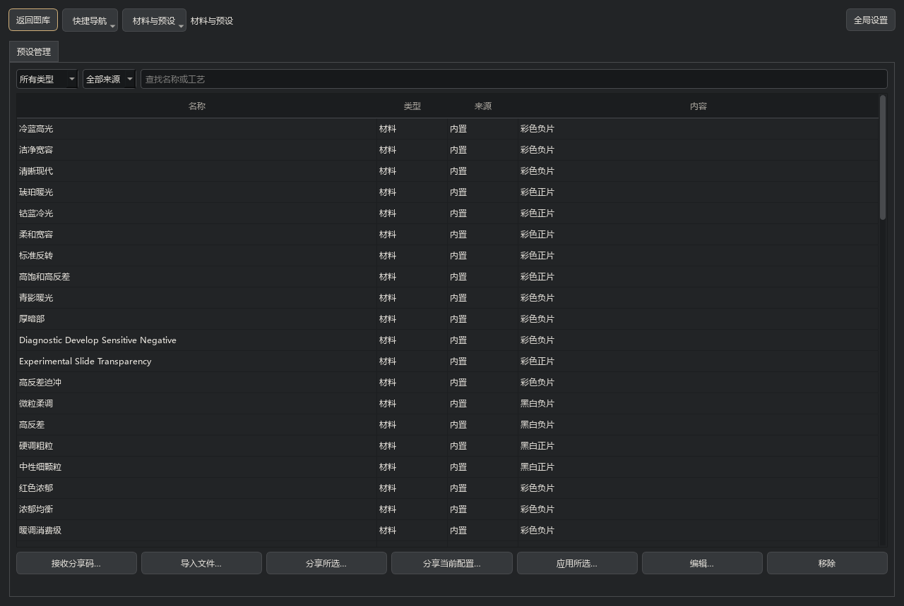
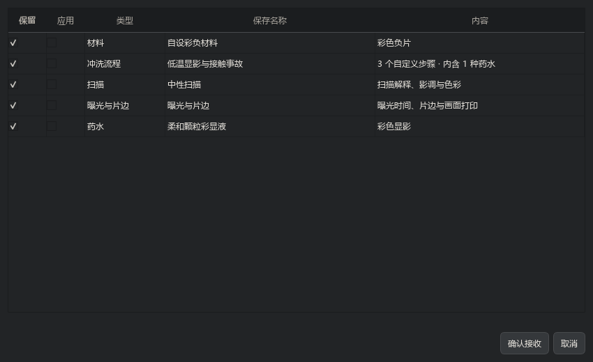

# Development Source Snapshot

[中文](DEVELOPMENT_SNAPSHOT.md) · [Changelog](CHANGELOG.en.md) · [Project home](../README.en.md)

> This snapshot documents the source tree. The displayed versions are Desktop 0.4.0 and Android 0.1.0. See the changelog for earlier binary releases.

---

## 2026-11-28 · From a coating recipe to a developed frame

- **Expose.** Compare emulsion-first and base-first loading, or give individual emulsions different response curves. An internal filter acts on the light that passes through it. [Desktop guide](DESKTOP_GUIDE.en.md#coatings)
- **Develop and compare.** Reopen a layered latent, keep the bath and scan fixed, and switch grain generation. The sample page includes matched crops. [Experimental stock comparison](SHOWCASE.en.md#coatings)
- **Translate.** Desktop reads packs from the project or executable’s languages directory. Android can import the same JSON format from Downloads. [Desktop translation packs](TRANSLATING.en.md) · [Android translation packs](../android/TRANSLATING.md)

## 2026-11-24 · Desktop DNG Decoding, Batch Entry Points, and Sample Plates

- Desktop source decodes camera DNG into 16-bit linear exposure input, reports progress by processing stage in the workbench, and provides CLI and Python/IDE batch workflows for saved recipes ([CLI & scripts](DESKTOP_GUIDE.en.md#cli)).
- Showcase comparisons and CLI examples use our own photograph of red fruit and green leaves to compare panchromatic, orthochromatic, and blue-sensitive silver emulsions, six lens filters on color negative and reversal film, and instant film, plates, and printing papers ([Examples & recipes](SHOWCASE.en.md)).

---

## 2026-11-19 · Mobile Scan Interactions and Community Translation Tooling

- **Mobile**: Introduces a preview-first resizable scan drawer, direct/fine-tuning sliders, double-tap resets, hold-to-compare preview, and four workbench color themes ([Mobile guide](MOBILE_GUIDE.en.md)).
- **Community translations**: Android adds a template and packaging CLI that reuses desktop v1 language packs and tests partial translations inside a debug APK ([Android translation guide](../android/TRANSLATING.md)).
- **Desktop**: Onboarding sample preview refreshes automatically after parameter confirmation, the characteristic-curve dialog supports manual re-measurement after editing baths, and material density probes display pinned point markers directly on the canvas ([Desktop guide](DESKTOP_GUIDE.en.md)).

---

## 2026-11-18 · Desktop Darkroom Analysis Tools, Recovery, and Mobile Lightweight Updates

To try the current desktop source, install root dependencies and run `python run_film_foundry_launcher.py`, then open **First Darkroom Workflow** from the gallery. [Desktop quick start](DESKTOP_GUIDE.en.md#start) · [Android build guide](../android/README.md)

- **Comparison & analysis**: Adds 2D film test-strip matrices (synchronized zoom/pan and one-click adoption), multi-point variable-aperture density probes, measured grayscale characteristic curves, and 100% full-scale local grain previews computed at formal output dimensions.
- **Recovery & checkpoints**: Adds 5-second parameter-only crash recovery (`last_work.json`, configurable 1 / 3 / 5 rotating slots, archiving unresolved sessions on new work without storing images or large arrays), plus `.ffworkspace` process checkpoints and step-prefix branching for all seven experimental material families.
- **Workflow & customization**: Adds per-family pinned controls, per-frame batch exposure EV offsets, scan crop/straighten and base eyedropper, optical dodge/burn masking with 240 px paper previews, viewport-aware library thumbnail loading with SQLite disk cache, custom themes, and importable desktop language packs ([Desktop translation guide](TRANSLATING.en.md)).
- **Mobile**: Updates lightweight film sensitivity and presets, adds qualified GLES 3.1 continuous-bath acceleration with CPU fallback, and adds a hidden Settings one-shot camera for the seven experimental materials (existing rolls remain frozen on their original formation version).

---

## 2026-11-10 · Earlier Checkpoint: Single-Window Workbench, Selective FFC2, and Experimental Materials

[Desktop guide](DESKTOP_GUIDE.en.md) · [Changelog](CHANGELOG.en.md) · [Build & packaging](../packaging/README.md)

### Single-window workbench & gallery entry

- Indexes source folders or imported files without copying originals; double-click opens a read-only viewer while selecting images creates work inside a unified single/dual-sidebar window shared with full resource editors (output location is chosen at execution time).
- Supports side-by-side, draggable split, and hold-for-original preview comparisons, 90° rotation, undo/redo, histograms, tone/RGB curves, and 8-band HSL.

### Expanded film processing & selective preset sharing

- Normal, Expected-effect, and Principle modes share one film formation pipeline covering per-bath solution capabilities, local grain/fog kinetics, silver retention, edge-anchored rotary wetting, contamination/wash/hardening, surface silver/dye damage, time history, electronic rolls, staged development checkpoints, and formed edge marks/imprints.
- **Materials & Presets → Preset Manager** organizes materials, solutions, processes, scanners, and exposure/edge presets with selective `FFC2:` collection sharing and independent *Keep* / *Apply* selection on import (processes embed their bath solutions; Android and CLI remain compatible with legacy single-item FFC2 codes).

### Seven experimental materials, RAW/HDR input & compute

- Integrates integral instant, peel-apart, daguerreotype, photographic paper, wet plate, cyanotype, and platinum/palladium as experimental workspaces (default 1600 px formation cap, toggleable) with shared save, observation, and optical-cascade interfaces.
- Adds desktop DNG (`rawpy` / LibRaw) and Ultra HDR JPEG gain-map ingestion, field-level storage precision (keeping authoritative optics and chemical pools in FP32 with full-precision opt-out), and optional CUDA / OpenCL acceleration for selected operators with CPU fallbacks (Vulkan not implemented).
