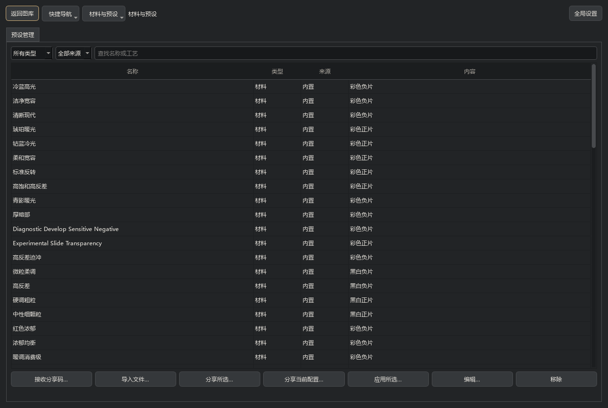
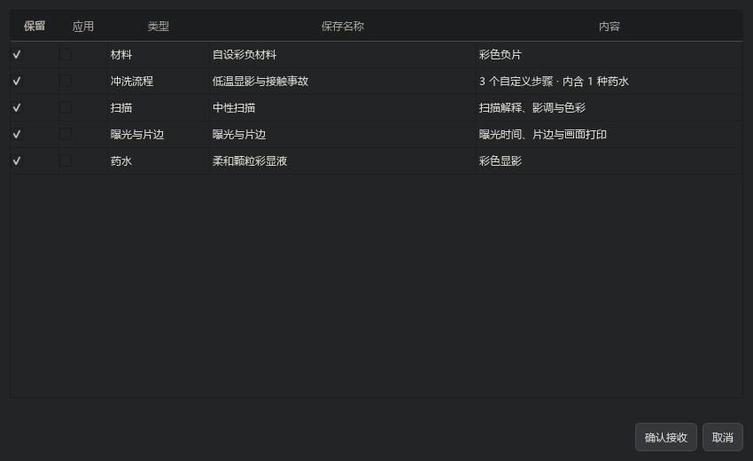

# 开发中源码快照 / Development source snapshot

**2026-11-10 · 中间留档，未发布新安装包。** 本页描述 0.4.0 之后的源码工作，不改写历史版本的发布说明。项目内显示版本暂时仍为桌面 0.4.0、Android 0.1.0；此前下载的 EXE／APK 不包含这里全部新增内容。

**2026-11-10 · Source checkpoint, no new binary release.** These changes follow the 0.4.0 baseline. Display versions remain Desktop 0.4.0 and Android 0.1.0; previously distributed binaries do not contain all features listed here.

[当前桌面指南](DESKTOP_GUIDE.md) · [更新记录](CHANGELOG.md) · [构建入口](../packaging/README.md)

## 从图库开始，在同一窗口工作

- 图库索引来源文件夹和单独导入的图片；不需要复制原文件。双击进入只读浏览，缩略图之后加载高清原图，可查看关联底片、扫描与附属材料，评级和收藏独立保存。
- 选择一张或多张图像，再选择材料进入工作区。普通图像可完整处理、只曝光、只冲洗或只扫描；潜影、已冲洗介质按已有阶段继续。执行时选择输出位置，默认工作区下的 `outputs/日期/`。
- 单侧布局适合小屏，双侧布局把材料／冲洗和扫描控制分开。完整工作区与预设编辑器同窗切换，必要的小配置使用弹窗；切换不清空当前草稿。
- 预览可原图并列、拖动切分或仅结果；仅结果时按住鼠标查看原图。提供旋转、撤回／重做、直方图、影调与 RGB 曲线、分色 HSL、参数和分组恢复。
- 全局设置管理工作区、图像来源、缓存、新工作默认值和离开工作区时的保存行为。工作存档与参数预设分开；尚无周期自动保存或崩溃恢复。

The gallery is the entry point. Select images to create work; double-click to browse without opening an editor. Workspaces and full editors share one window, while small configuration dialogs remain available. Output location is chosen when execution begins. Single- and dual-sidebar layouts, comparison views, rotation, undo/redo, curves and HSL support daily editing. Persistent automatic recovery is not yet implemented.

## 胶片：曝光、冲洗与扫描继续分开

普通、期望、原理三种控制方式共用胶片形成管线。期望模式将已支持的目标映射到材料与工艺条件；原理模式直接编辑药浴、时间、温度、搅拌与操作。效果可能耦合，界面提供关联影响说明，不承诺所有滑块只改变一种外观。

现有扩展覆盖逐浴药水能力、条件灰雾、局部形成与颗粒响应、留银、接触不均、贴边滚浸液面与残留、污染／清洗／硬化、有限表面银与染料损伤，以及材料储存、潜影等待和冲洗后受光。它们是保留因果关系的降阶模型，不是任意化学配方求解或完整流体、逐晶粒仿真。

电子胶卷可保留来源顺序、材料和曝光身份；未拍满封卷时补未曝光格。冲洗结果可以按条带查看、上灯台并反复扫描。分阶段冲洗档保存真实已执行状态，只允许调整尚未进入的受支持药浴；普通工作文件不等同于浴内检查点。

片边厂标、条码、片序、方向与画面打印分别配置。厂标通过同材料、同药浴的均匀参考响应形成并冻结到介质中；上卷偏移和局部位置可调整。规整双轨条纹借鉴真实片边结构，装饰数据不冒充注册 DX／KEYKODE；Code 128 自有编号另列。片边目前不包含完整空间事故和局部颗粒。

扫描只观察最终介质，不改写形成结果。自动成片按实际极性和片基选择反相／去罩，并校正亮度黑白位，不自动改用户色彩偏好。材料与配套扫描可以联动；既有配方不会仅因打开文件而自动升级。

Film exposure, processing and scanning remain separate. Normal, expected-effect and principle controls use the same film pipeline. Processes retain ordered baths, embedded solution capabilities and supported physical interactions. Scanning is read-only. Film-edge marks are formed and frozen with the medium, using a uniform reference response rather than full spatial simulation of the rebate.

## 预设管理与 FFC2

入口：**材料与预设 → 预设管理**。按类型、来源和名称筛选，支持多选分享、编辑副本和移除用户项。

| 类别 | 分享内容 | 接收后的用法 |
| --- | --- | --- |
| 材料 | 胶片材料定义 | 保存到材料库或应用于新曝光 |
| 药水 | 独立反应能力、活性及适用的颗粒／灰雾响应 | 保存到药水库，在匹配处理类型的药浴中载入 |
| 冲洗流程 | 步骤、逐浴条件、内嵌药水、操作与形成控制 | 保存或应用于允许重新冲洗的工作 |
| 扫描 | 解释、影调、颜色和观察配置 | 保存或应用到当前扫描 |
| 曝光与片边 | 曝光时间、厂标、齿孔与画面打印 | 用于后续新曝光，不能修改已有潜影 |

接收者逐项选择“保留”和“应用”。默认只保存；同名另存，不覆盖旧文件。流程自带药水，即使不把药水另存进库，仍能保留原流程。分享自动标准工艺时会固定发送时的程序。

旧 FFC2 配方码继续可读。新合集可包含同类多个预设，但需要支持合集的客户端；Android 与 CLI 尚未接合集选择，仍可使用旧兼容配方码。兼容编码不会补齐手机未实现的桌面工艺。FFC2 不带图像、输出路径或运行质量；外部漏光遮罩需要另行提供，含该依赖的流程不能直接生成便携参数码。本轮预设合集范围是胶片，其他七族未接此入口。

The preset library separates materials, solutions, processes, scanners and exposure/edge settings. Receivers independently choose what to keep and what to apply. Processes embed their solutions and do not depend on matching local filenames. Old recipe codes remain readable; new collections require updated consumers. Android and CLI do not yet select from collections. Legacy-compatible codes remain available, without extending mobile processing capabilities. External mask images are not embedded.

## 七类实验材料

一体式即显、撕拉片、达盖尔银版、相纸、湿版、蓝晒、铂钯已有各自的形成、观看与保存流程，可从同一主窗口进入。共享任务、保存、扫描输出等接口，不要求各族使用同一个内部反应程序。

它们仍标为实验中，默认启用 1600 长边形成，可关闭尺寸限制。现阶段不套用胶片低／中／高和降阶开关。仅材料声明可用时，撕拉片供体才可清理为负像；不默认所有撕拉材料都会留下完整负片。已有介质可以作为受支持后续光学曝光的来源，起点和终点由用户选择。

Integral instant, peel-apart, daguerreotype, photographic paper, wet plate, cyanotype and platinum/palladium are experimental. They retain family-specific processes, with shared workspace and delivery interfaces. Their default formation limit is 1600 pixels and can be disabled. A usable peel-apart negative depends on the declared donor material.

## 输入、保存与性能

- JPEG、PNG、TIFF 等普通图像继续支持；DNG 经 rawpy／LibRaw 解码，Ultra HDR JPEG 经真实增益图解码后进入共通管线。当前证据包含合成验证，不保证所有相机 DNG 或厂商 HDR 变体。
- 中间介质仍使用标准 NPZ／NPY 和图像格式。按字段用途与胶片档位分配保存精度，权威光学和化学状态保留所需精度；可明确选择全高精度保存。保存量化不能恢复已经丢失的信息。
- 缩放加速、减少机制的快速模式、处理质量三者分开；扫描沿共通观察逻辑。快速模式明确省略复杂形成机制，以效果完整度换速度。
- 共用准备、重复遍历、线程调度、保存与编码已有优化。部分算子接 CUDA／OpenCL，失败回退 CPU；GPU 没有承包全部形成计算，OpenCL 跨设备覆盖仍待验证，Vulkan 未实现。
- 24MP 非降阶中档仍是性能目标。历史耗时受图像、事故组合、后端及机器负载影响，本留档不提供新的速度承诺。

Standard image formats remain supported, with DNG and Ultra HDR JPEG ingestion added to the common pipeline. Intermediates use standard formats. Scaling, reduced mechanisms and processing quality are separate controls. Shared computation and encoding have been optimized; selected GPU operators retain CPU fallbacks. This checkpoint makes no new timing or device-coverage claim.

## 手机与验证边界

Android 源码同时保留到本快照：轻量形成保留随明暗变化的颗粒和主要显影反应，简化细碎空间机制；新增中性自动扫描，并减少扫描暂存读写。旧卷与任务按其冻结版本处理。手机仍是独立降阶运行时，未搬入七类实验材料，也未接新版桌面 FFC2 合集。

这些阶段已有定向数值、存读及界面检查。最近预设分享的 11 项检查包含两种控制模式的实际小图结果一致、逐浴依赖保留、选择合并、存盘再用和冻结阶段保护；截图使用隔离演示配置。中间留档没有重跑全量测试、重新测量 24MP 或构建 EXE／APK，不能据此宣称完整发行验收。

Android source changes are included, but no new APK is built. It remains an independent reduced implementation; experimental families and desktop preset collections are not ported. Targeted checks exist for the included work; this checkpoint is not a full release qualification or a new performance benchmark.
