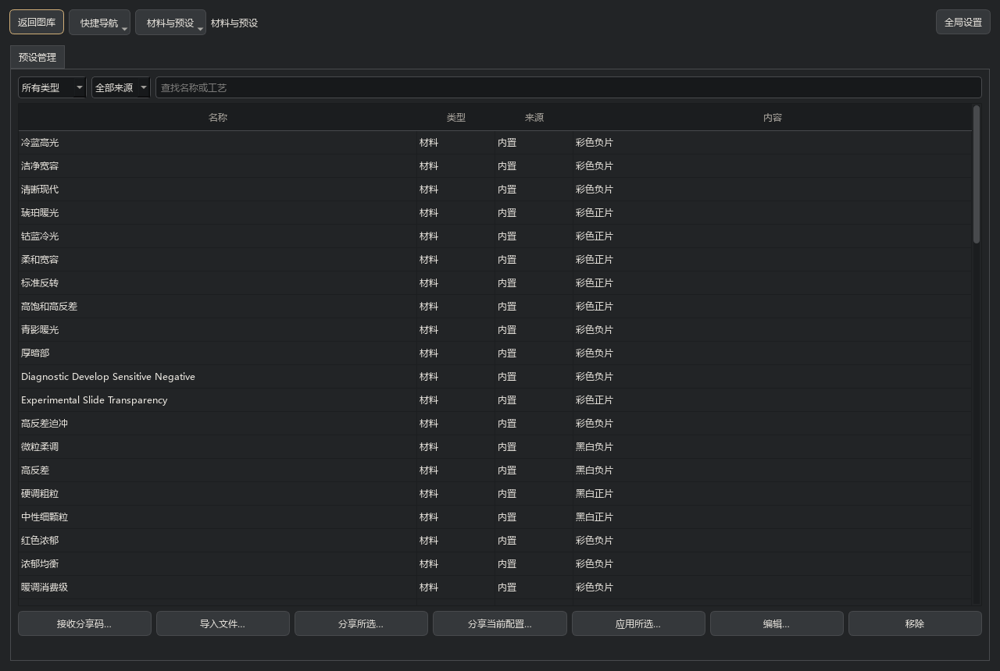
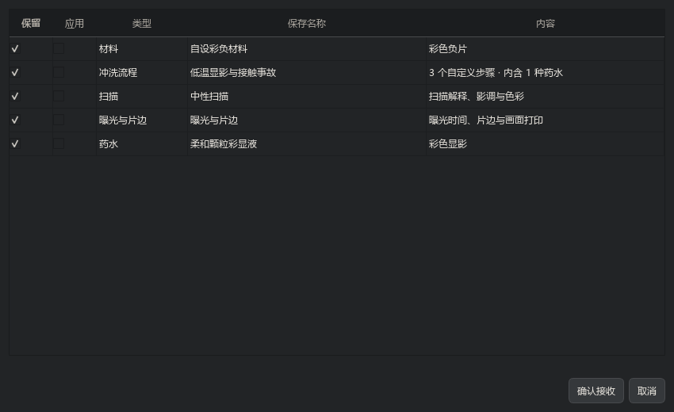

# 开发中源码快照

[English](DEVELOPMENT_SNAPSHOT.en.md) · [更新记录](CHANGELOG.md) · [项目首页](../README.md)

> 本页记录源码状态。本次快照的显示版本为桌面 0.4.0、Android 0.1.0。历史发行包的功能见更新记录。

---

## 2026-11-28 · 从分层材料到冲洗成片

- **曝光。** 可以对比乳剂朝前与片基朝前，也可以给各层乳剂指定不同的感色曲线，观察夹层如何改变下游乳剂的受光。[桌面操作指南](DESKTOP_GUIDE.md#coatings)
- **冲洗对照。** 重开逐层潜影，固定药浴和扫描后切换颗粒方式。效果页提供同一区域的放大对照。[实验材料样张](SHOWCASE.md#coatings)
- **安装译本。** 桌面从项目根目录或程序旁的 languages 文件夹读取语言包；手机可以从下载目录导入同格式的 JSON。[桌面译本](TRANSLATING.md) · [手机译本](../android/TRANSLATING.md)

## 2026-11-24 · 桌面 DNG 解码、批处理入口与新样张

- 桌面源码支持将相机 DNG 解码为 16 位线性曝光输入，并在工作台实时展示当前处理工序；支持通过 CLI 批量处理目录或在 Python / IDE 参数脚本中复现已有配方（见[命令行与脚本](DESKTOP_GUIDE.md#cli)）。
- 效果页与命令示例统一改用项目自摄红果绿叶样图，直观对照全色/正色/蓝敏三种银盐胶片、六种镜前滤镜在彩负与反转片上的表现，以及即时片、版材与纸面印相（见[效果展示](SHOWCASE.md)）。

---

## 2026-11-19 · 手机扫描交互与第三方翻译工具

- **手机端**：扫描页改为预览优先的大图布局，支持自由停靠的底部调整抽屉、长按预览对照、直接定位/长按精调滑钮与双击复位，并新增四套外观配色（见[手机指南](MOBILE_GUIDE.md)）。
- **社区翻译**：Android 新增词条模板与打包脚本，支持复用桌面 v1 语言包并在调试 APK 中即时验证局部译本（见[Android 翻译与移植](../android/TRANSLATING.md)）。
- **桌面端**：首次导览在确认参数后自动刷新示例；特性曲线窗口支持调参后手动重测；材料密度探针在画布上标出固定测点编号（见[桌面指南](DESKTOP_GUIDE.md)）。

---

## 2026-11-18 · 桌面暗房分析工具、自动保险与手机轻量更新

首次从源码体验可安装根目录依赖后运行 `python run_film_foundry_launcher.py`，在图库打开「第一次暗房工作」体验完整流程。[桌面安装与启动](DESKTOP_GUIDE.md#start) · [Android 源码与编译](../android/README.md)

- **比较与分析**：新增胶片二维试条矩阵（并排同步缩放与一键采用）、多点可选孔径密度探针、实测灰阶特性曲线，以及按正式工作尺寸整幅计算并 100% 物理像素检查颗粒的局部正式尺度预览。
- **保存与续作**：新增每 5 秒检查的轻量自动保险（可选 1 / 3 / 5 槽及异常退出冻结归档，仅存参数与来源引用）；实验材料支持保存 `.ffworkspace` 工序检查点并从早期步骤另开分支。
- **效率与定制**：支持按材料族钉选常用参数、批量逐片曝光 EV 偏移、扫描沿边拉直与片基滴管、印相遮挡/加光与 240 px 纸面预估；优化图库可见区缩略图加载与磁盘缓存；支持自定义配色与桌面社区语言包（见[桌面翻译指南](TRANSLATING.md)）。
- **手机端**：更新轻量胶片感光响应与预设，轻量连续药浴支持经精度/耗时校验的 GLES 3.1 加速；设置页新增七类实验材料单张试拍入口（独立于胶卷库；旧卷保持冻结版本）。

---

## 2026-11-10 · 历史快照：同窗工作台、选择性 FFC2 与七类实验材料

[当前桌面指南](DESKTOP_GUIDE.md) · [更新记录](CHANGELOG.md) · [构建与打包](../packaging/README.md)

### 同窗工作台与图库起点

- 从图库索引文件夹或导入照片，双击只读浏览，选图选材后进入同一窗口内的单/双侧工作台与完整编辑器（切换保留草稿）；正式执行时才确认输出目录。
- 预览支持单图/并列/切分、按住看原图、旋转、撤回/重做、直方图、影调与 RGB 曲线及分色 HSL。

### 胶片工艺扩展与选择性预设管理

- 普通、按效果、按药浴三种控制方式共用同一形成管线，覆盖逐浴药水能力、局部形成与颗粒响应、留银、贴边滚浸液面、污染清洗、表面银/染料损伤及材料储存与时间历史。
- 新增电子胶卷、分阶段冲洗检查点及随材料形成的片边厂标/画面打印。
- **材料与预设 → 预设管理**支持材料、独立药水、冲洗流程、扫描与曝光/片边五类资源的筛选与选择性 `FFC2:` 合集分享；接收端逐项选择“保留”与“应用”，流程自带内嵌药水不依赖本地文件名（Android 与 CLI 继续兼容单配置旧版 FFC2 码）。

### 七类实验材料、输入格式与硬件计算

- 一体式即时片、撕拉片、达盖尔银版、相纸、湿版、蓝晒、铂钯以实验状态接入主窗口（默认形成长边 1600 px，可关闭），共享工作区、保存、观察与光学级联入口；撕拉片供体是否可清理为可用负片取决于材料声明。
- 新增桌面 DNG（`rawpy` / LibRaw）与 Ultra HDR JPEG 增益图解码入口，并引入按字段分级保存精度（权威光学与化学库存保持 FP32，可选全高精度保留）以及部分算子的可选 CUDA / OpenCL 加速（保留 CPU 回退；Vulkan 未实现）。
