# Shoot a roll. Choose how to develop it.

[中文](MOBILE_SHOWCASE.md) · [Mobile guide](MOBILE_GUIDE.en.md) · [Project home](../README.en.md)

Film Foundry Mobile structures photography around **loading, shooting, development, viewing, and scanning**. Pick a stock and format, finish the roll, choose a process to form the negatives or slides, and shape the final photograph with light, color, and curves. Develop the same roll multiple times, or keep several scan interpretations of the same frame.

**Android 0.1.0 test version · Android 8.0+ · Chinese / English · Multiple themes**

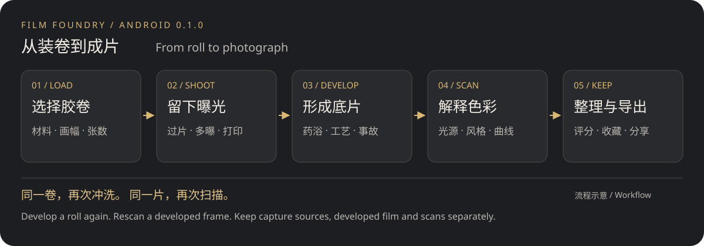

[Capture](#capture) · [Development](#develop) · [Scanning](#scan) · [Library](#library) · [Installation and support](#install)

---

## Capture: give the roll its own character

Choose color or black-and-white, negative or reversal stock, and 135, half-frame, or 120 format. The landscape viewfinder offers tap-to-focus/metering, zoom, and exposure compensation; available lenses and flash options depend on the device.

| Camera home: resume the loaded roll | Rolls: shooting and sealed |
| --- | --- |
| 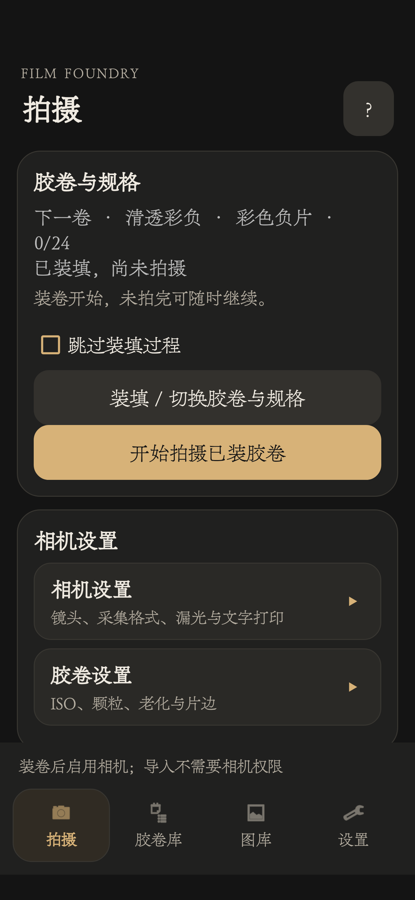 | 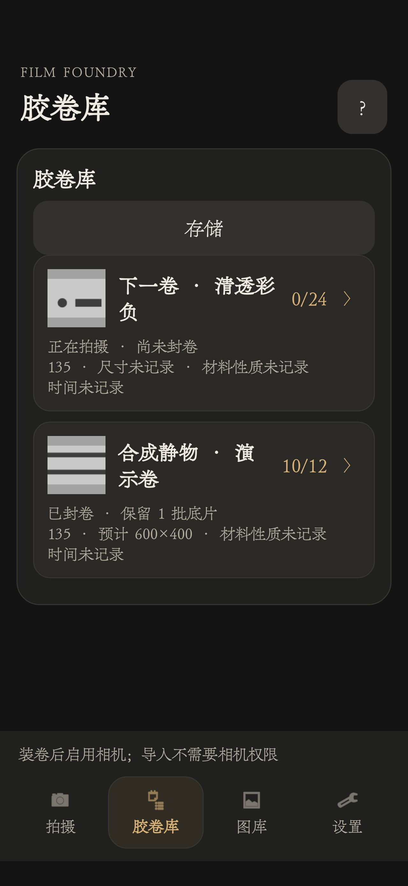 |

> The portrait screenshots below show real app UI in a separate demo installation populated with synthetic still-life inputs and roll records (the live camera was not opened). The 600 × 400 dimensions reflect small demo inputs rather than an output cap. Screenshots show the Chinese interface.

Manual advance gives every frame a distinct start and finish, while automatic advance suits rapid shooting. Multiple exposure lets you re-expose the same frame, and the 135 panoramic gate can be toggled before advancing with each exposure retaining its own mask state.

### Text imprinting

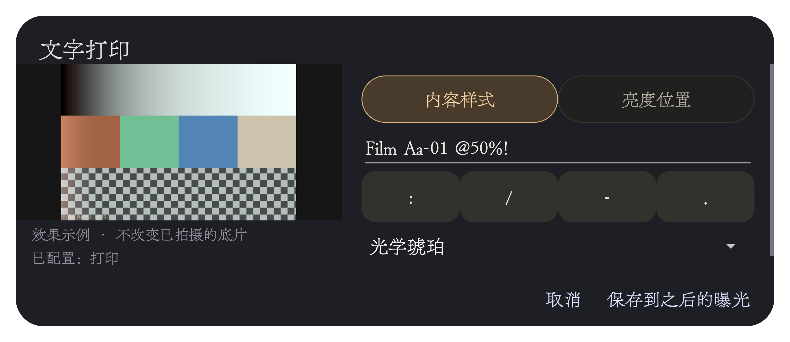

The preview stays pinned on the left while you edit text or switch to brightness and placement on the right:

- Up to 24 uppercase/lowercase English letters, digits, spaces, and ASCII punctuation (date-only strings keep classic numeric glyphs);
- Brightness from 0–200%, four corner presets, and fine horizontal/vertical sliders;
- Imprinting participates during exposure and applies only to subsequent shots.

### Light leaks, gate effects, and material effects

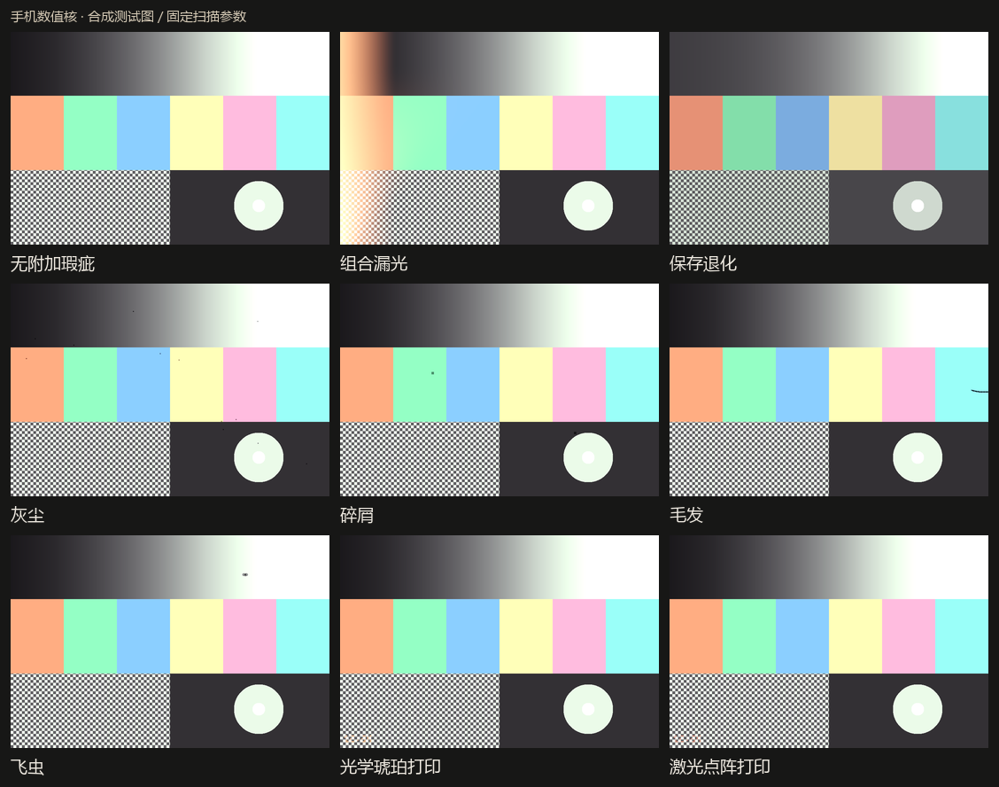

These examples were rendered by the mobile numerical kernel on synthetic targets with fixed scanner settings to illustrate each effect type. Camera leaks, gate dirt, material ageing, and text imprinting are configured independently, and grain, MTF, and halation strength can be set before loading a roll.

---

## Development: explore several results from one roll

After sealing a roll, start from a suggested process or open **Free processing** to arrange baths and adjust time, temperature, concentration, and agitation. Explore cross processing, silver retention, uneven development, chemical stains, and reticulation. Preparation summarizes the stock, process, expected film polarity, and step order before execution.

Each development creates an independent batch: retain only the developed film, or scan automatically into Library (format, bit depth, and JPEG quality are set under *Scan & save*). Long-press a batch on the roll page to manage its results directly.

| Roll details and development batches | Development preparation |
| --- | --- |
| 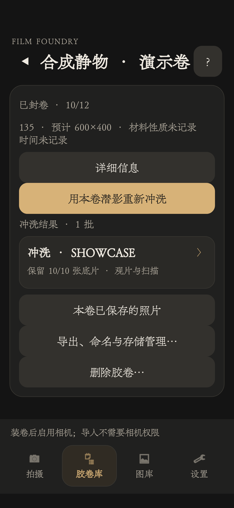 | 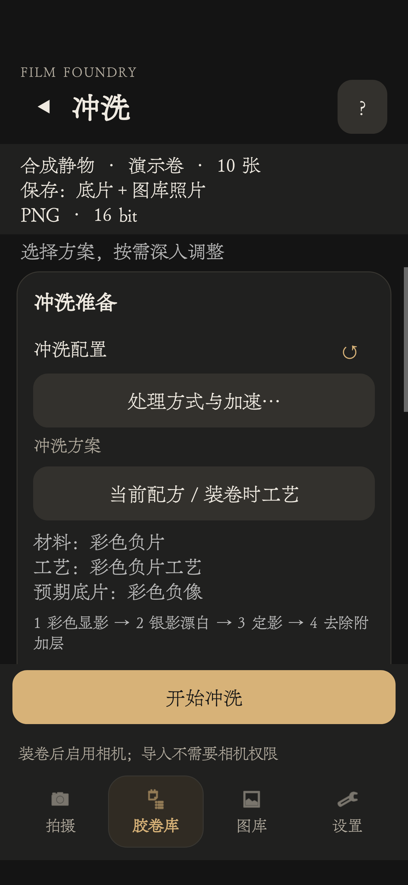 |

---

## Viewing and scanning: keep the film and continue editing

The light table shows the film in its native polarity, live transmission overlays transparent film against the live camera feed, and scanning interprets the final medium into a photograph—**always read-only, never altering the developed film**.

Start with a scan style, then refine base correction and inversion, light, tone, normalization, saturation, 8-band HSL, and tone/RGB curves. The preview provides a histogram overlay, hold-to-compare, and multi-step undo/redo; after saving, you can keep tweaking while preserving earlier versions.

| Film and automatic inversion | Tone / RGB curves | Output dimensions |
| --- | --- | --- |
| 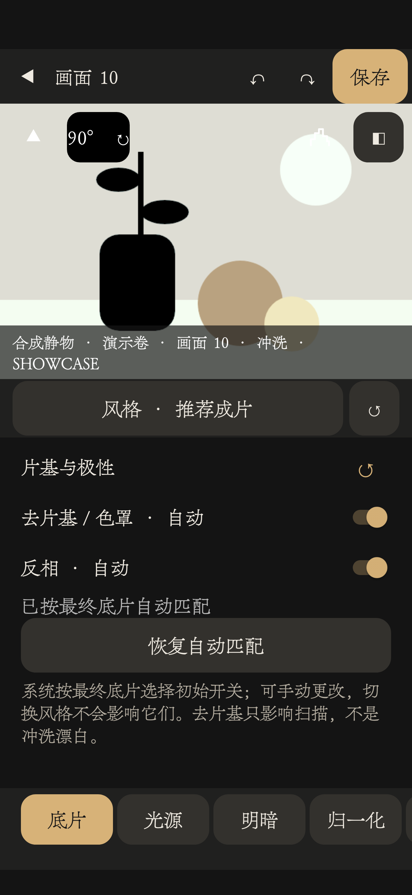 | 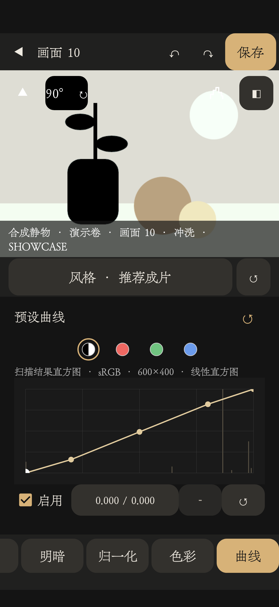 | 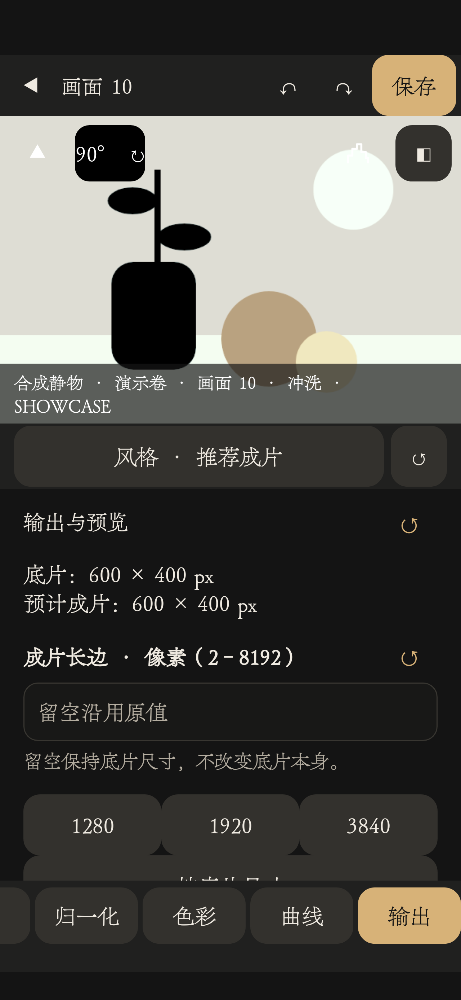 |

| Output format | Typical use |
| --- | --- |
| JPEG (Low / Medium / High = 40 / 70 / 100) | 8-bit lossy photos for easy sharing |
| PNG (8-bit / 16-bit) | Lossless output for gallery or file export |
| TIFF (16-bit) | Folder export for further editing |

> Changing an existing JPEG's format cannot recover lost precision—rescan the source film instead.

---

## Library: browse, filter, and trace the source

Cycle between 3-column grid, 5-column grid, and detailed list layouts with either paged or continuous scrolling. Opening a photo smoothly transitions from thumbnail to high-resolution image; long-press to enter batch selection.

| Three columns | Five columns | Detailed list |
| --- | --- | --- |
| 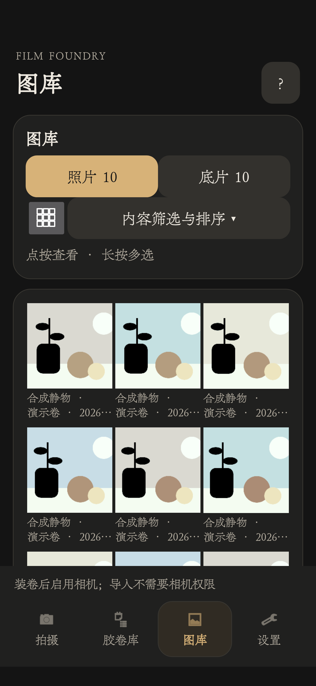 | 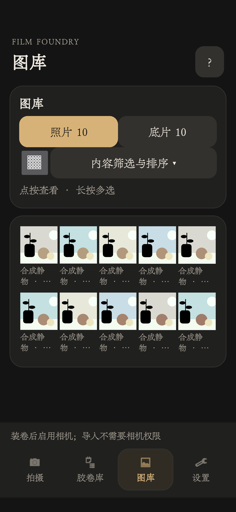 | 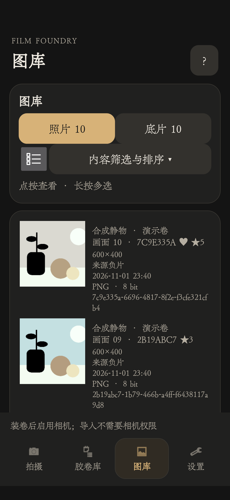 |

Ratings and favorites are independent. Filter by roll, favorites, and rating comparisons (`>`, `<`, `≥`, `≤`), and sort by creation time, file size, or roll name.

| Filters and sorting | Rating and favorite in the viewer |
| --- | --- |
| 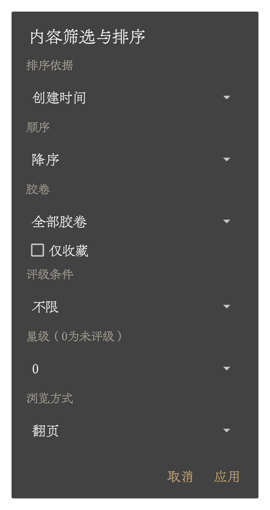 | 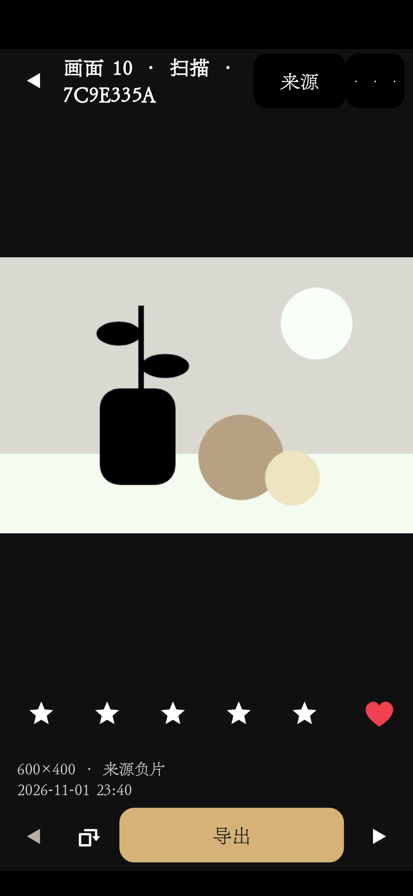 |

| Retained layer | Next steps |
| --- | --- |
| Originals and latent images | Return to the roll and develop again |
| Developed film | View, rescan, or export optical NPZ |
| Scanned photographs | Rate, favorite, export, and trace provenance |

All three layers are stored independently—deleting one never deletes the others. Export files you want to keep before uninstalling or changing devices.

---

## Installation and current support

- **APK architectures**: Available as `arm64-v8a`, `armeabi-v7a`, `x86_64`, `x86`, and `universal` packages, each installable standalone. Device validation currently focuses on **ARM64 phones**; there is no iOS version. [Build and architecture instructions](../android/README.md)
- **Capture formats**: JPEG is standard. RAW supports uncompressed 8/16-bit Bayer DNG and interleaved 3-channel LinearRaw DNG; Ultra HDR requires Android 14+, a compatible sRGB base, and a real gain map. Compressed DNG and wide-gamut P3 are not fully supported, and scanned outputs remain SDR photographs.
- **GPU assistance**: *Compute & acceleration* offers automatic GPU selection and a hardware self-test. Eligible operations run on OpenGL ES 3.1 when qualification and transfer-inclusive timing permit, falling back to CPU on failure (full development is not exclusively GPU-based, and self-test block timings do not represent full-photo times).
- **Desktop interchange**: Mobile and desktop share latent/optical NPZ formats and FFC2 recipes using separate numerical kernels, without promising pixel-identical output. See the [mobile guide](MOBILE_GUIDE.en.md) for full details.

### Image notes

The workflow diagram is an original project illustration, the imprint dialog comes from an isolated synthetic window, the 12 portrait screenshots capture real production UI in a separate demo installation, and the effect sheet comes from synthetic mobile-kernel renders. All images are distributed with the project under GPL-3.0-or-later and contain no private gallery media.
