# Shoot a roll. Choose how to develop it.

[中文](MOBILE_SHOWCASE.md) · [Mobile guide](MOBILE_GUIDE.en.md) · [Project home](../README.en.md)

Film Foundry Mobile follows loading, capture, development, viewing and scanning. Choose a stock and format, shoot the roll, then choose the process that forms the film. Light, color and curves determine its scanned appearance. Develop the same roll again, or keep several scans of the same developed frame.

**Android 0.1.0 test version · Android 8.0+ · Chinese / English · Dark / Light**

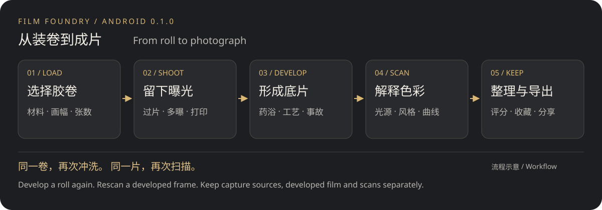

[Capture](#capture) · [Development](#develop) · [Scanning](#scan) · [Library](#library) · [Installation and support](#install)

## Capture: give the roll its own character

Choose color or black-and-white, negative or reversal stock, and a 135, half-frame or 120 format. The landscape finder offers tap-to-focus and metering, zoom and exposure compensation. Available lenses and flash options depend on the device.

| Camera home: resume the loaded roll | Rolls: shooting and sealed |
| --- | --- |
| 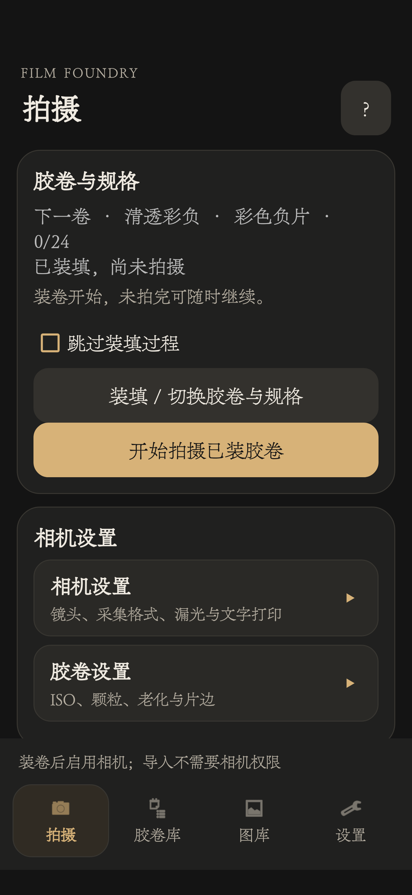 | 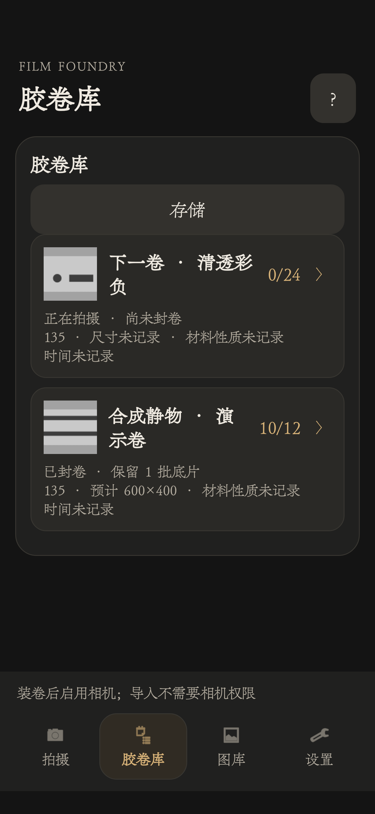 |

The portrait screenshots show real phone UI in a separate demo installation with generated still-life images and roll records. The real camera was not opened. Missing capture metadata remains marked as unrecorded. The 600×400 images are small demonstration inputs, not the application's output limit. Screenshots use the Chinese interface.

Advance manually between frames or enable automatic advance. Multiple exposure lets you expose the same frame again. The 135 panorama switch can change before advancing; each exposure retains its own mask state.

### Text imprinting

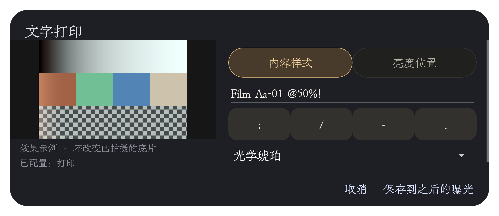

This is a real phone-window screenshot from the 0.1.0 test series. Its preview uses generated color patches and a checkerboard, not a camera photograph. The sample remains visible while editing text or switching to brightness and position.

- Up to 24 English letters, numbers, spaces and punctuation, preserving case. Date-only text keeps the original numeral shapes.
- Brightness from 0–200%, four corner presets and adjustable horizontal/vertical position.
- Saving affects subsequent exposures. Earlier exposures stay unchanged; imprinting contributes during exposure.

### Light leaks, gate effects and material effects

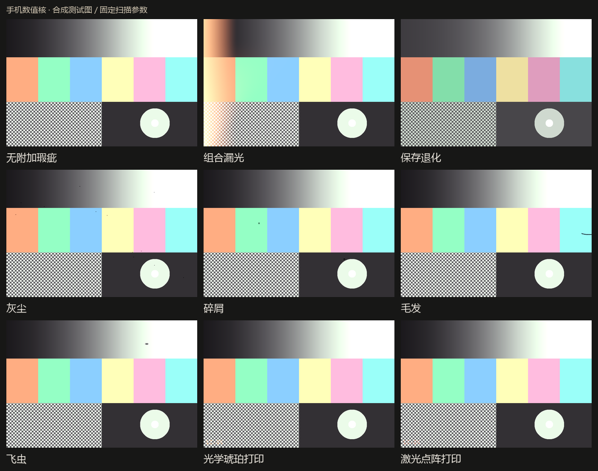

The mobile numerical kernel produced these synthetic examples with fixed scanner settings. They illustrate effect types, not app screens or natural-scene captures. Camera leaks and gate effects, material ageing and imprinting have separate controls. Grain, MTF and halation strength can also be chosen before loading a roll.

## Development: explore several results from one roll

After sealing, start with a suggested process or arrange baths in Free processing. Set time, temperature, concentration and agitation; try cross processing, retained silver, uneven development, contamination or reticulation. Preparation shows the stock, process, expected film and operation order before execution.

Each development creates a separate batch. Keep only the film or scan automatically afterward; set the automatic scan format, bit depth and JPEG quality under Scan & save. Hold a development batch on the roll page to manage its results without entering its details first.

| Roll details and development batches | Development preparation |
| --- | --- |
| 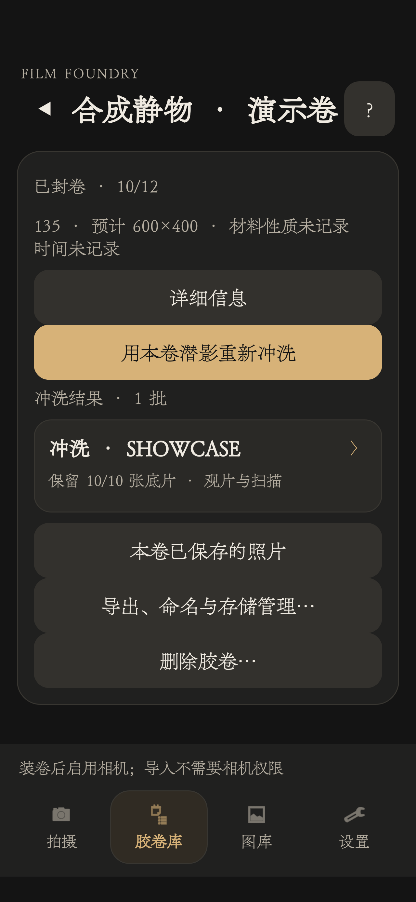 | 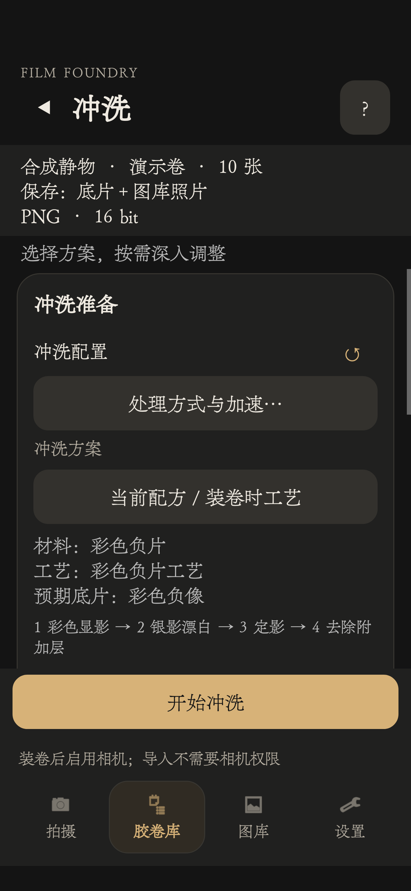 |

Roll details keep redevelopment, results and export together. Preparation identifies which resources will be retained and the process steps to run.

## Viewing and scanning: keep the film and continue editing

The light table displays the film's own polarity. Live transmission views transparent film against a camera background. Scanning interprets the final medium as a photograph and never modifies the developed film.

Start with a scan style, then adjust base removal and inversion, light, tone, normalization, saturation and tone/RGB curves. The preview provides a histogram and hold-to-compare. Undo and redo support editing; save, continue adjusting and retain earlier versions.

| Film and automatic inversion | Tone / RGB curves | Output dimensions |
| --- | --- | --- |
| 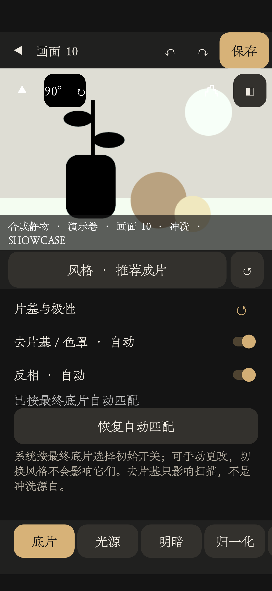 | 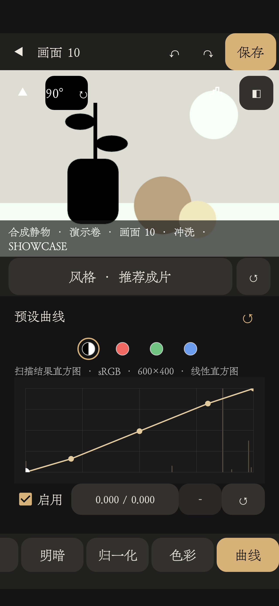 | 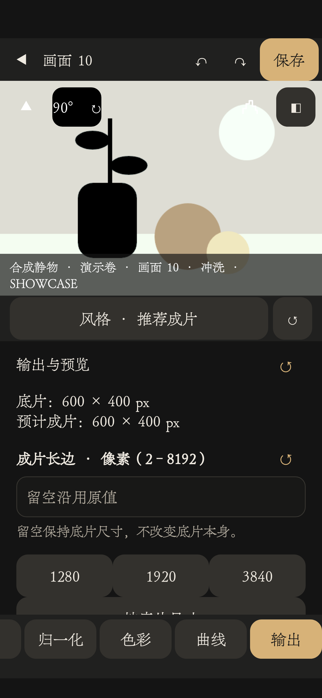 |

The same film preview stays above the tools. Curves selects tone or RGB channels; Output sets dimensions, with format and quality controls farther down the same panel.

| Output | Use |
| --- | --- |
| JPEG, Low / Medium / High (40 / 70 / 100) | 8-bit lossy photos for sharing |
| PNG, 8-bit / 16-bit | Lossless photos |
| TIFF, 16-bit | Folder export for further editing |

Changing an existing JPEG's extension cannot restore high-precision lossless data. Rescan its source film instead. System-gallery export supports JPEG/PNG; TIFF uses file export.

## Library: browse, filter and trace the source

Cycle between three columns, five columns and a list. Grids prioritize larger or smaller images; the list provides details. Choose pages or continuous scrolling. Photos transition from thumbnails to detailed images; hold an item to enter batch selection.

| Three columns | Five columns | Detailed list |
| --- | --- | --- |
| 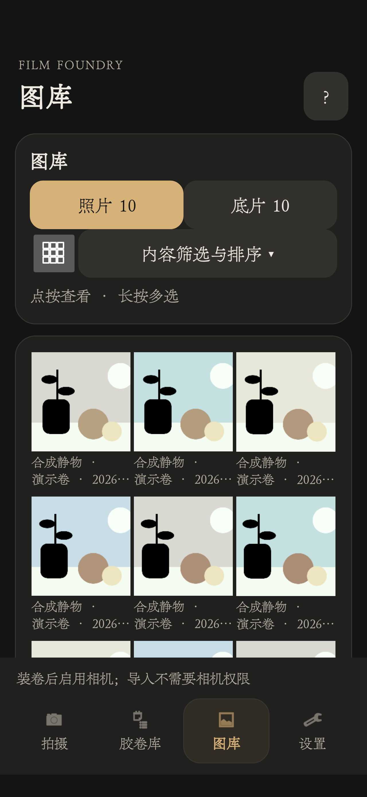 | 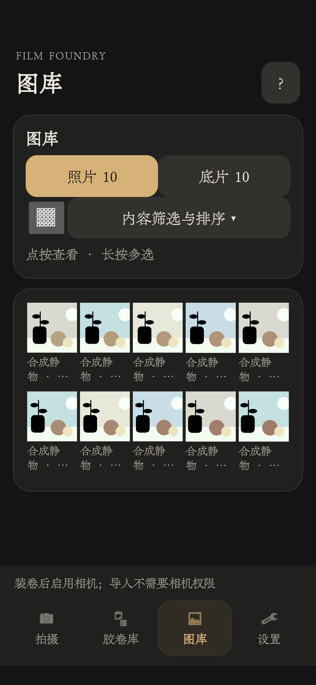 | 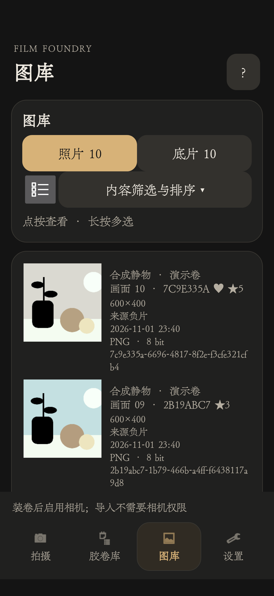 |

Ratings and favorites are independent. Filter by roll, favorites and rating comparisons (greater than, less than, at least, at most). Sort by creation time, file size or roll name.

| Filters and sorting | Rating and favorite in the viewer |
| --- | --- |
| 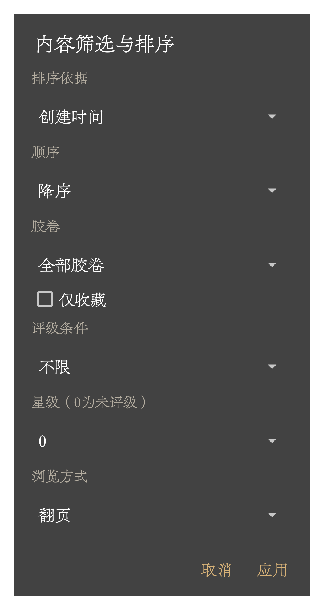 | 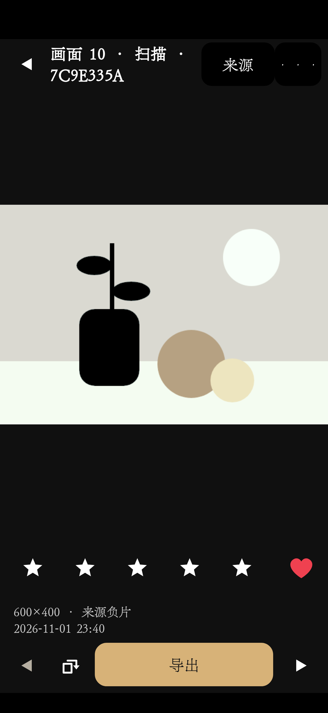 |

| Retained resource | Next steps |
| --- | --- |
| Originals and latent images | Return to the roll and develop again |
| Developed film | View, rescan or export optical material |
| Scanned photographs | Rate, favorite, export and trace the source |

These layers are stored independently. Deleting one does not automatically delete the others; missing sources are identified. Export the originals, latents, film and photographs you need before uninstalling or changing devices.

## Installation and current support

APK filenames end in `arm64-v8a`, `armeabi-v7a`, `x86_64` or `x86`. Choose `universal` when unsure. Each package installs independently. Device validation currently focuses on ARM64 phones; other architectures have built successfully but have not been tested on devices. There is no iOS version. [Build and architecture instructions](../android/README.md)

JPEG is the standard capture path. RAW and Ultra HDR have minimum support subject to device and format capabilities: the RAW path primarily supports uncompressed 8/16-bit Bayer DNG; Ultra HDR requires Android 14+, a compatible sRGB base image and a real gain map. Full support for wide-gamut P3 and compressed DNG is not provided. Scanned outputs remain SDR photographs.

Compute & acceleration provides automatic GPU selection and a hardware self-test. Eligible operations use the GPU when qualification and measured timing permit, with CPU fallback on unavailability or failure. Development is not entirely GPU-based. Capture retains the original, with some latent-image formation deferred to processing, so a full development wait can include that work. Block timings from the self-test are not promises of whole-photo processing time.

Mobile and desktop share latent/optical material formats and FFC2 recipes, with separate numerical implementations. Pixel-identical results are not promised. See the [mobile guide](MOBILE_GUIDE.en.md) for detailed operations and resource handling.

### Image notes

The workflow is an original project illustration. The imprint screenshot uses an isolated synthetic window; the 12 additional portrait screenshots show production UI in a separate demo installation. The effect sheet uses synthetic mobile-kernel samples. Screenshots retain their original pixels without redrawn controls. Generated still-life inputs pass through mobile exposure, development and scanning to illustrate the controls, not natural-scene image quality. Images are provided with the project under GPL-3.0-or-later and contain no private gallery material. Interface fonts follow the device's system settings.
