# 把一卷照片拍完，再决定怎样冲洗

[English](MOBILE_SHOWCASE.en.md) · [手机操作指南](MOBILE_GUIDE.md) · [项目首页](../README.md)

Film Foundry 手机版围绕装卷、拍摄、冲洗、观片和扫描组织创作。先选择材料与画幅，拍下这一卷；封卷后选择工艺形成底片，再用光源、色彩和曲线决定成片的呈现。同一卷可以多次冲洗，同一张底片也可以保留多个扫描版本。

**Android 0.1.0 测试版 · Android 8.0+ · 中文 / English · 深色 / Light**

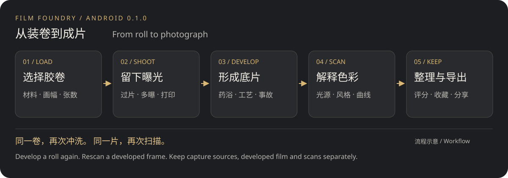

[拍摄](#capture) · [冲洗](#develop) · [扫描](#scan) · [图库](#library) · [安装与支持范围](#install)

## 拍摄：让这一卷有自己的性格

选择彩色或黑白、负片或反转片，以及135、半格或120画幅。横屏取景支持点击对焦测光、缩放、曝光补偿；镜头与闪光选项取决于设备。

| 拍摄首页：继续当前胶卷 | 胶卷库：区分在拍与已封卷 |
| --- | --- |
| 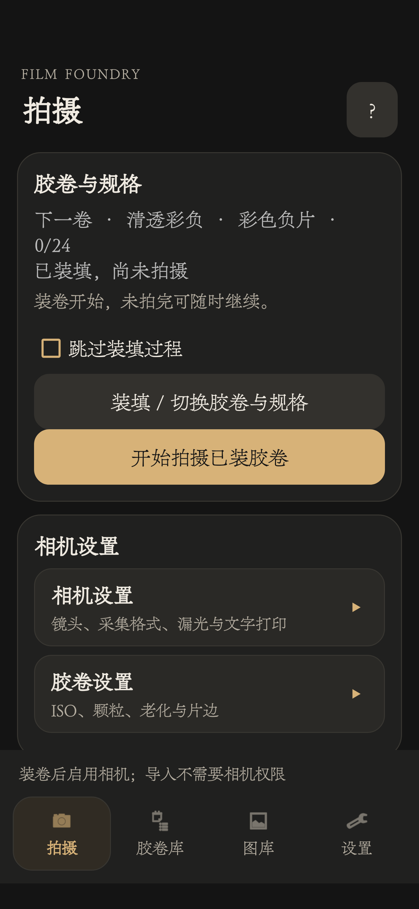 | 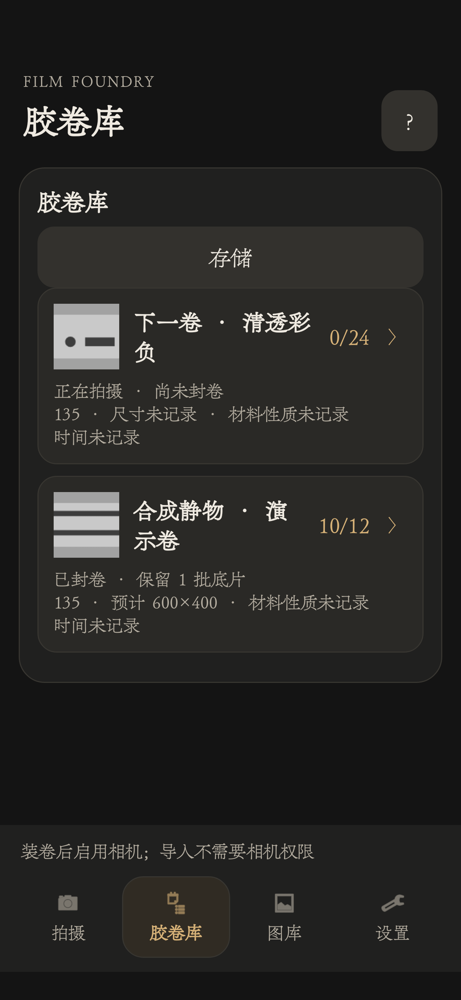 |

以下竖屏截图均来自独立演示副本中的真实手机界面，使用程序生成的静物与胶卷记录，没有打开真实相机。演示记录缺少的拍摄元数据仍如实显示“未记录”。图中的600×400是演示图尺寸，不是应用输出上限。

手动过片让每一格曝光有明确的开始和结束，自动过片适合连续拍摄；多重曝光可以在同一格叠加。135宽幅开关可在未过片时切换，每次曝光独立保留遮幅状态。

### 文字打印

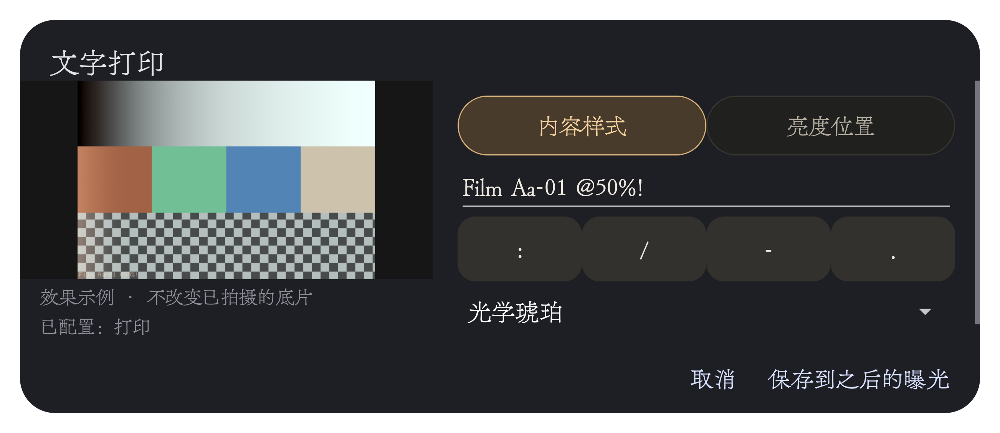

上图是0.1.0测试系列中实际手机窗口的截图，预览内容为程序生成的色块与棋盘格，不是相机实拍。左侧保留样张，右侧编辑文字或切换到亮度与位置设置。

- 最多24个英文字母、数字、空格及英文标点，保留大小写；纯日期继续使用原数字字形。
- 打印亮度0–200%，可选四角，也可通过水平与垂直位置自由微调。
- 保存用于之后的曝光；已有曝光保持原样。文字在曝光阶段参与成像。

### 漏光、片门与材料效果

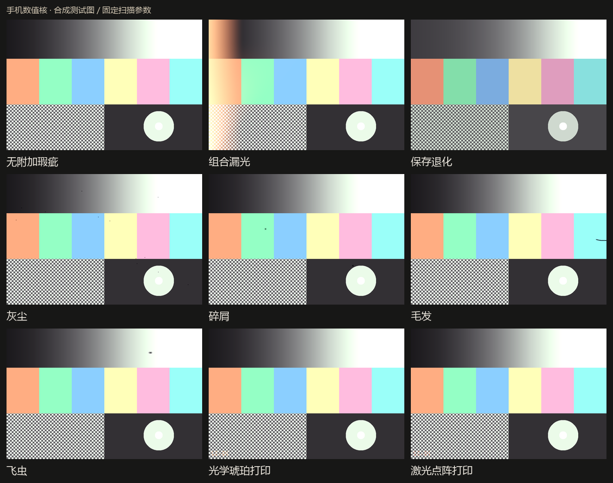

这张图由手机数值核处理合成目标得到，固定扫描参数，用于说明效果类型；它不是手机界面或自然场景实拍。漏光与片门效果、材料退化、文字打印分别设置；颗粒、MTF与光晕也可在装卷前选择强度。

## 冲洗：同一卷，尝试不同的结果

封卷后，从推荐工艺开始，或进入自由冲洗台排列药浴、设置时间、温度、浓度与摇晃。可以尝试交叉冲洗、留银，也可以加入显影不匀、污染与乳剂网裂。准备页先展示材料、工艺、预期底片与处理顺序。

每次冲洗形成独立批次。选择只保留底片，或在完成后自动扫描；自动扫描的格式、位深和JPG质量可在“扫描与保存”设置。长按胶卷页的冲洗批次即可管理结果，不必先进入详情。

| 胶卷详情与冲洗批次 | 冲洗准备与工艺顺序 |
| --- | --- |
| 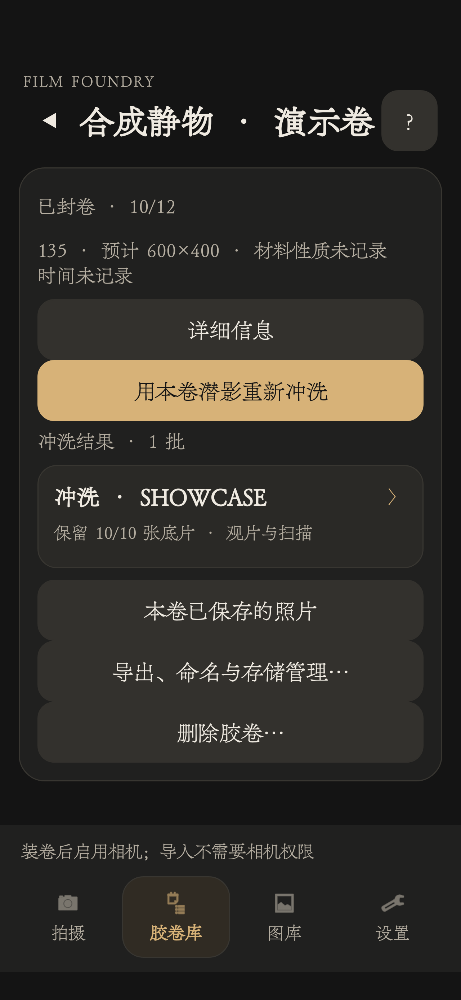 | 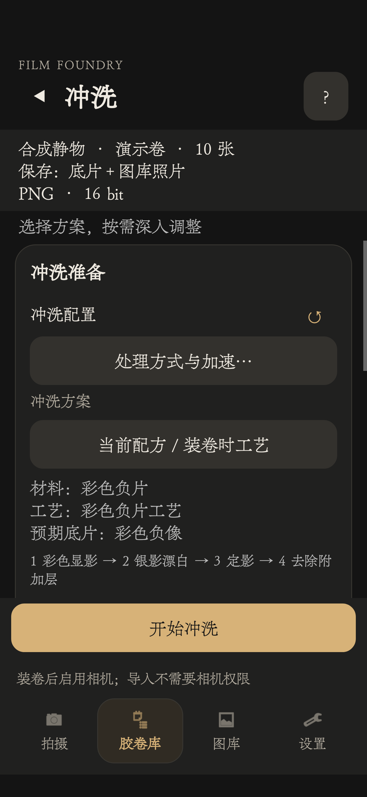 |

胶卷详情集中保留重新冲洗、查看结果与导出入口；准备页先说明这次保留哪些资源，以及实际将执行的工序。

## 观片与扫描：保留底片，继续调整

灯台呈现底片本身的正负像，实景透射将透明底片放到相机背景前观看，扫描则把最终介质解释为照片。扫描不会反写或改变已经冲洗形成的底片。

从扫描风格开始，再调整去片基与反相、光源、明暗、归一化、饱和度及影调／RGB曲线。预览提供直方图和按住对照，修改支持撤销与重做；保存后可继续调整，并保留之前的版本。

| 底片与自动反相 | 影调／RGB曲线 | 输出尺寸 |
| --- | --- | --- |
| 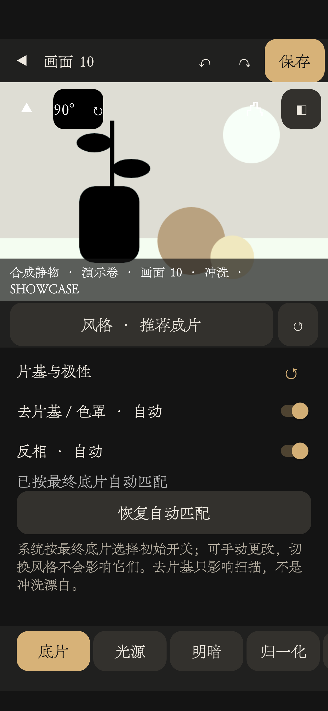 | 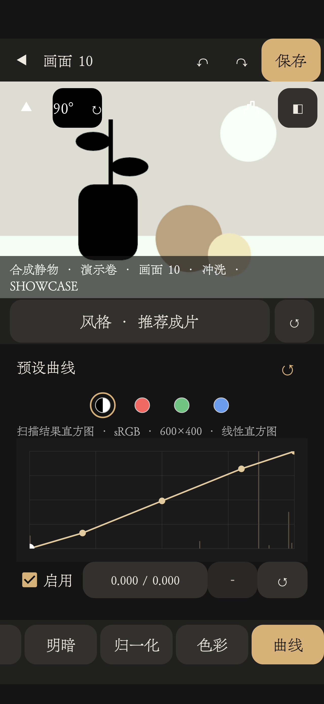 | 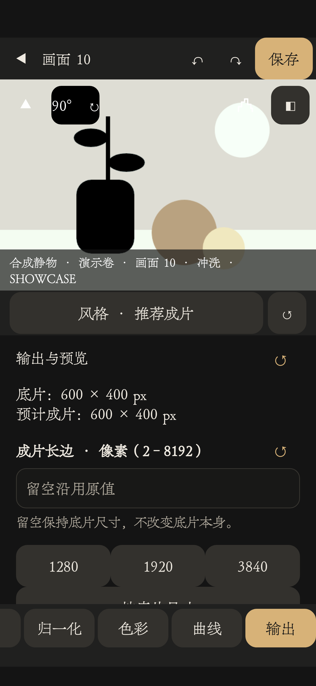 |

切换工具时，上方保留同一张底片的预览。曲线页切换影调或RGB通道，输出页设置成片尺寸；格式与质量控制位于同页下方。

| 输出 | 用途 |
| --- | --- |
| JPG，低／中／高（40／70／100） | 8位有损照片，便于分享 |
| PNG，8位／16位 | 无损成片 |
| TIFF，16位 | 保存到文件夹，继续后期 |

已有JPG不能通过改扩展名恢复为高精度无损成片，需要从来源底片重新扫描。系统相册支持JPG／PNG；TIFF使用文件导出。

## 图库：看图、筛选，也能找到来源

布局按钮在三列、五列与列表之间轮换。三列与五列分别用于大图、小图浏览，详细信息留给列表；浏览方式可选翻页或连续滑动。照片由缩略图衔接高清图，长按进入多选管理。

| 三列大图 | 五列小图 | 列表详情 |
| --- | --- | --- |
| 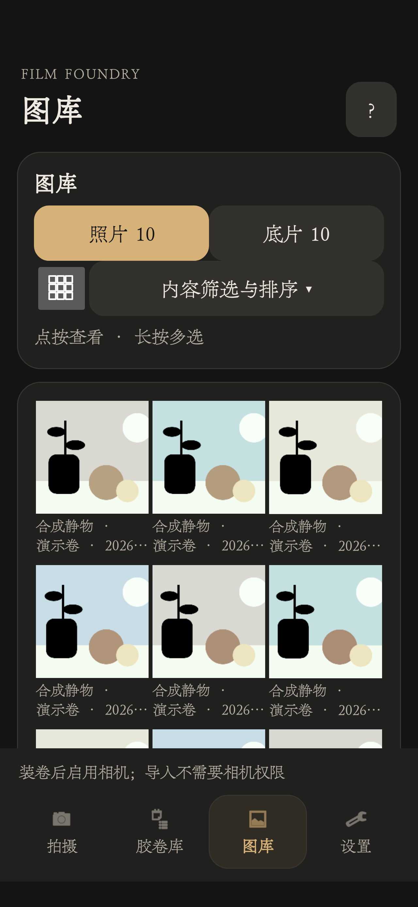 | 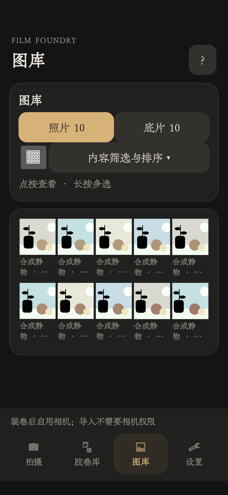 | 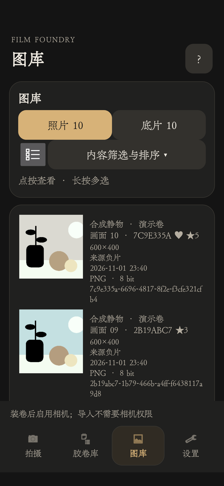 |

评分和收藏独立设置；内容筛选支持胶卷、仅收藏与评级条件（大于、小于、大于等于、小于等于），可按创建时间、文件大小或卷名排序。

| 内容筛选与排序 | 大图中的评分与收藏 |
| --- | --- |
| 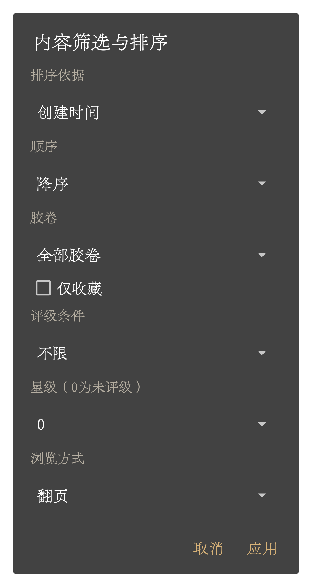 | 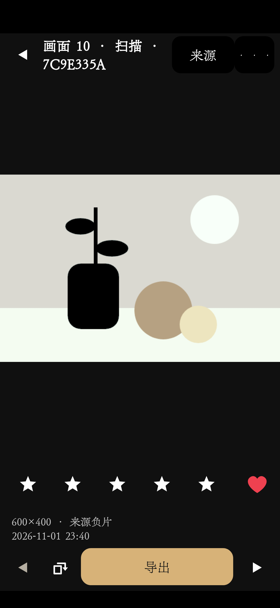 |

| 保留内容 | 可以继续做什么 |
| --- | --- |
| 原片与潜影 | 回到同一卷，再次冲洗 |
| 冲洗底片 | 观片、重新扫描、导出光学材料 |
| 扫描照片 | 评分、收藏、导出、追溯来源 |

三层分别保存。删除某层不会自动删除另外两层；来源缺失会明确提示。换机或卸载前应先导出需要的原片、潜影、底片和成片。

## 安装与当前支持范围

APK文件名末尾标明架构：`arm64-v8a`、`armeabi-v7a`、`x86_64`、`x86`；不确定时可用`universal`通用包。每个包都能单独安装。现阶段实机验证集中在ARM64手机，其他架构完成构建但尚未实机验证；暂无iOS版本。[编译与架构说明](../android/README.md)

JPEG采集是常规入口。RAW与Ultra HDR提供最小支持，受设备能力与格式限制：当前RAW路径主要支持未压缩8／16位Bayer DNG；Ultra HDR需要Android 14+、兼容的sRGB基图与真实增益图。广色域P3、压缩DNG等不在完整支持范围内，扫描输出仍是SDR照片。

设置中的“计算与加速”提供GPU自动择优和硬件自测。符合校验与耗时条件的步骤可使用GPU，不可用或失败时回退CPU；完整显影并非全部在GPU执行。拍摄保留原片，部分潜影形成计算延后到处理阶段，因此完整冲洗等待也可能包含这部分工作。硬件自测的计算块成绩不能当作整张照片的耗时承诺。

手机与桌面共享潜影／光学介质格式和FFC2配方，使用各自的计算实现；不承诺两端逐像素一致。更多操作、保存与恢复方式见[手机指南](MOBILE_GUIDE.md)。

### 图片说明

本页流程图为项目绘制的示意图；打印截图来自隔离的合成窗口，12张新增竖屏截图来自独立演示安装中的生产界面，效果图来自手机数值核的合成样本。截图按原图展示，未重绘控件；演示静物经手机曝光、冲洗与扫描计算生成，用于说明操作布局，不作为自然场景的效果评价。图片随本项目按GPL-3.0-or-later提供，不含私人相册素材。界面字体随设备系统设置变化。
