# 把一卷照片拍完，再决定怎样冲洗

[English](MOBILE_SHOWCASE.en.md) · [手机操作指南](MOBILE_GUIDE.md) · [项目首页](../README.md)

Film Foundry 手机版围绕**装卷、拍摄、冲洗、观片与扫描**组织创作。先选材料与画幅拍完一卷，封卷后再决定冲洗工艺形成底片，最后通过光源、色彩与曲线输出成片。同一卷可反复冲洗，同一张底片也可保留多个扫描版本。

**Android 0.1.0 测试版 · Android 8.0+ · 中文 / English · 多套外观主题**

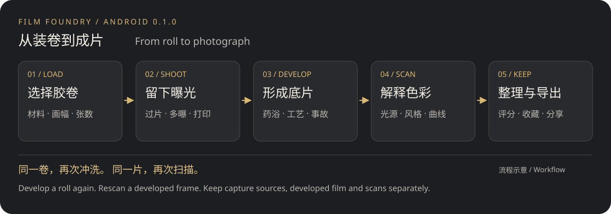

[拍摄](#capture) · [冲洗](#develop) · [扫描](#scan) · [图库](#library) · [安装与支持范围](#install)

---

## 拍摄：让这一卷有自己的性格

在装卷时选择彩色或黑白、负片或反转片，以及 135、半格或 120 画幅。横屏取景支持点击对焦测光、缩放与曝光补偿，可用镜头与闪光灯选项取决于设备能力。

| 拍摄首页：继续当前胶卷 | 胶卷库：区分在拍与已封卷 |
| --- | --- |
| 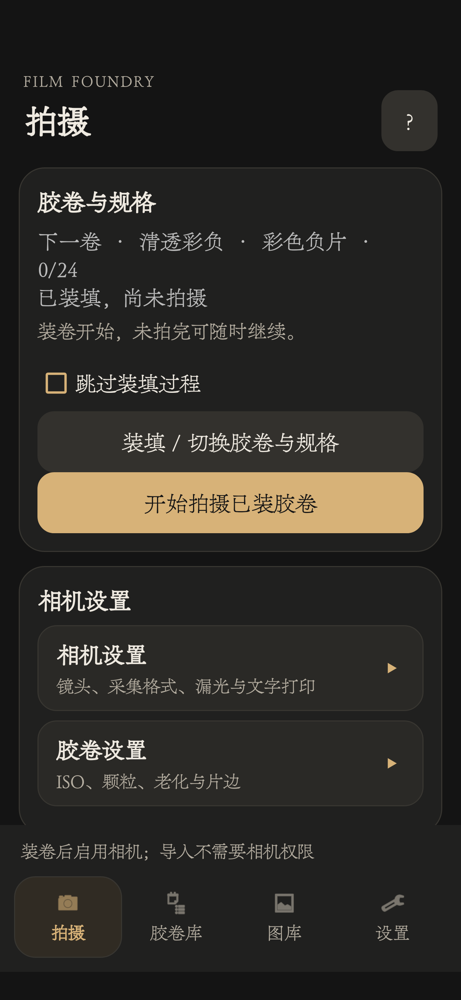 | 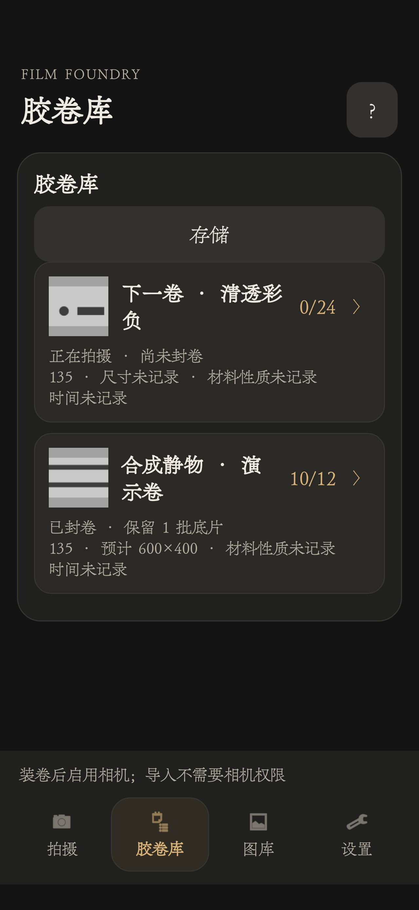 |

> 以下竖屏截图均来自独立演示副本中的真实手机界面（采用程序生成的静物与胶卷记录，未调用真实相机）。图中的 600 × 400 为演示输入尺寸，并非应用输出上限。

手动过片让每一格都有清晰的起止，自动过片适合连续拍摄；多重曝光可在同一格反复叠加；135 宽幅开关在未过片时可随时切换，每次曝光独立保留遮幅状态。

### 文字打印

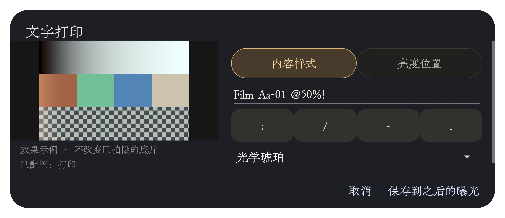

左侧固定实时样张，右侧编辑文字内容或切换亮度与位置设置：

- 最多支持 24 个大小写英文字母、数字、空格及英文标点，纯日期保留经典数字字形；
- 打印亮度 0–200%，支持四角快速定位与水平/垂直精细微调；
- 文字在曝光阶段参与成像，保存后仅作用于后续曝光，已有曝光不变。

### 漏光、片门与材料效果

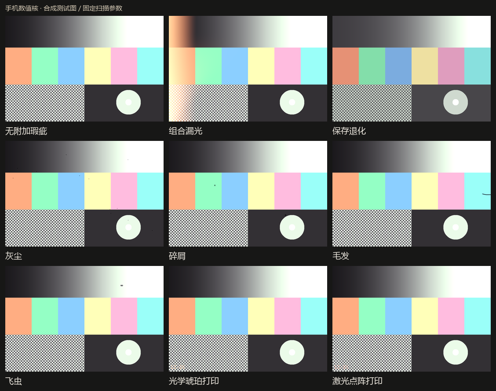

上图由手机数值核处理合成目标生成（固定扫描参数），用于直观展示各类效果。漏光、片门脏物、材料退化与文字打印各自独立设置，颗粒、MTF 与光晕强度也可在装卷前选择。

---

## 冲洗：同一卷，尝试不同的结果

封卷后可直接使用推荐工艺，或进入 **自由冲洗台** 自定义药浴顺序、时间、温度、浓度与摇晃，体验交叉冲洗、留银以及显影不匀、化学污染与乳剂网裂。准备页会先清晰列出材料、工艺、预期底片与实际执行顺序。

每次冲洗生成独立批次：可仅保留底片，或在冲洗后自动扫描进图库（自动扫描的格式、位深与 JPG 质量在“扫描与保存”中配置）。在胶卷页长按冲洗批次即可直接管理结果。

| 胶卷详情与冲洗批次 | 冲洗准备与工艺顺序 |
| --- | --- |
| 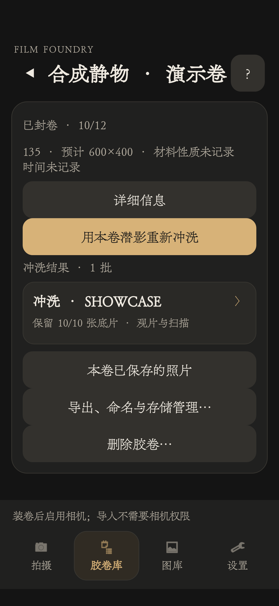 | 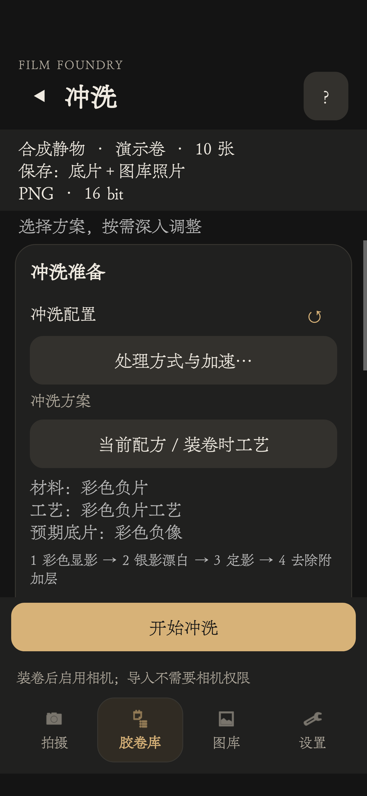 |

---

## 观片与扫描：保留底片，继续调整

灯台按底片原有正负极性展示，实景透射将透明底片叠在实时相机背景前观看，扫描则把最终介质解释为照片——**始终只读，绝不回写或改变底片**。

扫描从预设风格起步，进一步调节去片基与反相、光源、明暗、归一化、饱和度、分色 HSL 及影调/RGB 曲线；支持直方图叠层、长按对照与多步撤销/重做，保存后可继续微调并保留历史版本。

| 底片与自动反相 | 影调 / RGB 曲线 | 输出尺寸 |
| --- | --- | --- |
| 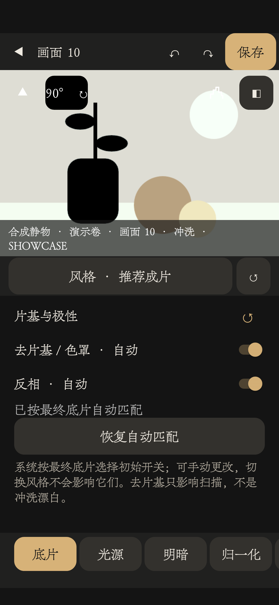 | 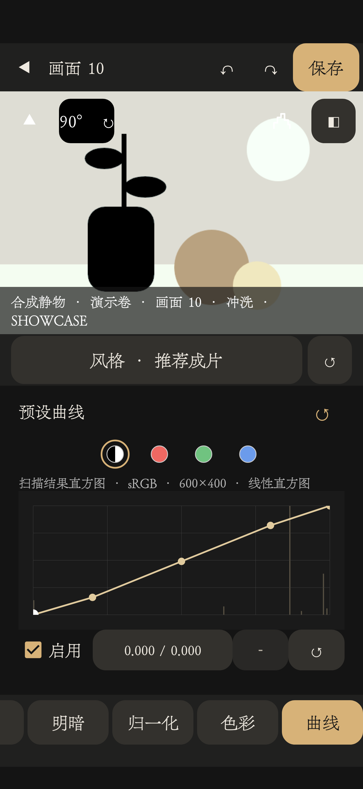 | 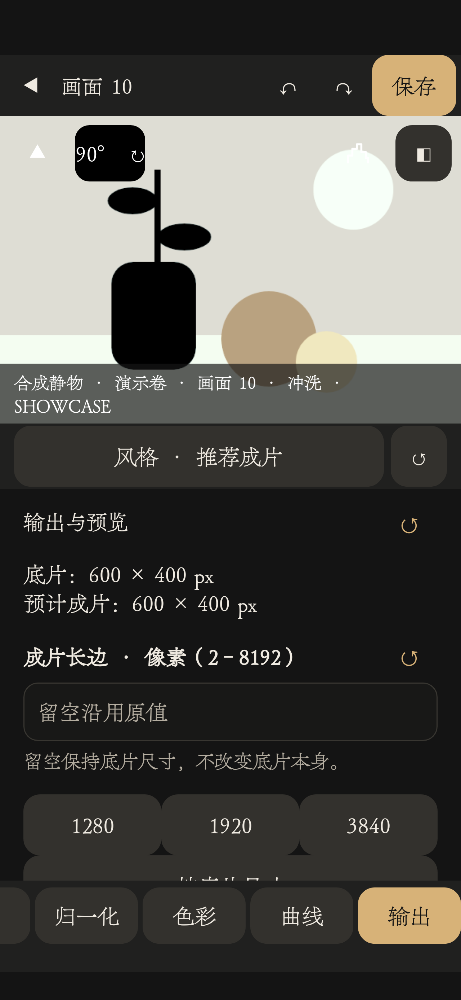 |

| 输出格式 | 适用场景 |
| --- | --- |
| JPG（低 / 中 / 高：40 / 70 / 100） | 8 位有损照片，便于日常分享 |
| PNG（8 位 / 16 位） | 无损成片，支持系统相册与文件导出 |
| TIFF（16 位） | 导出至文件夹，适合继续后期 |

> 已有 JPG 无法靠改格式恢复高精度无损细节，请回到来源底片重新扫描。

---

## 图库：看图、筛选，也能追溯来源

布局按钮在三列大图、五列小图与详细列表之间切换，支持翻页或连续滑动浏览；点击看图时由缩略图平滑衔接高清原图，长按进入批量选择。

| 三列大图 | 五列小图 | 列表详情 |
| --- | --- | --- |
| 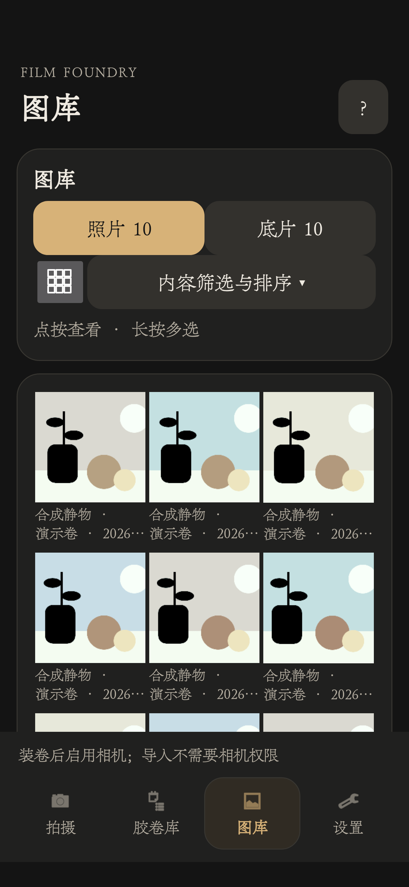 | 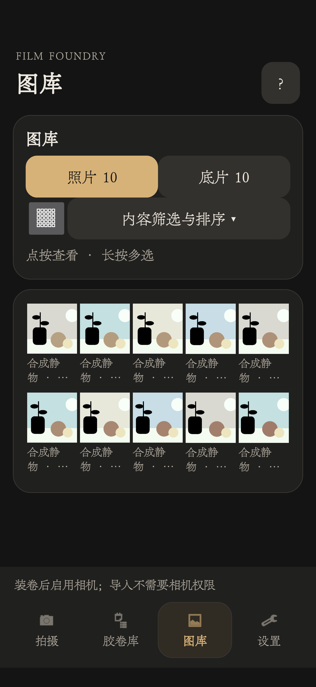 | 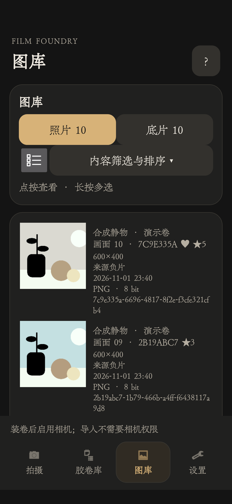 |

评分与收藏独立管理；支持按胶卷、仅收藏及评级条件（`>`、`<`、`≥`、`≤`）筛选，并按创建时间、文件大小或卷名排序。

| 内容筛选与排序 | 大图中的评分与收藏 |
| --- | --- |
| 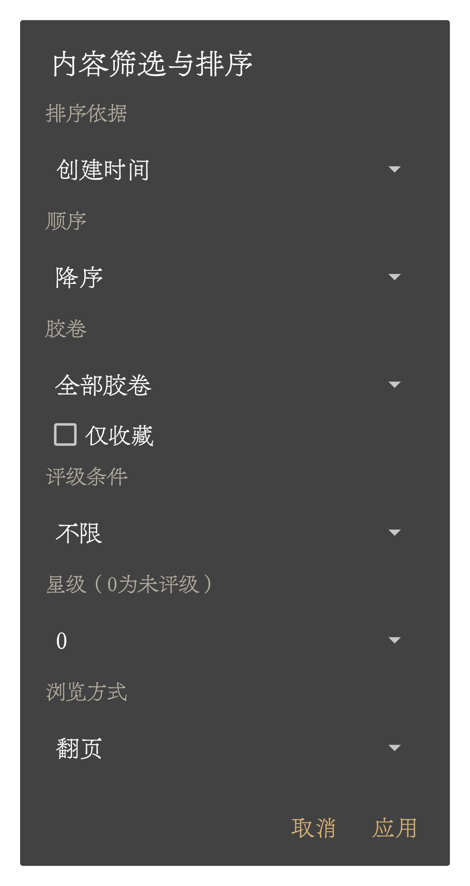 | 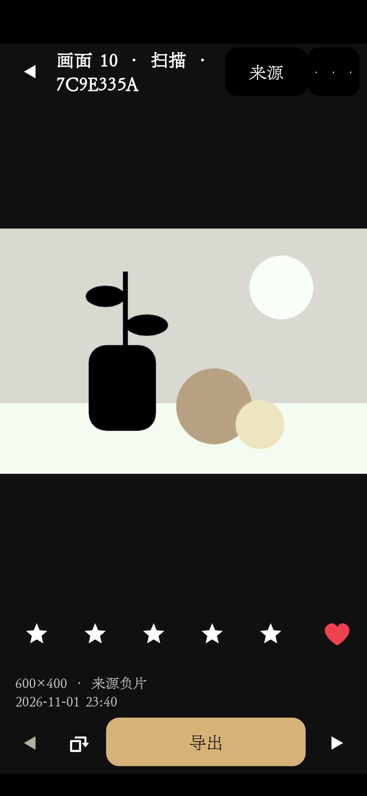 |

| 资源层 | 可继续执行的操作 |
| --- | --- |
| 原片与潜影 | 回到同一卷，再次以不同工艺冲洗 |
| 冲洗底片 | 观片、重新扫描或导出光学 NPZ |
| 扫描照片 | 评分、收藏、导出与追溯来源 |

三层资源彼此独立，删除其一不会级联删除另外两层；换机或卸载前请先导出需要保留的文件。

---

## 安装与当前支持范围

- **安装架构**：提供 `arm64-v8a`、`armeabi-v7a`、`x86_64`、`x86` 与 `universal` 通用包，均可独立安装。现阶段实机验证集中在 **ARM64 手机**，暂无 iOS 版本。[编译与架构说明](../android/README.md)
- **采集格式**：JPEG 为常规入口；RAW 支持未压缩 8 / 16 位 Bayer DNG 与三通道交错 LinearRaw DNG；Ultra HDR 需 Android 14+、兼容 sRGB 基图与真实增益图。压缩 DNG 与广色域 P3 暂未完整支持，扫描输出仍为 SDR 照片。
- **GPU 协同加速**：「计算与加速」提供 GPU 自动择优与硬件自测，仅在精度校验与含传输耗时达标时启用 OpenGL ES 3.1，失败自动回退 CPU（完整显影并非全部在 GPU 执行，硬件自测成绩不等同于整张成片耗时）。
- **跨端互通**：手机与桌面共享潜影/光学 NPZ 格式与 FFC2 配方，各自独立计算，不承诺逐像素一致。更多操作与导出细节见[手机操作指南](MOBILE_GUIDE.md)。

### 图片说明

本页流程图为项目原创绘制，文字打印截图来自隔离合成窗口，12 张竖屏界面截图取自独立演示安装中的真实生产界面，效果图由手机数值核处理合成样本生成。所有图片随本项目按 GPL-3.0-or-later 提供，不含任何私人相册素材。
