# Examples and Recipes

[中文](SHOWCASE.md) · [Desktop guide](DESKTOP_GUIDE.en.md) · [Project home](../README.en.md)

[Film sensitivity](#film-stocks) · [Coating response and grain](#coatings) · [Color film filters](#lens-filters) · [B&W filters](#silver-filters) · [Instant film, plates & prints](#materials) · [Three-scene recipes](#recipes) · [Same latent, different processes](#shared-process) · [Grain, MTF & halation](#details)

---

<a id="film-stocks"></a>

## How do different film stocks render the same red fruit?

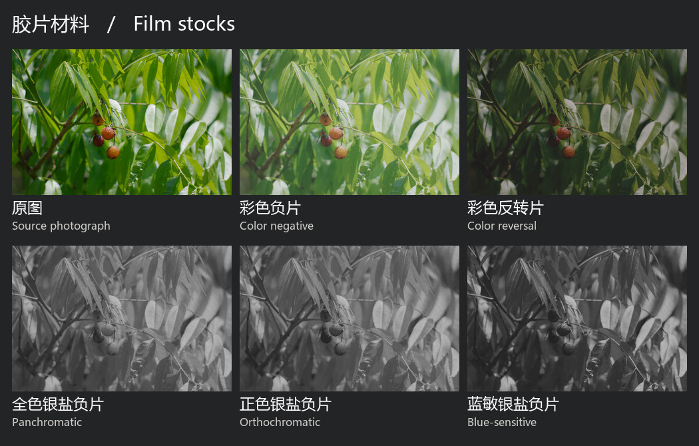

Focus on the red fruit in the center. The panchromatic silver negative preserves rich midtones on the skin; switching to the orthochromatic stock darkens the red fruit noticeably against the green leaves; switching to the blue-sensitive stock deepens the foliage shadows as well. All three monochrome negatives were created from the material editor's **Build material…** templates (panchromatic, orthochromatic, and blue-sensitive silver negatives) and processed with identical B&W development and scanning—the tonal differences originate purely during emulsion exposure.

The top row shows paired color negative and color reversal results. The filter comparisons and CLI examples below reuse our photograph of red fruit and green leaves (720 px long edge), available for direct download and reproduction: [Source photograph](images/fruit-and-leaves.jpg).

---

<a id="coatings"></a>

## What changes when two emulsions respond to different wavelengths?

The four scans use the same project photograph, experimental stock, baths, scan settings and random seed. The cyan-forming emulsions were assigned a green band (520–555 nm), and the yellow-forming emulsions a red band (615–680 nm). The left column uses RGB response; the right uses reconstructed spectral exposure and the stock’s wavelength-dependent filter. Compare the fruit and leaves across each row to see the color shift.

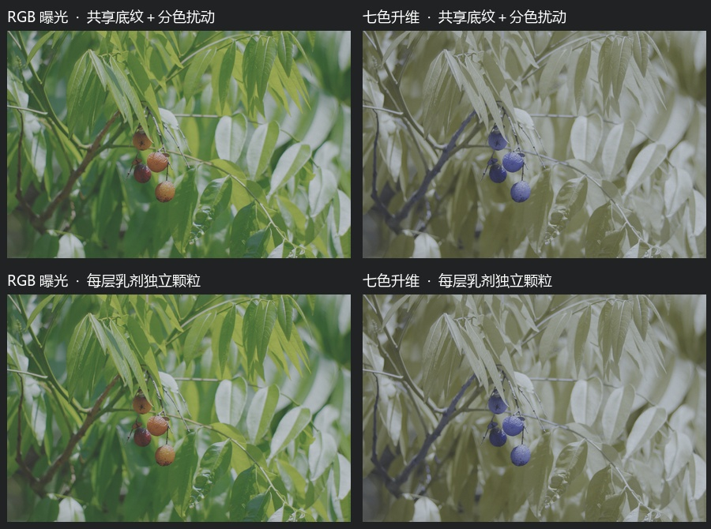

The bottom row enables independent grain for each emulsion. The crops below show the same small area of the spectral scans enlarged 3×. Compare the texture inside a leaf. [Recreate the comparison in the workbench](DESKTOP_GUIDE.en.md#coatings).

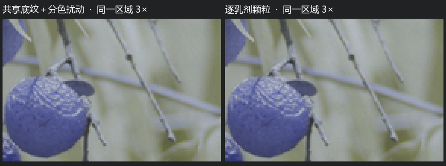

---

<a id="lens-filters"></a>

## How do lens filters affect color negative and reversal film?

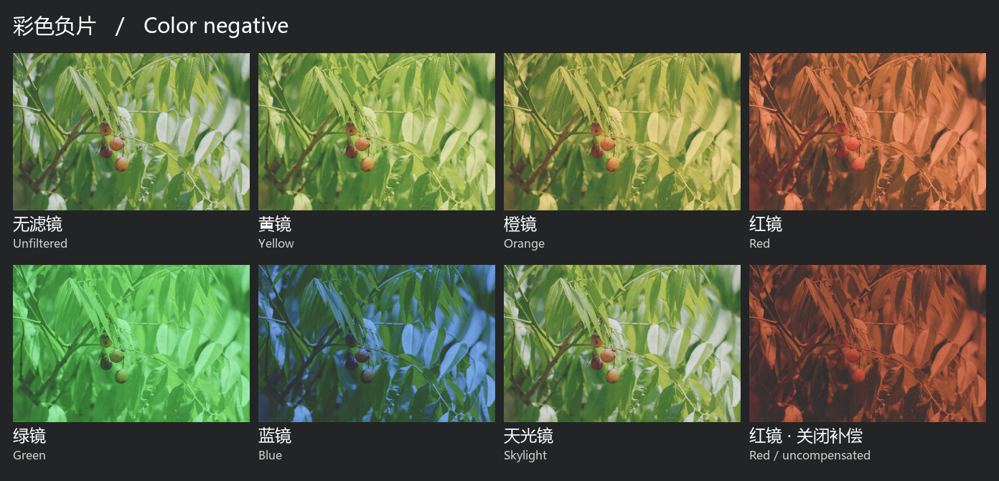

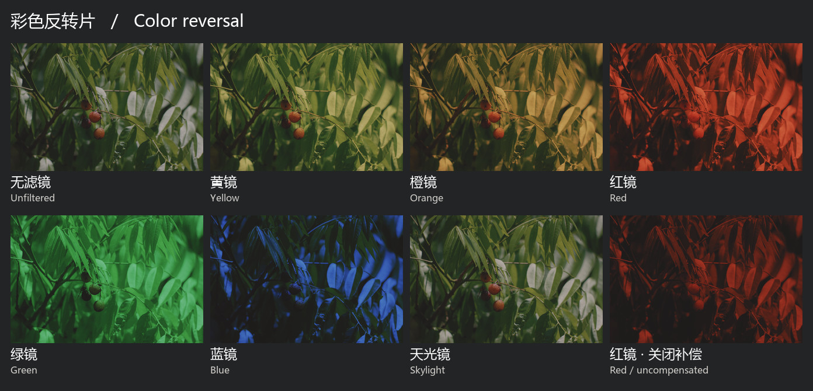

Both grids use the exact same filter order. Compared to the unfiltered top-left reference, yellow and orange push the foliage progressively warmer, blue strongly darkens the red fruit, and skylight adds a subtle warm shift. The right column compares the same red filter with neutral-light compensation enabled (top) versus disabled (bottom)—pay attention to shadow separation in the reversal foliage.

| Grid | Material preset | Development preset | Scanner preset |
| --- | --- | --- | --- |
| Color negative | `clear_modern_negative` | `standard_color_negative` | `neutral_scan` |
| Color reversal | `color_reversal_transparency` | `standard_color_reversal` | `positive_transparency_scan` |

Shared settings: `0 EV` exposure, fixed seed `43`, scanner auto-normalization disabled; all six filters use neutral compensation except the bottom-right cell. Run the command below to reproduce the compensated blue-filter color negative (replace `blue` with `yellow`, `orange`, `red`, `green`, or `skylight` to compare the others):

```bash
python -m film_foundry.app.cli full docs/images/fruit-and-leaves.jpg outputs/blue-compensated.png \
  --film-preset clear_modern_negative --develop-preset standard_color_negative --scanner-preset neutral_scan \
  --seed-strategy fixed --seed 43 --exposure-ev 0 --no-scan-normalize --format png \
  --lens-filter blue --filter-compensation
```

---

<a id="silver-filters"></a>

## How much light does a red filter lose on three B&W emulsions?

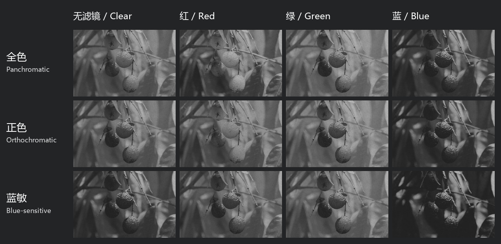

Compare the three emulsions vertically in the left column first, then read across the panchromatic row: red lifts the fruit out of the foliage, while blue darkens it. All cells use `standard_bw_negative` development and `bw_neutral_scan` with the same exposure, seed, and normalization settings as above, cropped to an identical 260 × 170 px region after scanning.

Each colored-filter column applies neutral compensation for its respective emulsion. For the red filter alone, panchromatic, orthochromatic, and blue-sensitive emulsions require **+1.85 EV, +3.85 EV, and +5.74 EV** respectively—almost six stops on blue-sensitive film, so read that cell's brightness alongside its compensation amount.

> **Model scope**: Inputs are RGB images, filters use visible-light linear RGB transmittances, and silver emulsions use analytic sensitivity curves. These stop values apply to this model; consult manufacturer filter factors for real-world film shooting.

---

<a id="materials"></a>

## Instant film, plates, and printing papers

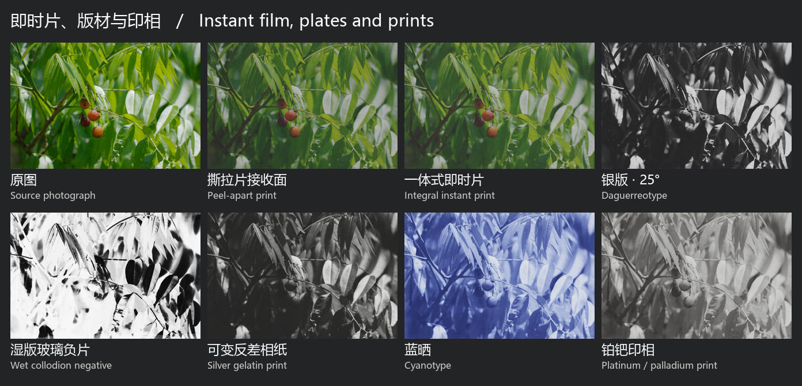

| Position | Medium & visual cues |
| --- | --- |
| Top row, two color prints | Peel-apart receiver sheet and stabilized integral instant print; compare dye-transfer rendering on the red fruit and leaf veins |
| Top right & bottom left | Daguerreotype observed at a 25° specular viewing angle; wet-plate collodion glass negative viewed in transmission, where brighter leaves form denser silver |
| Bottom row, three papers | Printed from reference negatives and viewed after 3600 s simulated drying; compare silver-gelatin blacks, cyanotype Prussian blue, and platinum/palladium tonal roll-off |

All samples use default desktop material definitions and standard processes (720 px long edge, seed `13579`). [Replay material recipes from the CLI](DESKTOP_GUIDE.en.md#cli)

---

<a id="recipes"></a>

## Overall styles and three-scene recipes

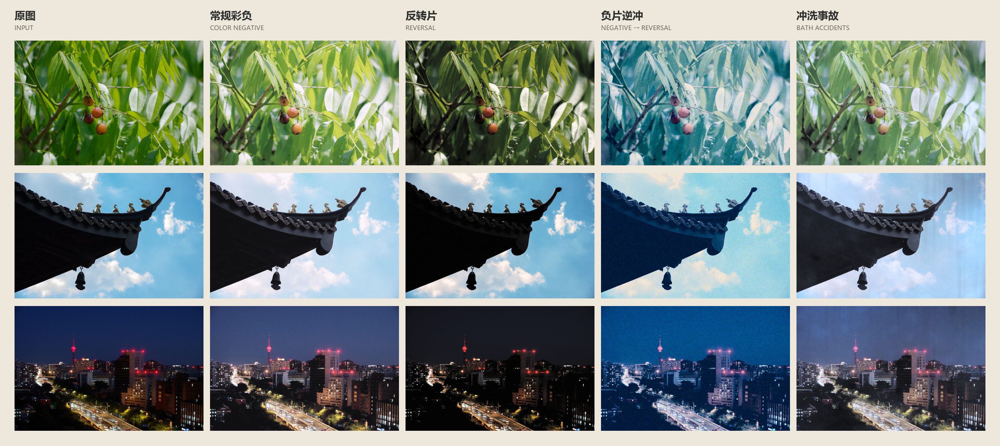

Three scenes—red fruit and leaves, eaves and sky, and city night—processed through four material/process pairings:

| Column | Material preset | Process | Scanner starting point |
| --- | --- | --- | --- |
| Standard color negative | `vivid_balanced_negative` | `standard_color_negative` | `chrome_saturated_scan` |
| Color reversal | `color_reversal_transparency` | `standard_color_reversal` | `positive_transparency_scan` |
| Cross-processed negative | `warm_consumer_negative` | `experimental_color_negative_clear_reversal` | `positive_transparency_warm` |
| Processing accidents | Same as color negative | Color negative + chemical stain & uneven development | Same as color negative |

Shared settings: 1536 px long edge, full model / Standard, grain/MTF/halation enabled, fixed seed `4040`, incident identity `404026`. Scanner adjustments applied on top of the starting presets:

### Scanner settings

| Parameter | Color negative & accidents | Reversal | Cross-processed negative |
| --- | --- | --- | --- |
| Light EV | 0 | 0.35 | 1.45 |
| Normalization mode / strength | `luma` / 0.82 | `luma` / 0.90 | `rgb` / 0.65 |
| Saturation | 1.14 | 1.12 | 1.60 |
| Positive color-control strength | — | 1 | 1 |
| Black adaptation | — | 0 | 0 |
| Highlight softness | — | 0.22 | 0.18 |

- **Color negative & accidents tone curve**: `[(0, 0), (0.18, 0.16), (0.5, 0.5), (0.8, 0.8), (1, 0.99)]`
- **Cross-processed negative tone curve**: `[(0, 0), (0.20, 0.13), (0.45, 0.45), (0.75, 0.82), (1, 1)]` (mask-bleach dye damage `0.06`, dye coupling efficiency `1.12`, mask bleach completion `1`)

### Processing accident settings

| Parameter | Value |
| --- | --- |
| Time / Temperature | 11 min / 26 °C |
| Agitation / Developer exhaustion | 0.35 / 0.28 |
| Chemical stain / Uneven development | 0.88 / 0.82 |
| Reticulation / Dye damage | 0.10 / 0.28 |
| Grain multiplier | 1.14 |

<details>
<summary>Expand individual full-scene comparisons</summary>

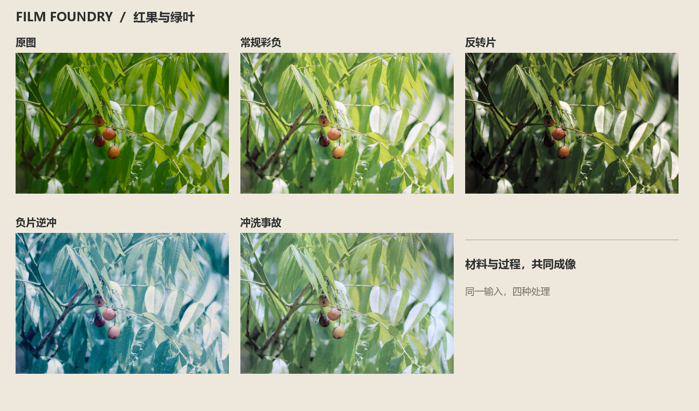

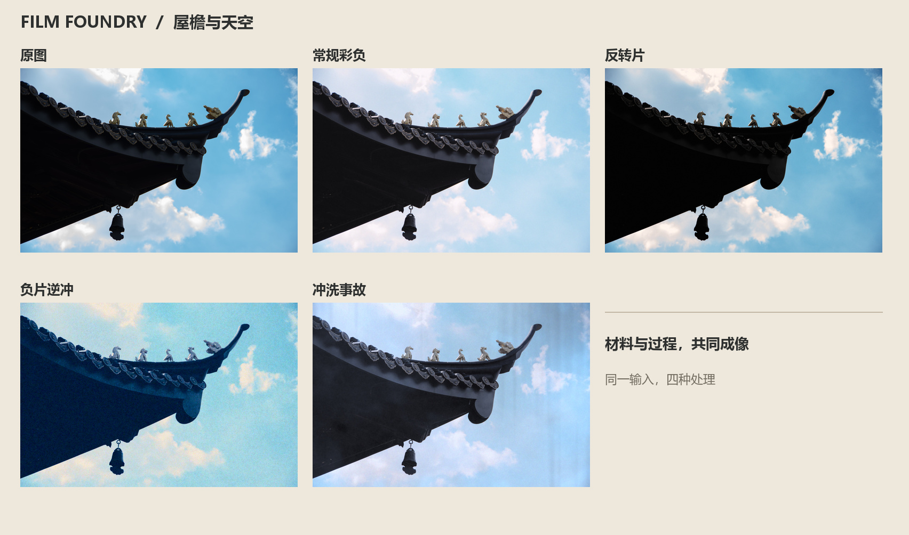

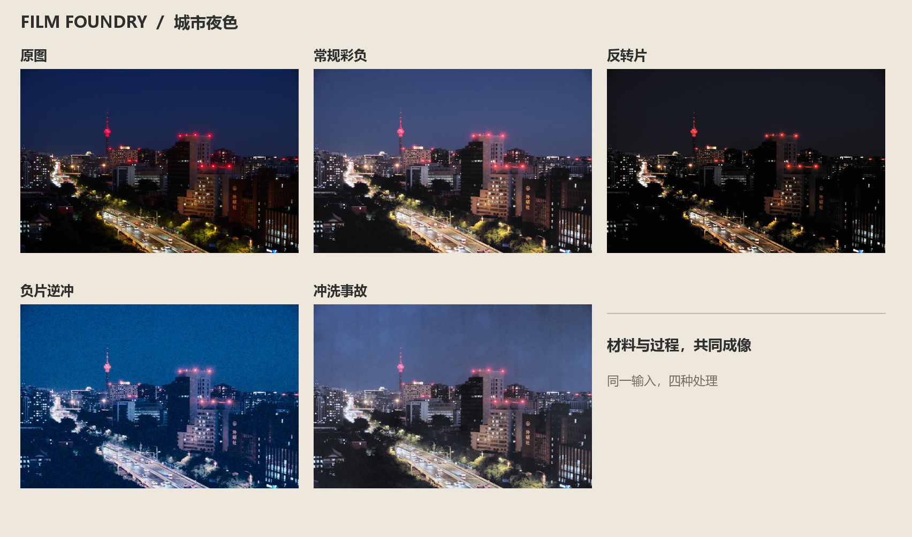

</details>

---

<a id="shared-process"></a>

## One latent image, three different processes

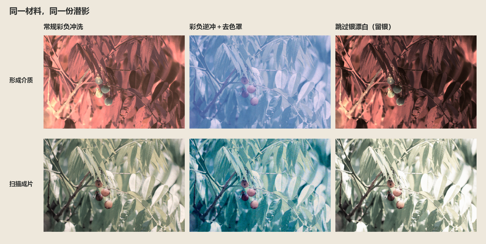

A single exposed latent image is processed through three different bath sequences. Developed media viewed in transmission appear on top; scans appear below:

| Process | Key steps | Resulting medium |
| --- | --- | --- |
| Standard color negative | Color development, silver bleach, fix | Dye negative |
| Cross reversal + mask bleach | First dev, remaining-halide activation, color dev, silver bleach, experimental mask bleach | Clear-base positive transparency |
| Bleach bypass (silver retention) | Color development and fix (skipping silver bleach) | Negative combining dye and metallic silver |

**Silver bleach** converts metallic silver into fixable salt; **mask bleach** weakens the colored masking coupler with partial dye loss; **scanner base removal** only balances observation. Each belongs to a distinct stage and cannot substitute for another.

**Settings**: `warm_consumer_negative` (mask-bleach dye damage `0.06`), 1024 px long edge, full model / Standard, fixed seed `4040`. Transmission previews use a neutral light at `+2.5 EV`; scan settings match the [three-scene recipes](#recipes); bleach-bypass sets `silver_bleach_completion=0` and `mask_bleach_completion=0`. [Kodak bleach-bypass process reference](https://www.kodak.com/en/motion/page/processing-techniques/)

---

<a id="details"></a>

## Grain, MTF, and halation close-ups

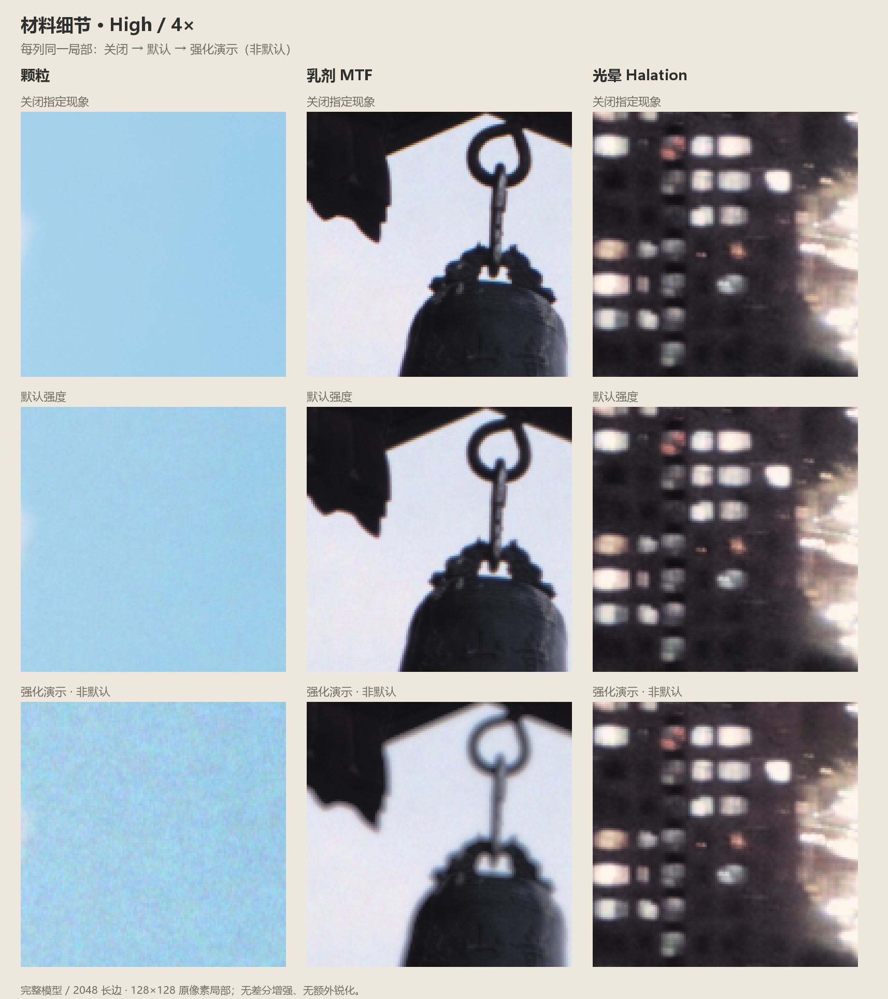

Each column compares the same 128 × 128 px crop enlarged 4× from a 2048 px full-model / High render, ordered **Off → Default → Boosted** from top to bottom:

| Phenomenon | Material preset | Default | Boosted |
| --- | --- | --- | --- |
| Grain | `vivid_balanced_negative` | Multiplier 1 | `look.grain_multiplier = 3` |
| Emulsion MTF | Same as above | Strength 0.17, radius 0.0009 | Strength 0.70, radius 0.0022 |
| Halation | `warm_consumer_negative` | Strength 0.20, threshold 0.68 | Strength 0.65, threshold 0.55 |

Grain is cropped from the sky, MTF from roof eaves and bell edges, and halation from night-scene point highlights. Default settings are intentionally subtle; the boosted row makes parameter direction easy to inspect.
