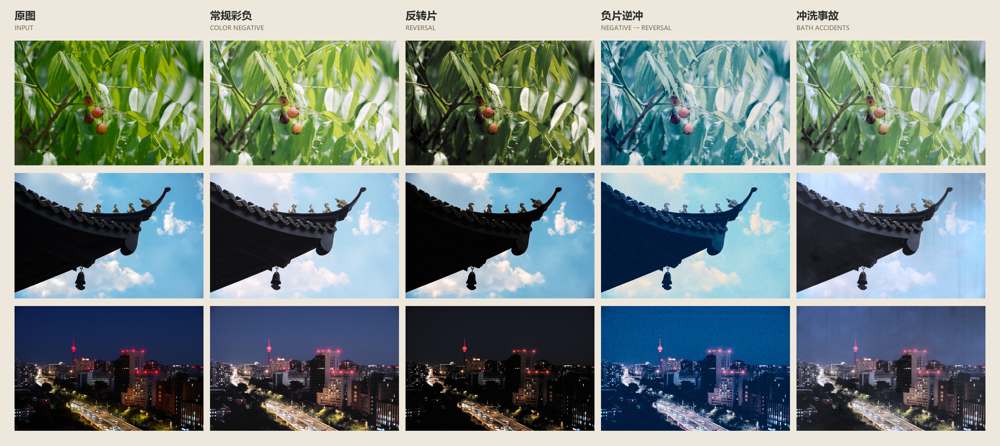
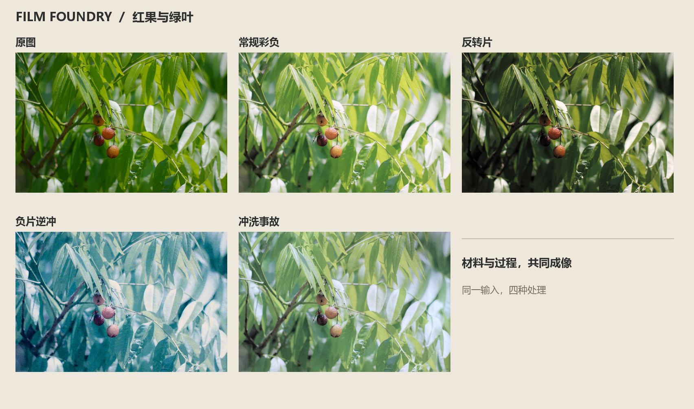
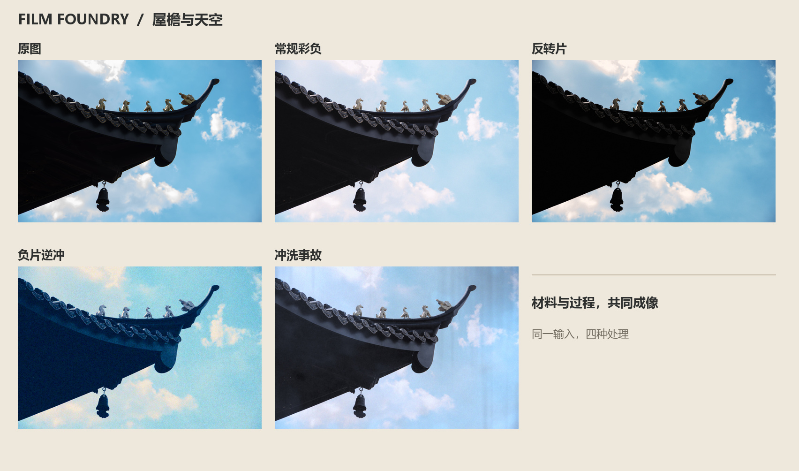
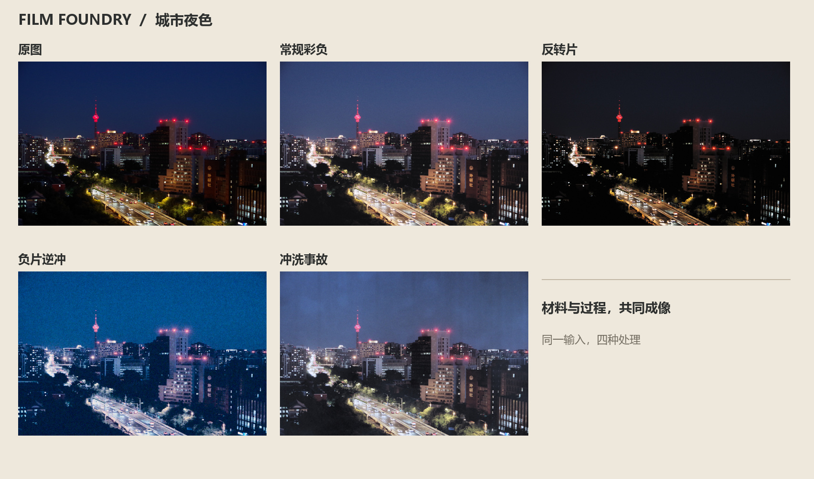
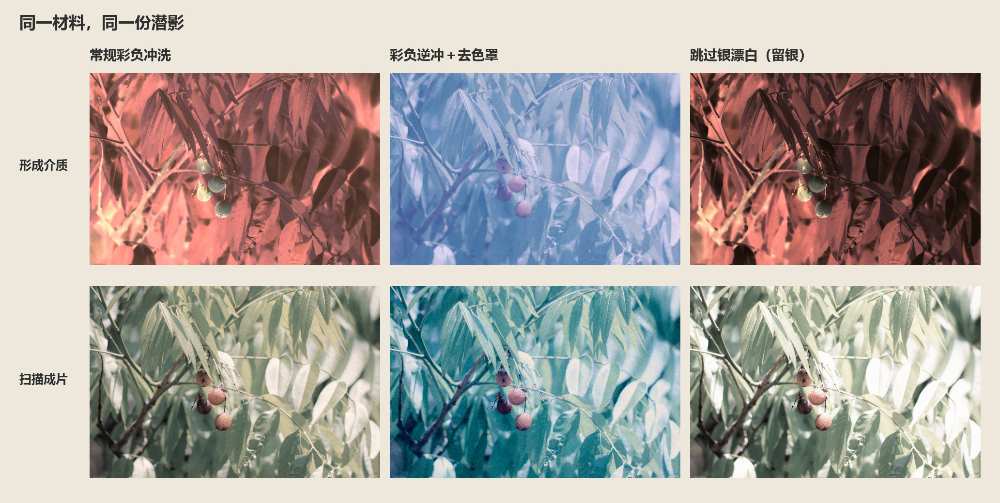
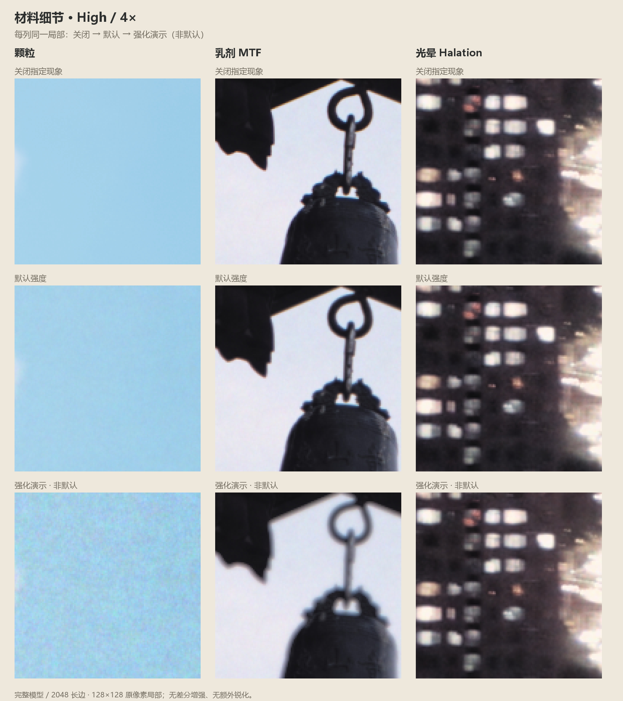

# 效果展示与配方

[整体风格与配方](#recipes) · [同一潜影，不同冲洗](#shared-process) · [颗粒、MTF 与光晕局部](#details)

## 整体风格与配方

红果绿叶、屋檐天空和城市夜景，分别经过四种材料与冲洗搭配。

| 展示列 | 材料 | 冲洗 | 扫描起点 |
| --- | --- | --- | --- |
| 常规彩负 | `vivid_balanced_negative` | `standard_color_negative` | `chrome_saturated_scan` |
| 反转片 | `color_reversal_transparency` | `standard_color_reversal` | `positive_transparency_scan` |
| 负片逆冲 | `warm_consumer_negative` | `experimental_color_negative_clear_reversal` | `positive_transparency_warm` |
| 冲洗事故 | 同常规彩负 | 彩负冲洗＋药痕与显影不匀 | 同常规彩负 |

共同设置：1536长边、完整模型／Standard，颗粒、MTF与光晕开启；固定种子4040、事故身份404026。扫描在上述预设基础上使用以下配置。

### 扫描配置

| 项目 | 彩负及事故 | 反转片 | 负片逆冲 |
| --- | --- | --- | --- |
| 灯光EV | 0 | 0.35 | 1.45 |
| 归一化模式／强度 | luma／0.82 | luma／0.90 | rgb／0.65 |
| 饱和度 | 1.14 | 1.12 | 1.6 |
| 正片调色强度 | — | 1 | 1 |
| 黑位适应 | — | 0 | 0 |
| 高光柔化 | — | 0.22 | 0.18 |

彩负及事故影调：`[(0,0),(.18,.16),(.5,.5),(.8,.8),(1,.99)]`。

负片逆冲影调：`[(0,0),(.20,.13),(.45,.45),(.75,.82),(1,1)]`；材料漂白附带损色0.06，药浴成色效率1.12、去色罩完成度1。

### 冲洗事故

| 参数 | 值 |
| --- | --- |
| 时间／温度 | 11 min／26 °C |
| 摇晃／显影液衰竭 | 0.35／0.28 |
| 化学污染／显影不匀 | 0.88／0.82 |
| 网裂／染料损伤 | 0.10／0.28 |
| 颗粒倍率 | 1.14 |

### 单景与细节

## 同一潜影，不同冲洗

用同一种材料曝光一次，将保存的潜影分别交给三种工艺。上排是形成介质的透射外观，下排是扫描成片。

| 工艺 | 处理方式 | 形成结果 |
| --- | --- | --- |
| 常规彩负冲洗 | 彩显、银漂白、定影 | 染料负像 |
| 彩负逆冲＋去色罩 | 首显、激活剩余卤化银、彩显，再去银和去色罩 | 透明正像 |
| 跳过银漂白（留银） | 彩显与定影，跳过银漂白 | 染料与金属银共同形成负像 |

**银漂白**将金属银转为可被定影去除的银盐；**去色罩**削弱材料中的有色耦合剂，并可能影响染料。**扫描去片基**则只调整呈现。三者分别在工艺或观察阶段发挥作用。

材料与药水决定冲洗结果；扫描读取最终介质，保存的底片可以用不同配置反复扫描。

### 展示设置

- 材料：`warm_consumer_negative`，漂白附带损色0.06。
- 1024长边、完整模型／Standard，固定种子4040。
- 透射展示：中性光源，+2.5 EV；扫描配置见[样张配方](SHOWCASE.md#recipes)。
- 留银组：`silver_bleach_completion=0`、`mask_bleach_completion=0`。

[银漂白与留银工艺参考](https://www.kodak.com/en/motion/page/processing-techniques/)

## 颗粒、MTF 与光晕局部

每列比较同一局部，依次为关闭、默认强度和强化设置。采用完整模型／High、2048长边，取128×128像素局部放大4倍。

| 现象 | 材料 | 默认 | 强化设置 |
| --- | --- | --- | --- |
| 颗粒 | `vivid_balanced_negative` | 倍率1 | `look.grain_multiplier=3` |
| 乳剂MTF | 同上 | 强度0.17、半径0.0009 | 强度0.7、半径0.0022 |
| 光晕 | `warm_consumer_negative` | 强度0.2、阈值0.68 | 强度0.65、阈值0.55 |

颗粒取自屋檐照片的天空，MTF取自屋檐与铃铛边缘，光晕取自夜景点光源。默认效果较细微，强化行用于展示参数变化。
