# 效果展示与配方

[English](SHOWCASE.en.md) · [桌面使用指南](DESKTOP_GUIDE.md) · [项目首页](../README.md)

[胶片材料与感色](#film-stocks) · [逐层响应与颗粒](#coatings) · [彩卷与镜前滤镜](#lens-filters) · [黑白胶片与色镜](#silver-filters) · [即时片、版材与印相](#materials) · [三景配方](#recipes) · [同潜影不同冲洗](#shared-process) · [颗粒、MTF 与光晕](#details)

---

<a id="film-stocks"></a>

## 胶片材料怎样记录同一枝红果？

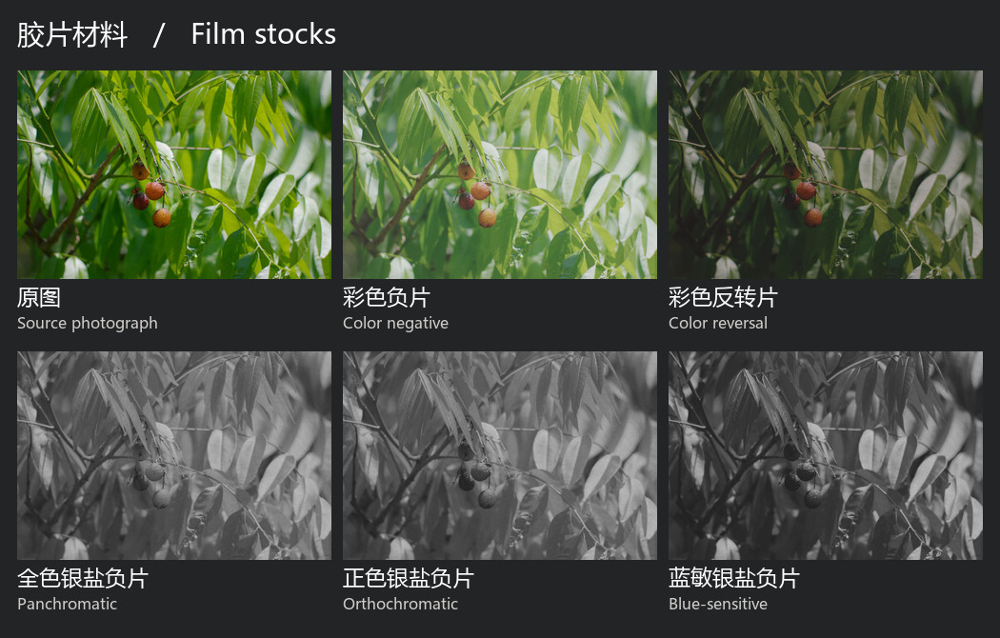

观察画面中央的红果：全色银盐负片保留了丰富的果皮中间调；换成正色片后，红果相对绿叶明显变暗；换成蓝敏片后，叶丛阴影也大幅压低。这三种黑白材料分别来自材料编辑器的「构建材料…」模板（全色、正色、蓝敏银像负片），共用完全相同的黑白负片冲洗与扫描设置，灰阶差异纯粹发生在乳剂曝光阶段。

上排为彩色负片与彩色反转片的配套冲扫结果。下文多组对照与命令示例共用项目自摄的红果绿叶样图（长边 720 px），可直接下载复现：[展示用原图](images/fruit-and-leaves.jpg)。

---

<a id="coatings"></a>

## 改变乳剂感色和颗粒，同一张照片会怎样？

四格使用同一张项目自摄照片、实验材料、药浴、扫描设置和随机种子。青染料对应的乳剂改为感绿光（520–555 nm），黄染料对应的乳剂改为感红光（615–680 nm）。左列用 RGB 感度，右列开启光谱升维并应用材料的夹层透射曲线。沿同一行看红果与叶片，可以分辨曝光响应带来的颜色变化。

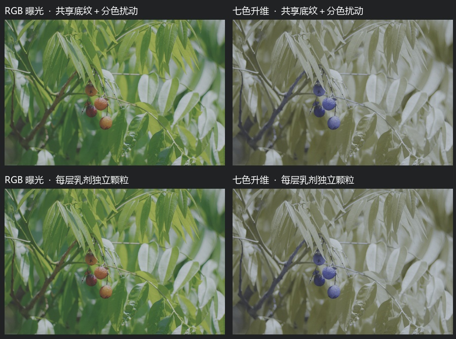

下排开启每层独立颗粒。下图把右列两张的同一块区域放大 3 倍，便于比较叶片内部的纹理。操作入口见[乳剂分层与颗粒](DESKTOP_GUIDE.md#coatings)。

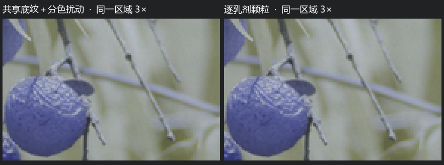

---

<a id="lens-filters"></a>

## 同一块镜片在彩负和反转片上怎样显色？

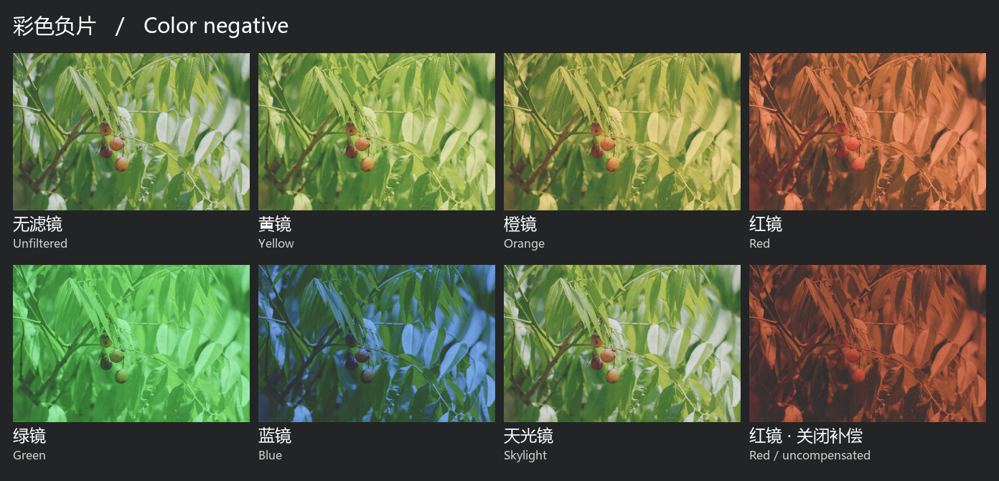

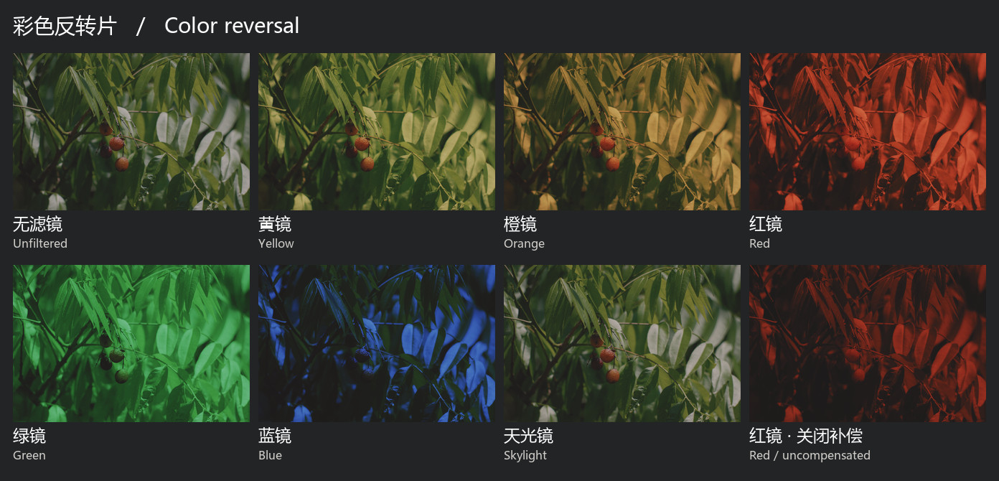

两张对照图采用相同滤镜顺序。以左上角无滤镜为参照，黄镜与橙镜依次将画面推向暖色，蓝镜显著压暗红果，天光镜则带来轻微暖移。右侧上下两格使用同一块红镜：上格开启中性光损光补偿，下格保留实际损光（对比两图时可留意反转片叶丛的暗部变化）。

| 对照图 | 材料预设 | 冲洗预设 | 扫描预设 |
| --- | --- | --- | --- |
| 彩色负片 | `clear_modern_negative` | `standard_color_negative` | `neutral_scan` |
| 彩色反转片 | `color_reversal_transparency` | `standard_color_reversal` | `positive_transparency_scan` |

统一设置：曝光 0 EV、固定种子 43、关闭扫描自动归一化；六种镜片默认开启损光补偿，仅右下格关闭。以下命令可复现彩负蓝镜一格（将 `blue` 替换为 `yellow`、`orange`、`red`、`green` 或 `skylight` 即可对照其他滤镜）：

```bash
python -m film_foundry.app.cli full docs/images/fruit-and-leaves.jpg outputs/blue-compensated.png \
  --film-preset clear_modern_negative --develop-preset standard_color_negative --scanner-preset neutral_scan \
  --seed-strategy fixed --seed 43 --exposure-ev 0 --no-scan-normalize --format png \
  --lens-filter blue --filter-compensation
```

---

<a id="silver-filters"></a>

## 同一块红镜在三种黑白胶片上有多少损光？

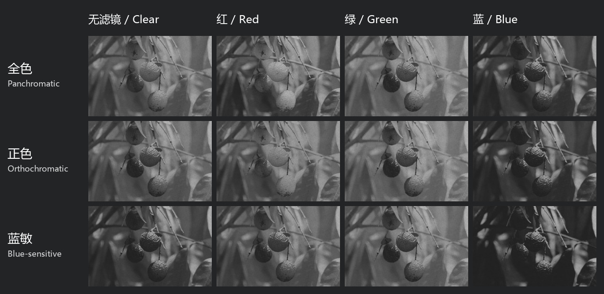

先沿最左列纵向比较三种乳剂本身，再沿全色片一行横向观察：红镜将红果从绿叶中提亮分离，蓝镜则将红果压暗。三组均使用 `standard_bw_negative` 冲洗与 `bw_neutral_scan` 扫描，沿用上组曝光、种子与归一化设置，成片后统一裁取 260 × 170 px 果实局部。

三个色镜列均按各自材料开启中性光补偿。以红镜为例，全色、正色与蓝敏三种乳剂的补偿量依次为 **+1.85 EV、+3.85 EV、+5.74 EV**——蓝敏片配红镜已补偿近六档，解读该格时需将补偿量与最终亮度结合来看。

> **模拟范围**：输入为 RGB 照片，滤镜采用模型内可见光线性 RGB 透过率，黑白乳剂采用解析感色曲线。上述补偿档数仅对应当前模型组合，实拍请以胶卷与滤镜厂商测光数据为准。

---

<a id="materials"></a>

## 即时片、版材与印相

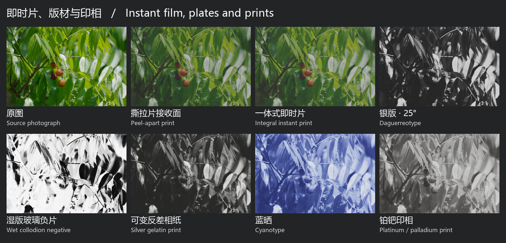

| 观察位置 | 展示介质与看点 |
| --- | --- |
| 上排两张彩色图 | 撕拉片接收面与稳定后的一体式即时片；对比果皮红色与叶脉绿色的染料转移表现 |
| 上排银版、下排湿版 | 银版以 25° 视角观察金属镜面反射；湿版为玻璃负片透射观感，亮叶面呈更暗密度 |
| 下排三张纸面 | 经参考流程负片印相并在模拟干燥 3600 秒后观察；对比银盐相纸黑位、蓝晒普鲁士蓝与铂钯灰阶过渡 |

以上样张均采用桌面材料工作台的默认材料定义与标准工序（长边 720 px、种子 13579）。[从命令行运行材料配方](DESKTOP_GUIDE.md#cli)

---

<a id="recipes"></a>

## 整体风格与配方

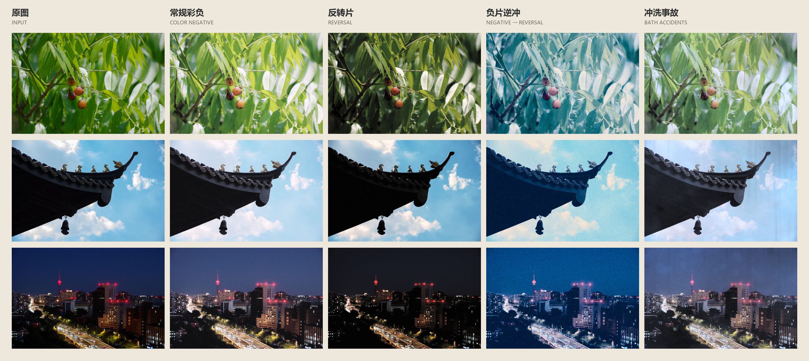

红果绿叶、屋檐天空与城市夜景三组场景，分别经过四种材料与冲洗搭配：

| 展示列 | 材料预设 | 冲洗方式 | 扫描起点 |
| --- | --- | --- | --- |
| 常规彩负 | `vivid_balanced_negative` | `standard_color_negative` | `chrome_saturated_scan` |
| 反转片 | `color_reversal_transparency` | `standard_color_reversal` | `positive_transparency_scan` |
| 负片逆冲 | `warm_consumer_negative` | `experimental_color_negative_clear_reversal` | `positive_transparency_warm` |
| 冲洗事故 | 同常规彩负 | 彩负冲洗＋化学污染与显影不匀 | 同常规彩负 |

共同设置：1536 px 长边、完整模型 / Standard，开启颗粒、MTF 与光晕，固定种子 `4040`、事故身份 `404026`。扫描微调参数如下：

### 扫描配置

| 项目 | 彩负及事故 | 反转片 | 负片逆冲 |
| --- | --- | --- | --- |
| 灯光 EV | 0 | 0.35 | 1.45 |
| 归一化模式 / 强度 | `luma` / 0.82 | `luma` / 0.90 | `rgb` / 0.65 |
| 饱和度 | 1.14 | 1.12 | 1.60 |
| 正片调色强度 | — | 1 | 1 |
| 黑位适应 | — | 0 | 0 |
| 高光柔化 | — | 0.22 | 0.18 |

- **彩负及事故影调曲线**：`[(0, 0), (0.18, 0.16), (0.5, 0.5), (0.8, 0.8), (1, 0.99)]`
- **负片逆冲影调曲线**：`[(0, 0), (0.20, 0.13), (0.45, 0.45), (0.75, 0.82), (1, 1)]`（材料漂白附带损色 `0.06`，药浴成色效率 `1.12`，去色罩完成度 `1`）

### 冲洗事故参数

| 参数 | 值 |
| --- | --- |
| 时间 / 温度 | 11 min / 26 °C |
| 摇晃 / 显影液衰竭 | 0.35 / 0.28 |
| 化学污染 / 显影不匀 | 0.88 / 0.82 |
| 网裂 / 染料损伤 | 0.10 / 0.28 |
| 颗粒倍率 | 1.14 |

<details>
<summary>展开单景大图，细看红果、屋檐与城市夜色</summary>

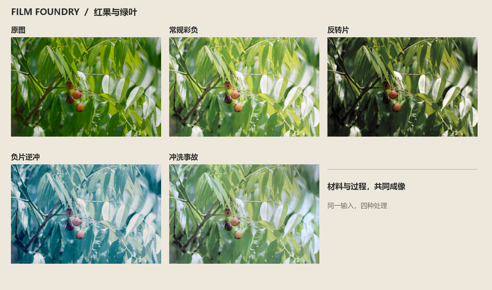

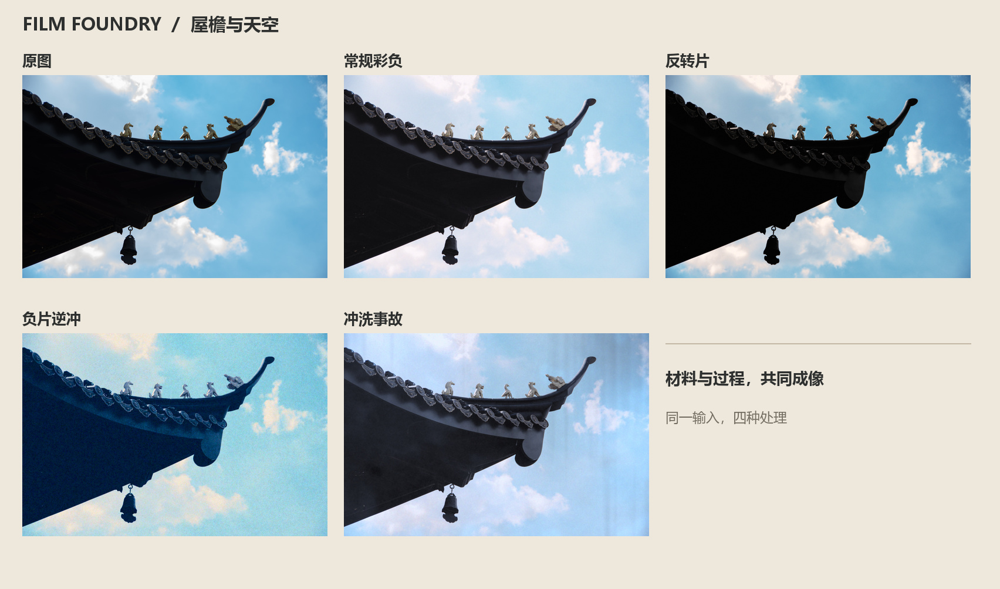

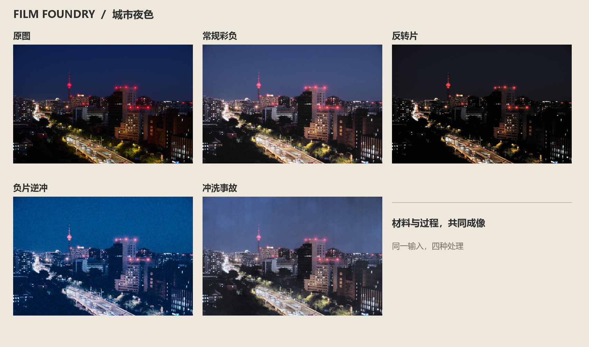

</details>

---

<a id="shared-process"></a>

## 同一潜影，不同冲洗

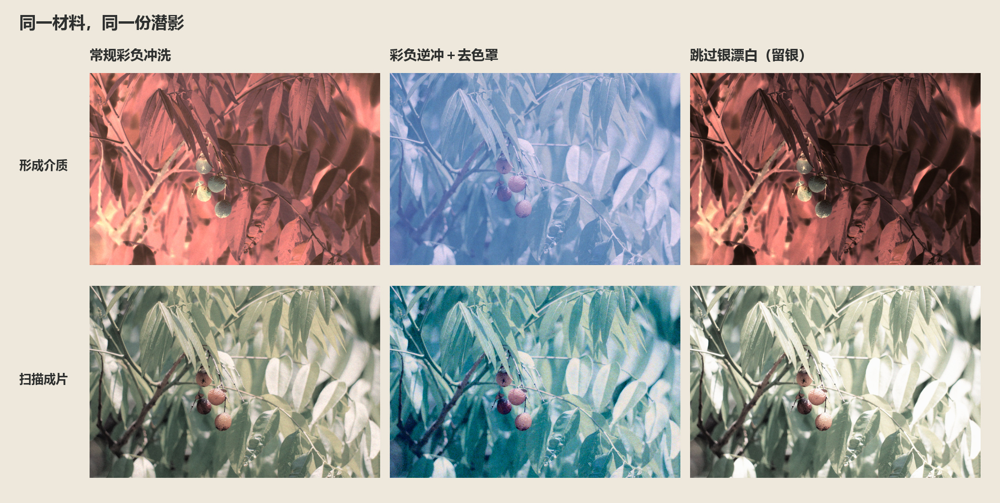

用同一种材料曝光一次，将保存的潜影分别送入三种工艺。上排为最终介质的透射外观，下排为对应扫描成片：

| 工艺 | 关键步骤 | 形成结果 |
| --- | --- | --- |
| 常规彩负冲洗 | 彩显、银漂白、定影 | 染料负像 |
| 彩负逆冲＋去色罩 | 首显、激活剩余卤化银、彩显、去银与实验去色罩 | 透明正像 |
| 跳过银漂白（留银） | 彩显与定影（跳过银漂白） | 染料与金属银共同组成的负像 |

**银漂白**把金属银转为可定影银盐；**去色罩**削弱有色耦合剂并伴随一定染料损伤；**扫描去片基**则仅在观察阶段平衡底色。三者分别位于冲洗与观察两个独立阶段，互不替代。

**本组展示设置**：材料 `warm_consumer_negative`（漂白附带损色 `0.06`），1024 px 长边，完整模型 / Standard，固定种子 `4040`；透射展示为中性光源 `+2.5 EV`，扫描配置见[三景配方](SHOWCASE.md#recipes)；留银组设 `silver_bleach_completion=0`、`mask_bleach_completion=0`。[银漂白与留银工艺参考](https://www.kodak.com/en/motion/page/processing-techniques/)

---

<a id="details"></a>

## 颗粒、MTF 与光晕局部

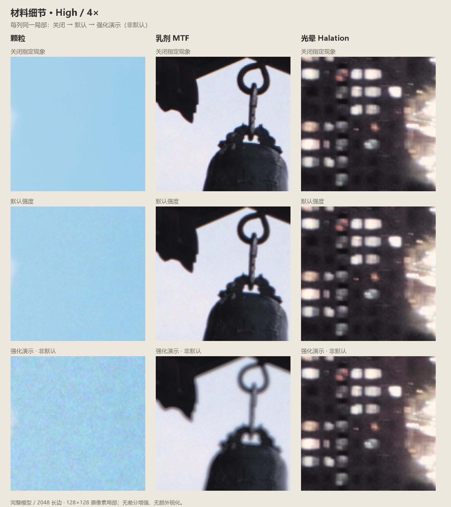

每列对照同一局部区域，从上到下依次为**关闭、默认强度、强化设置**（完整模型 / High，2048 px 长边，裁取 128 × 128 px 局部放大 4 倍）：

| 现象 | 材料预设 | 默认参数 | 强化设置 |
| --- | --- | --- | --- |
| 颗粒 | `vivid_balanced_negative` | 倍率 1 | `look.grain_multiplier = 3` |
| 乳剂 MTF | 同上 | 强度 0.17、半径 0.0009 | 强度 0.70、半径 0.0022 |
| 光晕 | `warm_consumer_negative` | 强度 0.20、阈值 0.68 | 强度 0.65、阈值 0.55 |

颗粒取自屋檐天空，MTF 取自屋檐与风铃边缘，光晕取自夜景点光源；默认设置偏向克制，强化行用于直观展示参数变化方向。
